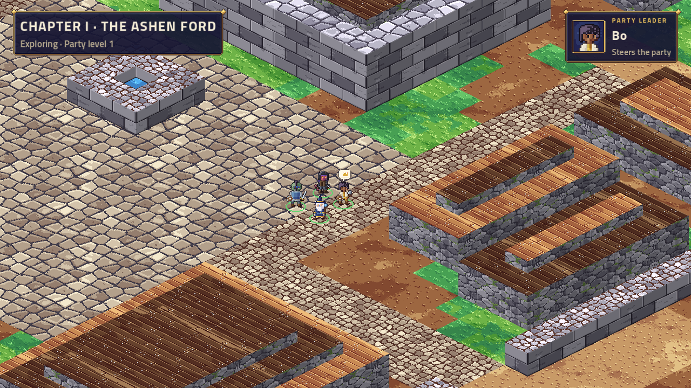
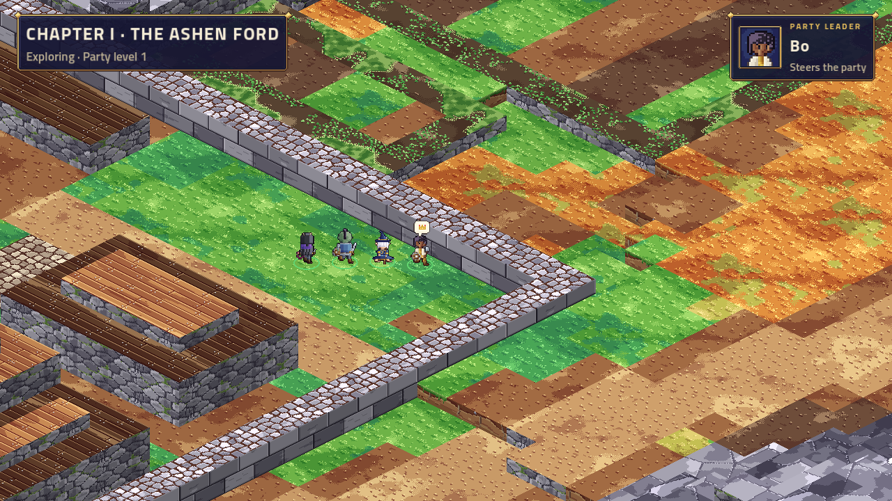
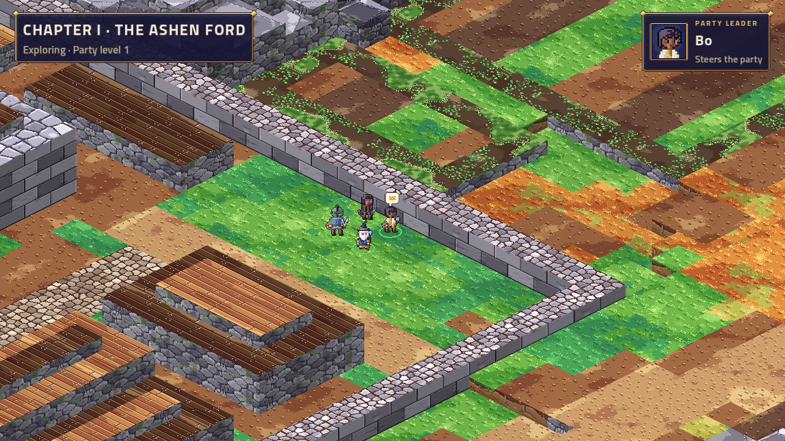

# Overworld 5b, Task 11: the bots walk, end to end on Linux

Measured on 2026-11-01 in a cloud container: 4 cores, Godot 4.7.2 .NET under Xvfb with lavapipe, which is software Vulkan. Server, TV and bots ran on one machine over loopback. The numbers describe this machine, not a living room.

## What runs now

All of these passed here: the first Linux runs of the Tactics modes.

| Run | Result |
|---|---|
| `ARCBOX_GAME=tactics` | 206 beats to the Results, with music, effects and the ending sting |
| `ARCBOX_GAME=tactics ARCBOX_RECONNECT=1` | the TV was killed at beat 30 and relaunched. It caught up to beat 36 (35 skipped) and played on to the Results |
| `ARCBOX_GAME=tactics ARCBOX_RESTART=1` | the server restarted at beat 30, and the TV played on from beat 39, after 38 (passed twice). See below |
| `ARCBOX_GAME=tactics ARCBOX_WALK=1` (new) | Seq climbed: 15 to 17 steps before the restart, 48 to 57 in all. The leader was drawn 15 to 17 tiles from the start. After the restart the party was on the saved tile. The relaunched TV snapped to the party's tile. The drop stopped inside the lease. Passed 3 times |

**`ARCBOX_RESTART=1` failed at first on Linux**, on "TACTICS screen tactics-resuming". This isn't a game bug. The bots reconnect every second and were back before the TV, so Resuming ended before the TV heard of it. The TV also rejoined once while the server was still shutting down, and played the beats it had queued. Making the game wait for the TV would break "a slow TV never stalls the game". So the check now accepts either Resuming, or the first beat after the TV's last rejoin being newer than any beat it played before.

**The handoff's no-TV timeout at 40 s isn't a bug.** Reproduced with `bots.cjs --host --timeout=40`. The bots took their turns, but ending a turn wasn't logged. And with no TV, each AI beat waits its fallback, 400 ms plus 250 ms an event, up to 6 s. The first player turn came about 1 s after the pick. The AI's beats after it took 21 s, and the whole battle about 90 s. Every move and end of turn is logged now, and a timeout names each bot's screen.

## Numbers

**Press to the TV's `WALK` line** (`--walk-latency`, 20 presses a run, alternating e and w):

| | median | p90 | worst |
|---|---|---|---|
| TV, run 1 (no e2e) | 32 ms | 69 ms | 69 ms |
| TV, e2e runs 1 to 3 | 35, 24, 28 ms | 59, 45, 40 ms | 65, 53, 56 ms |
| Host view, no TV (40 presses) | 2 ms | 6 ms | 15 ms |

The `WALK` line is printed when the view reaches the TV's main thread, so it doesn't include drawing.

- **About 90% of the median is the software renderer.** The host view shows the server path is 2 ms. The rest is the view waiting for the TV's next frame, and lavapipe draws the walking world at a median of 33 to 43 ms a frame (`WALKSTATS`).
- **The first frame that shows the step finishes about one frame after the `WALK` line.** So thumb to TV motion here is roughly 60 to 85 ms, which is inside the ≤ 100 ms target with the panel excluded.
- **On a GPU at 60 fps,** the frame wait drops to about 8 ms on average. Expect about 10 to 25 ms plus the phone's Wi-Fi.
- **Not seen again:** the handoff's unexplained worst case of 109 ms to the host view. The worst here was 15 ms.

**A cut leader's phone** (`--walk-drop`; the kill and the stall go through a local proxy, with stateful reconnect on):

| | kill (3 TV runs) | stall (host view) |
|---|---|---|
| last step after the cut | 282 to 291 ms | 288 ms |
| party stopped | 565 to 638 ms | 561 ms |
| lead passed (8 s silence rule) | 7.77 to 7.78 s | 7.82 s |
| disconnect event at another phone | 15.0 to 15.5 s | 29.8 s |

These match the Windows numbers in the handoff. The party stops inside the 750 ms lease. A vanished phone still looks connected for 15 to 30 s, so 5d must not treat `connected` as fast.

## The followers lag: confirmed, and fixed

The handoff's hypothesis was right in substance. A pure `WalkTrack` test (`A_flood_of_stops_doesnt_leave_the_followers_behind`) models what `--walk-flood` does to the server:

- **The flood:** 60 messages a second meet a 20-token bucket refilled each second. The first third of each second gets through and ends on a release, so the party stops for most of every second.
- **What went wrong:** each rest fanned the followers out beside the leader. Each set-off then sprang them back to where they had left the trail, behind the party, with their pace held at 0 until they got there.
- **The result:** after 12 s the last follower was 15.5 to 20.5 tiles back, and walking backwards to get there.

**The fix:** on the first frame of a walk after a rest, a follower who is off the trail rejoins it at the nearest point. That point lies between where the follower left the trail and their place behind the walker ahead, and only a point they can reach in a straight line counts. The follower doesn't move; only the point they're heading for changes.

- **The test:** the last follower now stays within 2 spacings plus 2 tiles, and nobody walks back more than 0.3 tile.
- **Mutation checks:** without the fix, the test fails at 15.5 to 20.5 tiles. Without the straight-line check, the random-stream test fails with a follower on a wall.
- **On the real TV:** a 12 s `--walk-flood` with 4 players kept the widest gap between neighbours to 2.77 tiles, and leader to last walker to 4.96 tiles. The fan-out at each rest is included in both.

## The `--walk-log` lines

`WALKAT <unix ms> <seq> <held> <leader x y> <widest gap> <name x y>…` says where the TV drew everyone. It prints at most every 0.25 s while anything moves, and once at rest. The e2e run reads it to check that the party moved, where it stood after the restart, and when the TV heard the party stop. [The README](../../../../games/Tactics/README.md#bot-phones-and-the-tv-end-to-end) has the formats.

## Pictures

These are judged for content only. Software rendering draws a frame every 30 to 50 ms here.

## Seen, not changed

- **Followers overlap on quick U-turns.** In `--walk-latency`, one step east then one west, followers pass through each other and briefly stand within 0.03 to 0.3 tile of one another. One mid-walk shot showed four walkers as two bodies. At rest they fan out to separate tiles. This happened before the fix too, and was worse then: 0.04 tile while moving.
- **A walking screenshot comes only every 24 tiles,** so a short route mostly yields stopped shots.

## Only a person can check

- Latency and feel on a real phone over Wi-Fi, and on a TV box with a GPU.
- Whether the rejoin after a rest looks natural at sofa distance. A follower now heads for the nearest point on the trail instead of walking back.
