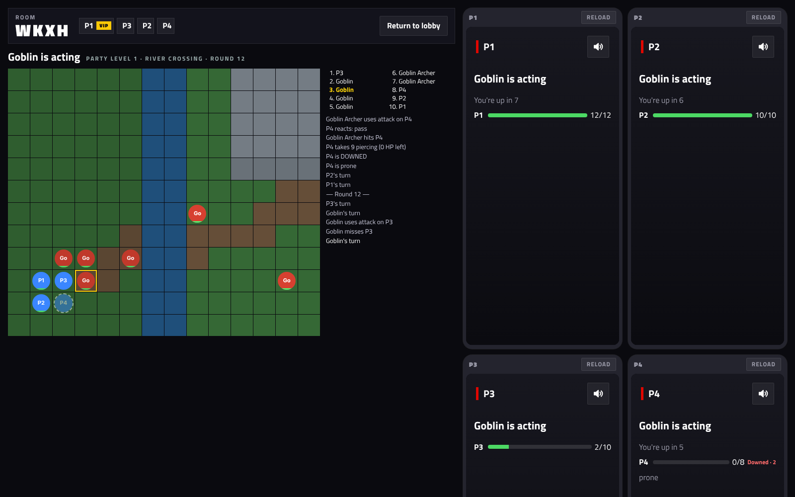
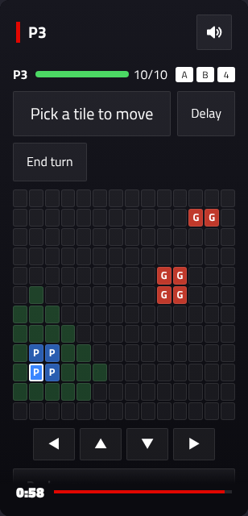
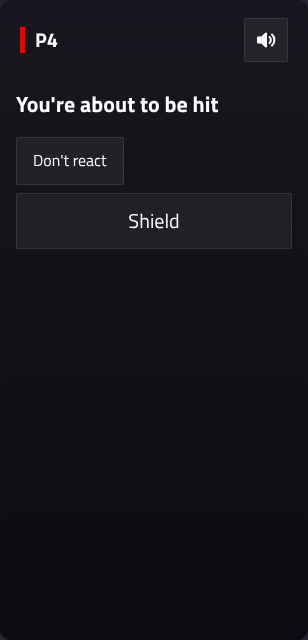

# ArcBox Tactics: first browser playtest (2026-10-31)

The first end-to-end run of milestone 3a in a real browser: the dev page standing in for the TV, and four phones in iframes, driven by [`tools/tactics-playtest/play.cjs`](../../../tools/tactics-playtest/play.cjs). Each scripted player only ends their turn and passes on reactions, so the party loses. The point was to see every screen working together, not to play well.

## What worked

- **The whole flow, through the real UI:** the lobby's campaign step (new campaign, "I'm new here", Everybody's in), class picks, the battle pick, the battle, and results with XP and injuries.
- **The dev page's board** draws the map from the content pack, the units with HP, Downed heroes, the turn order and a readable log. It sends `shown` after each beat, so AI turns move at a watchable pace.
- **The phones** show their status ("Goblin is acting", "You're up in 7", Downed countdowns), reaction prompts with a deadline, and the results.

| Board, mid-battle | Turn screen | Reaction |
|---|---|---|
|  |  |  |

## What the playtest found, and fixed

1. **The turn screen's buttons were off-screen.** On a 640 px phone, "Move here", the abilities and End turn sat below the map and d-pad, partly under the sticky countdown. A player had to scroll on every turn, and an automated tap couldn't reach End turn, so every turn ran out its 60 s timer. The battle took over 6 minutes to reach round 3. Now:
   - the commit buttons (Move here / Use, Delay, End turn) come first;
   - the map is smaller, and the d-pad is one row;
   - there's room under the abilities for the countdown.

   The same battle now finishes in about 2 minutes.
2. **A player's pass on a reaction read "P4 reacts: pass"** in the log. It now reads "P4 lets it go".

## Still to look at, with real people

- Picking targets for an area spell on the map with the d-pad: the code is tested, but nobody has tried it.
- The phone map has no terrain yet. The board's map decoding could be shared, so water and rocks show on the phone too.
- Real phones on the LAN, rather than iframes (docs/dev-playtest.md §3).
