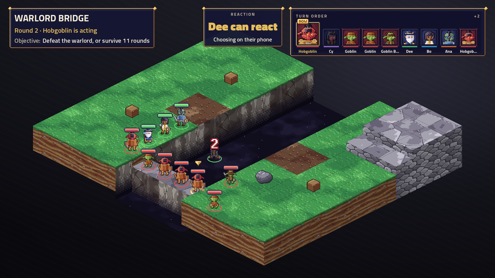
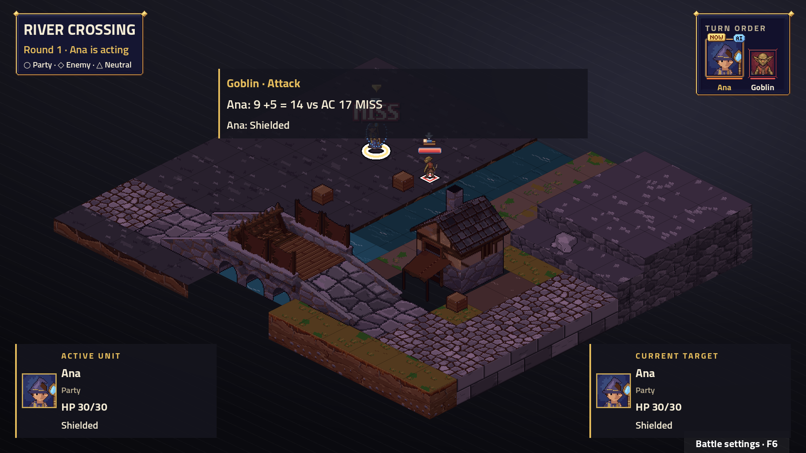

# ArcBox Tactics: the TV scene (milestone 3b, 2026-10-31)

A Tactics battle now plays on the Godot TV: map, units, animated turns, HUD and recovery from a dropped TV. All six plan tasks are done, each with an independent review, on a Windows PC with an RTX 5080. The user then played a battle on the TV from a Samsung S23, over Tailscale, and is content with the phone checks for now.

**Updated 2026-11-02:** since this was written the TV draws the overworld, fights in the world, the story's scenes and each player's colour. That work is in [Since then](#since-then-the-overworld-on-the-tv), and the ranked list at the end is brought up to date. The full account is the [overworld report](2026-11-02-tactics-overworld.md).

## What works

| Task | Result | Proof |
|---|---|---|
| 1. Scene and phase screens | Muster, encounter pick and results draw from the host view | [Encounter pick](2026-10-31-tactics-tv-scene/task-1-encounter-pick.png), [results](2026-10-31-tactics-tv-scene/task-1-results.png) |
| 2. The map | All five sample maps draw with the pack's terrain art, and a reviewer compared each against its map file | [River Crossing](2026-10-31-tactics-tv-scene/task-2-river_crossing.png), [Crypt Hall](2026-10-31-tactics-tv-scene/task-2-crypt_hall.png), [Crystal Cave](2026-10-31-tactics-tv-scene/task-2-crystal_cave.png) |
| 3. Units | All 10 River Crossing units match the encounter file by tile and kind, with HP bars, rings, Downed countdowns and condition icons | [Start of battle](2026-10-31-tactics-tv-scene/task-3-river_crossing.png), [a Downed unit](2026-10-31-tactics-tv-scene/task-3-mid_battle-downed.png) |
| 4. Beat playback | A 320-beat AI battle ran with none missed, no overlaps and a median of 0.42 s a beat | [Attack](2026-10-31-tactics-tv-scene/task-4-attack-melee.png), [save](2026-10-31-tactics-tv-scene/task-4-condition-save.png) |
| 5. HUD | Turn order, round, objective, AI badges and the reaction banner, all following what's on screen | [Objectives](2026-10-31-tactics-tv-scene/task-5-objectives-warlord.png), [AI finished](2026-10-31-tactics-tv-scene/task-5-ai-finished.png) |
| 6. Catch-up | A TV killed at beat 30 came back in the same room, skipped 34 beats, played beat 35 and went on to Results | [After the relaunch](2026-10-31-tactics-tv-scene/task-6-reconnect-caught-up.png), [Resuming](2026-10-31-tactics-tv-scene/task-6-restart-resuming.png) |

**The user's rules:**

- **Beats, not state:** the picture folds each beat's own events into a displayed view, and reconciles to the state when the queue empties.
- **`shown`:** sent after each beat.
- **Attacks under about 1 s:** plain attacks run up to 0.95 s, and a 5-target area spell lands by 0.96 s. An attack can reach 1.17 s when the target also falls or a reaction adds a condition. The hit itself lands by 0.52 s, so I ruled that within "about 1 s".
- **A slow or missing TV never stalls the game:** with every signal dropped, a battle finished on the fallback timers in 316 s.

**The showcase:** a real Warlord's Bridge collapse played on the TV, after the walk and the narrator's line that lead to it, as in these [before](2026-10-31-tactics-tv-scene/task-4-collapse-1-before.png), [during](2026-10-31-tactics-tv-scene/task-4-collapse-2-during.png) and [after](2026-10-31-tactics-tv-scene/task-4-collapse-3-after.png) shots. The ridge archers spawned on cue.

**Tests:** 2,506 .NET tests and 253 web tests pass with 0 warnings, up from 1,913 and 253. `tools/tv-e2e.sh` now runs Tactics on Windows, and its plain and reconnect modes pass.

**Phone checks, from the user during a real battle:** the d-pad, 60 s a turn, 10 s a reaction and the reaction prompt's countdown are all fine for now. The user wants sound effects on reactions later.

## What was fixed along the way

Reviews caught these before they reached the user:

- **The board could halve in size mid-fight.** Its fit was recalculated on every view, so one raised tile could shrink the whole map. It's now fixed for the battle.
- **Area spells took about 2 s,** and a test's name hid it. They now land within a second.
- **That fix then mistook attacks for area spells** when a thorns or drain effect touched a second unit, which cost a multi-attack its second swing. Areas are now decided by who was rolled against, and this was checked on 130 attacks and 91 spells from real engine battles.
- **The reaction prompt ran ahead of the swing that caused it.** My brief said that couldn't happen, and it was wrong. The prompt now waits for its beat.
- **A persistent drawing error could hang the TV** and hide Results. It's now logged once, and the queue keeps going.
- **The TV showed "Warlord Bridge"** rather than "The Warlord's Bridge", and "Goblin B…" for the boss the objective names.
- **`tv-e2e.sh`'s plain Tactics mode failed every healthy run,** because the implementer had never run that mode.

The host view gained additive fields for the TV: board changes, the character sprite, `LastBattle`, `Reacting`, objectives and the encounter's name. Phone views are unchanged.

## Fitting the new art

A cloud session pushed the Wardenflame art, sound and story to this branch during this work. Merging it failed 16 tests that had pinned old frame numbers. Checking each one found 10 real bugs, all fixed: spell poses that lunged, effects cut at 0.6 s, an arrow stuck in its target, lines and cones drawn from the wrong end, walk frames, paralysed using stunned's art, misworded villains, a hidden finale clock, and missing art for the new maps' sides and spikes.

The TV then ran plain and reconnect battles on the new art. After the last fixes it ran one short Warlord's Bridge battle, 115 of 115 beats. The Warlord now speaks in Vorga's voice.

## Since then: the overworld on the TV

Built on branch `ccr-18ad4510-q68nad` between 2026-10-31 and 2026-11-02, mostly in a cloud container with Godot under Xvfb and lavapipe (software Vulkan). The user then checked it on the RTX 5080 at `213ede0`. The rules above still hold: beats not state, `shown` after each beat, and a slow TV never stalls the game.

### The world

| What | How | Commits |
|---|---|---|
| The region is drawn in 16-tile blocks | The plan and baked light are built off the main thread, then the blocks in view, then the rest at 4 ms a frame with the party already moving. Hiding the world goes through the RenderingServer, because hiding the node re-recorded all 80 blocks | `52d5e04`, `b1e3222`, `21d81ca` |
| The party and the camera | Followers walk the leader's trail and fan out at rest. They rejoin the trail at its nearest point after a rest, so a flood of stops can't leave them 15 to 20 tiles behind | `69dbace`, `69852bf`, `80a9aae` |
| Walking feedback | The leader bumps a wall that refuses a step (0.12 tile, 0.15 s, the step sound at -14 dB). A press into a wall on a diagonal turns the leader. "Bo leads now." on a handover | `92cc416`, `a26f87a`, `706ca99`, `daa0740` |
| Loading | The region's title stays up until the world is revealed, and gives up after 10 s (`WorldCover`, pure C#) | `eccdedb`, `7de8659` |
| A dither fix | Turned tops no longer show a comb of vertical stripes, on the board too | `8bed5e3` |
| Dev lines | `--walk-log` prints `WALK`, `WALKAT`, `BUMP` and `WALKSTATS` for the e2e run and the bots | `7533924`, `4dde20d` |

### Fights in place and the director

A fight on a stamped map is drawn in the world, not on a separate board (5c).

- **`StagePlan`** builds the board from the region's own tiles: the stamp plus 10 tiles on, through a window aligned to a texture, so there's no seam. On the Windows check, grass, banks and water ran straight across the stamp's edges (`2174338`).
- **`StageDirector`** runs the phases: Forming (heroes walk from their places to their slots, the grid comes up, enemies step in), Fighting, Fading after the last blow, Results over the world, then FallingIn after a win or flight, or Waking at the recovery spawn after a loss. A party that is far off, unseen, or would pass within 2 tiles of an enemy fades in instead. The walk-in is at most 2.2 s, inside the game's 3 s `FormUp` hold, so the game never waits on it (`36b9c4e`, `ecbe1ce`, `1ebcc0b`, `58eb02d`).
- **The walk-in keeps heroes apart:** `BattleIntro.Apart` times their walks together, so no two share a tile. Its search is bounded at 20,000 places, and a party it can't fit fades in (`61f07e7`, `60225ba`).
- **A TV back mid-fight** plays on the plain board while the world loads, then hands over with a fade, once every block in the cut's view is recorded (`584d9bd`, `03308a6`).
- **Raised or sunk tiles** rebuild the affected world blocks off the main thread. Repaints asked for while one runs are merged (`58eb02d`). This has not run on the GPU: River Crossing changes no terrain.

### The story layer

The story is drawn over the world (5d). `StoryTrack`, `StoryScreen` and `VoteClock` decide what shows, in pure C#; `StoryLayer` and its boards only draw it.

- **Caption** with the speaker's portrait in the line's mood. Lines play their clips through the narrator. A line is never said twice, and a TV that joins mid-line shows it without speaking (`c967b4e`, `047c81a`).
- **Votes, choices and tie-breaks** on one panel that shrinks its rows to fit up to 11 options. The server sends how long each clock ran (`4995632`).
- **Skill checks** over the dimmed world: roller cards, a tumbling d20 and the verdict. A roll tumbles only if the TV saw it being picked.
- **The chapter card** and the next scene's title in the gap between scenes.
- **The "!" and the scene's cast** stand in the world: the beat's figure at its spot, and while a scene plays, its speakers near it once a line could reveal them (`a8fd529`, `8a5afce`).
- **Restarts:** after a server restart the saved line is spoken again if this TV never heard it, shown if it did (`410c6fe`, `b6234fa`).
- **Dev tools:** `--story-demo[=<step>]` plays it all from the real lore with no server, and `--story-log` prints a `STORY` line per line taken.

### Player colours

Each player picks a colour on their phone at character creation. The TV draws it on their walker's ring and their hero's battle ring, over a dark outline that reads on grass, stone and ash. On a hero's own turn the ring keeps their colour, drawn wider, with the turn arrow. Vote pips take the voter's colour with a black or white initial, whichever contrasts more, and each roller's check card has a stripe in it. A player with no colour keeps the party green. Pure C# picks every colour (`BoardUnit.RingColour`, `VoterPip`, `CheckCard.Colour`). This replaced an earlier seat-colour attempt, reverted because the room has no stable seat number (`0ff70aa`, `2b537c0`, `ac7a937`).

### The content cache

The TV now caches content packs per file (`69e993c`). A file it already has, at the same path with the SHA-256 the index lists, is copied and verified rather than fetched. Measured against the real server under Xvfb:

| Case | Fetched |
|---|---|
| Cold | 4,309 files, 121.6 MB, plus a 588 KB index |
| Warm restart | 0 requests |
| One region file changed | 1 file (76 KB) plus the index; 4,308 reused |

The cache keeps up to 3 versions per pack, then evicts least recently used while it's over 1 GiB, never a pack's newest version or the one before it. No server or protocol change.

### The review fixes

From the hardware check and the whole-branch review:

- **"-102" on a level 1 fight** was a hit's "-10" beside a Downed hero's "2". A Downed count now hides while a number pops up beside it (`31d793d`).
- **No unit marks during the walk-in or under the Results table,** and the table over the world is only as tall as its rows (`61f07e7`, `354d4cf`).
- **A fall-in heard with a step:** after a win the four walkers stood stacked on the leader's tile when the TV heard the new epoch and a step together. The director now takes the arrival from the outcome, but only for the fight's own epoch (`3d8d211`, `432d8a3`).
- **The story's panels were rebuilt every frame** (414 rebuilds in 40 s, 5 after), because records compared arrays by reference (`85026aa`). The story layer also flipped its draw order 3 to 5 times a second (`01e175c`).
- **A saved battle keeps the stage it was drawn on,** and a fight begun on a plain board stays plain after a repaint (`b1c8d28`, `be8ed1d`).
- **`ARCBOX_SHOTS=0`** runs the TV without screenshots, because every shot stalls frames (`c35bef7`).
- **The stage perf test** checks the tiles read, not a timing ratio, so it no longer fails in Release (`767e0b2`).

### Performance, from the hardware check

The user's Windows run at `213ede0`: RTX 5080, 1920×1080 `ultra`, capped at 144 fps (so 6.94 ms is the floor), no screenshots. "Release" is the editor binary with an optimised build, not a true export.

| Measure | Debug | Release | Cloud, software |
|---|---|---|---|
| Walking frame, median | 6.94 ms | 6.94 ms | 33 to 43 ms |
| Walking frames over 16 ms | 0 of 4,608 | 1 of 4,645 | |
| Worst frame, fight in place, any 5 s window | 7.1 ms | 6.9 ms | |
| Draw calls, walking / fight in place | 1,444 to 1,759 / 2,345 | the same | |
| First world load, off the main thread | 194 to 212 ms | 211 to 235 ms | |
| Fight start frame | 4.9, 5.1 ms | 2.2, 3.1 ms | |
| Blocks re-recorded at a fight's start | 0 of 80 | 0 of 80 | |
| Press to the TV's `WALK` line, median | 5 ms | 4 ms | 24 to 35 ms |
| Texture memory, world open | 38.2 MB | 38.2 MB | 34.5 to 35.0 MB at 1080p |

With screenshots on, the same fight start took 216.7 ms. Only this GPU has been measured.

## What's left, ranked

**Fixed since this report:** the fresh-install crash. Loading speech at startup collided with the cold shader compile, and turning `audio/general/text_to_speech` off took empty-cache crashes from 12 of 43 launches to 0 of 30. What actually corrupts the heap isn't known. The TV now also has its music, sound effects, recorded voices and board lighting (see `docs/tv-host.md`), and a dither fix took vertical stripes off the ground.

1. **Sound and light haven't been judged by a person.** The levels and the far side of a dim crypt are on the playtest checklist. The overworld adds footsteps, the wall bump's knock, `town_emberwick`, voiced story lines, and new victory, defeat and boss stings. The Windows check ran with a dummy audio driver.
2. **Unseen on a real TV:** a damaging area spell, zones, pushes, teleports, transformations and the boss's phase. All are tested in code, but only a level 1 Sleep has played on screen, and the boss's phase was never reached. A level 5 party on the Warlord's Bridge is the next thing to play. Of the overworld's TV work, the GPU has seen walking and a seeded fight in place. It hasn't seen a fight started by walking into a stamp, the story layer, the scene cast, player colours, or a raised or sunk tile repainting the world.
3. **Connecting at home:** phones couldn't reach the PC over plain Wi-Fi, only through Tailscale, and other players would hit the same block. Check the router's AP isolation.
4. **Every character of a class looks the same** on the TV, because it uses a generic class sprite rather than the character's look. The phone now composes each character's real look at creation; the TV doesn't yet. Player colours tell heroes apart in the meantime.
5. **The sofa checks** in `docs/playtest-checklist.md`: readability on a real TV, whether the room notices prompts, and the HUD at 2560×1440. The Tailscale session didn't cover these. Add the overworld's: the walker rings, the faint grid on grass, the 11-option vote panel's 14 px rows at 720p, and bright ground against small figures in a fight.
6. **`tools/tv-e2e.sh`:** the Tactics modes now pass on Linux, including `RESTART`, `WALK`, `STAGE` and `CHAPTER`, and plain, `WALK`, `RECONNECT` and `RESTART` passed on Windows. Still unrun: REDLINE on either (Windows lacks Playwright), `ARCBOX_RESTART=kill`, and `STAGE` and `CHAPTER` on Windows.
7. **A slow TV:** a TV falling over 8 s behind drops to the newest beat. That's tested, but the 8 s margin is unmeasured and it hasn't been seen on a slow machine.
8. **Lower-level polish:** crypt props are low contrast without lighting, the ford draws a thin brown line over the river, the strip twitches 28 px between turns, and sides are told apart by hue alone, which is weak for red-green colour blindness. Followers briefly overlap on quick U-turns. The Ash ground repeats every 4 tiles.
9. **A mid-fight TV takeover on the GPU:** the hold that waits for the cut's blocks (`584d9bd`) fixed late blocks seen only on Windows. It hasn't been rerun there.

## Decisions for the user

- **The finale's size:** `hall_of_the_flame` draws at half size, because it's just too tall for 2x. It plays fine, but units are small. It could use the top strip or be trimmed. Still open.
- **Overworld plan:** done. Milestones 5a to 5d are built; 5e, tuning and a real session, needs the user. The open overworld decisions are at the top of the [overworld report](2026-11-02-tactics-overworld.md).
- **Balance:** the decisions listed under "Decisions for the user" in the rules-engine tracker are still open.

## Attack and save panel — 2026-11-09 (#164)

The TV now names the actor and ability, displays each attack/save roll with its modifier and AC/DC, explains MISS against the final AC after a reaction, and names push/condition effects. Existing timing tests pass without extra beat holds. Native fixture screenshots and full validation notes are in [the readout report](2026-11-09-tv-rolls/README.md); no physical-TV or human readability test is claimed.

