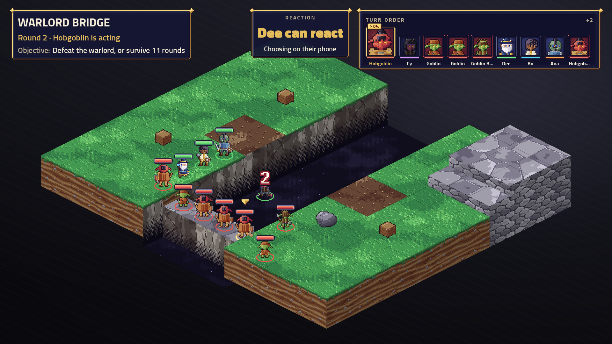

# ArcBox Tactics: the TV scene (milestone 3b, 2026-10-31)

A Tactics battle now plays on the Godot TV: map, units, animated turns, HUD and recovery from a dropped TV. All six plan tasks are done, each with an independent review, on a Windows PC with an RTX 5080. The user then played a battle on the TV from a Samsung S23, over Tailscale, and is content with the phone checks for now.

## What works

| Task | Result | Proof |
|---|---|---|
| 1. Scene and phase screens | Muster, encounter pick and results draw from the host view | [Encounter pick](2026-10-31-tactics-tv-scene/task-1-encounter-pick.png), [results](2026-10-31-tactics-tv-scene/task-1-results.png) |
| 2. The map | All five sample maps draw with the pack's terrain art, and a reviewer compared each against its map file | [River Crossing](2026-10-31-tactics-tv-scene/task-2-river_crossing.png), [Crypt Hall](2026-10-31-tactics-tv-scene/task-2-crypt_hall.png), [Crystal Cave](2026-10-31-tactics-tv-scene/task-2-crystal_cave.png) |
| 3. Units | All 10 River Crossing units match the encounter file by tile and kind, with HP bars, rings, Downed countdowns and condition icons | [Start of battle](2026-10-31-tactics-tv-scene/task-3-river_crossing.png), [a Downed unit](2026-10-31-tactics-tv-scene/task-3-mid_battle-downed.png) |
| 4. Beat playback | A 320-beat AI battle ran with none missed, no overlaps and a median of 0.42 s a beat | [Attack](2026-10-31-tactics-tv-scene/task-4-attack-melee.png), [save](2026-10-31-tactics-tv-scene/task-4-condition-save.png) |
| 5. HUD | Turn order, round, objective, AI badges and the reaction banner, all following what's on screen | [Objectives](2026-10-31-tactics-tv-scene/task-5-objectives-warlord.png), [AI finished](2026-10-31-tactics-tv-scene/task-5-ai-finished.png) |
| 6. Catch-up | A TV killed at beat 30 came back in the same room, skipped 34 beats, played beat 35 and went on to Results | [After the relaunch](2026-10-31-tactics-tv-scene/task-6-reconnect-caught-up.png), [Resuming](2026-10-31-tactics-tv-scene/task-6-restart-resuming.png) |

**The user's rules:**

- **Beats, not state:** the picture folds each beat's own events into a displayed view, and reconciles to the state when the queue empties.
- **`shown`:** sent after each beat.
- **Attacks under about 1 s:** plain attacks run up to 0.95 s, and a 5-target area spell lands by 0.96 s. An attack can reach 1.17 s when the target also falls or a reaction adds a condition. The hit itself lands by 0.52 s, so I ruled that within "about 1 s".
- **A slow or missing TV never stalls the game:** with every signal dropped, a battle finished on the fallback timers in 316 s.

**The showcase:** a real Warlord's Bridge collapse played on the TV, after the walk and the narrator's line that lead to it, as in these [before](2026-10-31-tactics-tv-scene/task-4-collapse-1-before.png), [during](2026-10-31-tactics-tv-scene/task-4-collapse-2-during.png) and [after](2026-10-31-tactics-tv-scene/task-4-collapse-3-after.png) shots. The ridge archers spawned on cue.

**Tests:** 2,506 .NET tests and 253 web tests pass with 0 warnings, up from 1,913 and 253. `tools/tv-e2e.sh` now runs Tactics on Windows, and its plain and reconnect modes pass.

**Phone checks, from the user during a real battle:** the d-pad, 60 s a turn, 10 s a reaction and the reaction prompt's countdown are all fine for now. The user wants sound effects on reactions later.

## What was fixed along the way

Reviews caught these before they reached the user:

- **The board could halve in size mid-fight.** Its fit was recalculated on every view, so one raised tile could shrink the whole map. It's now fixed for the battle.
- **Area spells took about 2 s,** and a test's name hid it. They now land within a second.
- **That fix then mistook attacks for area spells** when a thorns or drain effect touched a second unit, which cost a multi-attack its second swing. Areas are now decided by who was rolled against, and this was checked on 130 attacks and 91 spells from real engine battles.
- **The reaction prompt ran ahead of the swing that caused it.** My brief said that couldn't happen, and it was wrong. The prompt now waits for its beat.
- **A persistent drawing error could hang the TV** and hide Results. It's now logged once, and the queue keeps going.
- **The TV showed "Warlord Bridge"** rather than "The Warlord's Bridge", and "Goblin B…" for the boss the objective names.
- **`tv-e2e.sh`'s plain Tactics mode failed every healthy run,** because the implementer had never run that mode.

The host view gained additive fields for the TV: board changes, the character sprite, `LastBattle`, `Reacting`, objectives and the encounter's name. Phone views are unchanged.

## Fitting the new art

A cloud session pushed the Wardenflame art, sound and story to this branch during this work. Merging it failed 16 tests that had pinned old frame numbers. Checking each one found 10 real bugs, all fixed: spell poses that lunged, effects cut at 0.6 s, an arrow stuck in its target, lines and cones drawn from the wrong end, walk frames, paralysed using stunned's art, misworded villains, a hidden finale clock, and missing art for the new maps' sides and spikes.

The TV then ran plain and reconnect battles on the new art. After the last fixes it ran one short Warlord's Bridge battle, 115 of 115 beats. The Warlord now speaks in Vorga's voice.

## What's left, ranked

**A crash to look at first:** the TV segfaulted about 1 s after launch, before the room appeared, in 2 runs on a fresh empty user-data folder. An identical retry worked, and so did another fresh launch, so the cause is unknown.

1. **The TV doesn't use the new sound or light yet:** music, sound effects, recorded voice clips, the Victory and Defeat strips, the lighting data and most of the HUD kit. The narrator uses live speech for now. This is the next pass.
2. **Unseen on a real TV:** a damaging area spell, zones, pushes, teleports, transformations and the boss's phase. All are tested in code, but only a level 1 Sleep has played on screen, and the boss's phase was never reached. A level 5 party on the Warlord's Bridge is the next thing to play.
3. **Connecting at home:** phones couldn't reach the PC over plain Wi-Fi, only through Tailscale, and other players would hit the same block. Check the router's AP isolation.
4. **Every character of a class looks the same** on the TV, because it uses a generic class sprite rather than the character's look.
5. **The sofa checks** in `docs/playtest-checklist.md`: readability on a real TV, whether the room notices prompts, and the HUD at 2560×1440. The Tailscale session didn't cover these.
6. **`tools/tv-e2e.sh` on Linux:** the Tactics modes have never run there, and the REDLINE modes changed only in ways a line-by-line read found harmless. Run them once on Linux. `ARCBOX_RESTART=1` wasn't rerun after the last fix either.
7. **A slow TV:** a TV falling over 8 s behind drops to the newest beat. That's tested, but the 8 s margin is unmeasured and it hasn't been seen on a slow machine.
8. **Lower-level polish:** crypt props are low contrast without lighting, the ford draws a thin brown line over the river, the strip twitches 28 px between turns, and sides are told apart by hue alone, which is weak for red-green colour blindness.
9. **The dice panel from mockup 01 isn't built.** The TV shows save rolls as badges, but not the attack roll panel with advantage.

## Decisions for the user

- **The finale's size:** `hall_of_the_flame` draws at half size, because it's just too tall for 2x. It plays fine, but units are small. It could use the top strip or be trimmed.

- **Overworld plan:** [milestone 5a's plan](../plans/2026-10-31-tactics-overworld.md) is ready and can start now that this milestone is done. It's waiting on how to run it.
- **Balance:** the decisions listed under "Decisions for the user" in the rules-engine tracker are still open.
