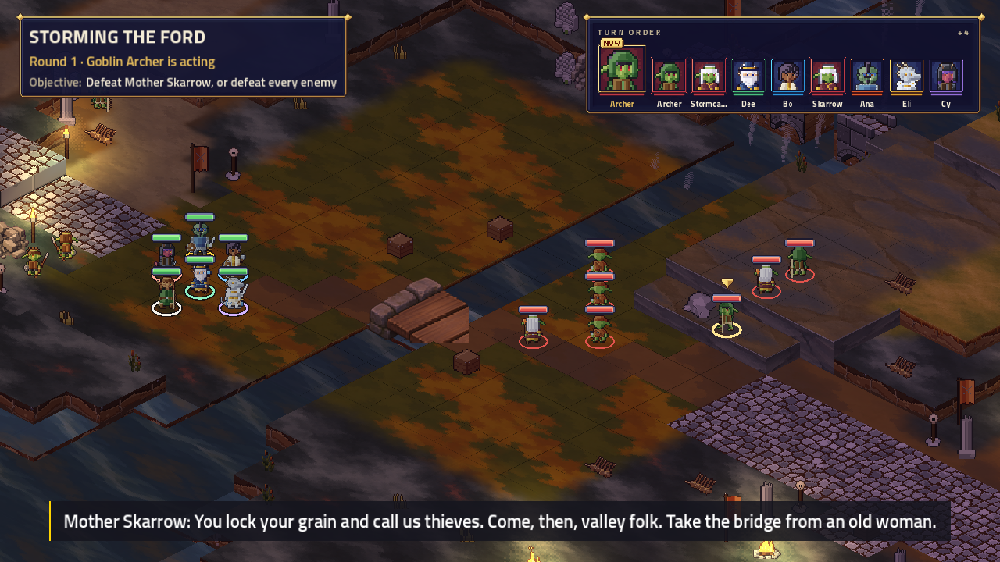
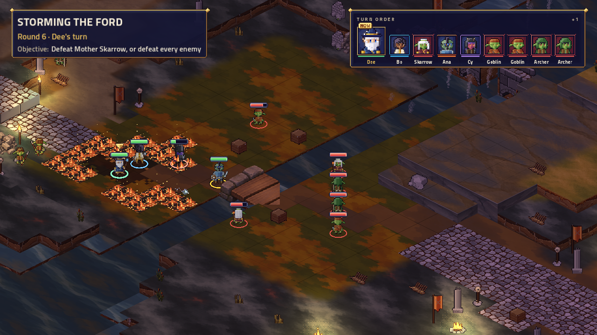
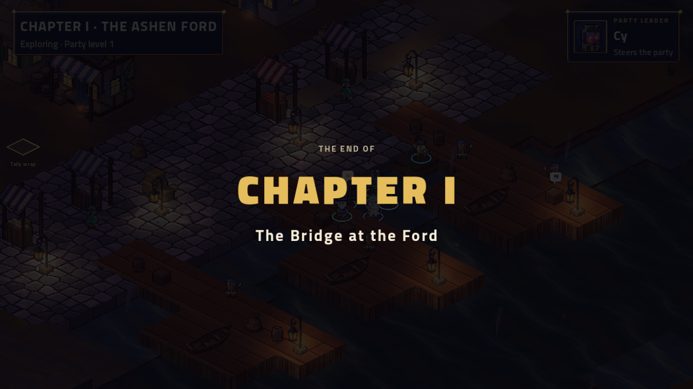

# G — encounter integration and balance

**Historical integration checkpoint.** The later [completion report](completion.md) records the authorized Ford/cave tuning, final visual review, merged shops/gold integration and four-player chapter validation. The measurements and held decisions below describe the earlier checkpoint, not the final shipped configuration.

Phase G adds the Ford Assault stormcaller and enables the environmental rules in River Crossing and Ford Assault. Showcase opt-ins are gated on their intended-level simulation results; the approved reaction damage, duration, saves and AI weights are unchanged.

## What changed

- `river_crossing.json` and `ford_assault.json` enable the rules. Their shared map, its heights/flags/props and the Ashen Ford stamp are unchanged.
- A Ford-only `goblin_ford_shaman` spawns at **[9,7]**, with id `ford_shaman` and the existing `skarrow_clan` tag. It copies the normal shaman's stats and adds Storm Hex alongside Cinder Bolt and Rally. Other shamans are unchanged. The existing goblin shaman sprite already has matching staff, idle, walking and casting animation, so no generated replacement was necessary.
- Storm Hex is an **action**, **tier 0**, **range 6**, line-of-sight, single-enemy spell attack for **1d8 lightning** at every level. Its damage is the approved cantrip amount; its range matches Cinder Bolt. It uses the existing pointing animation, lightning projectile and storm impact. There is no Mana cost or new scaling. Ford rewards are unchanged.
- `environment.json` includes `grass_ford/autumn` as fuel: the ford's local art palette is still autumn grass, already approved as fuel. This makes its fire reactions and forecasts work without changing the stamped map. This alias is balance-visible and is included in the on/off comparison.
- The simulator now reports reactions, friendly conduction damage, burning tile-rounds and terminal surface deaths. It observes events without changing AI decisions or battle state. The README excludes secondary conduction from the direct spell-area ladder.

## Showcase content and gate decisions

- **Warlord Bridge — enabled:** the existing eight `mine_boards/oak` deck tiles already match the approved fuel rule. Its only encounter edit is `environment: true`. The existing entry-triggered collapse is unchanged; no burn-triggered collapse was added.
- **Forest Ruins — enabled:** `maps/forest_ruins.json` repaints **nine** grass tiles, **x=4–6, y=3–5**, from `grass/lush` to the existing `grass/dry` material. Heights, flags, props and zones are unchanged. The patch and opt-in exactly match the tested snapshot.
- **Crystal Cave / Rime Tower approach — held:** the tested candidate wins **348/360 (96.7%)** at level 7. The unchanged original already wins **344/360 (95.6%)**. With starting webs but reactions off it wins **340/360 (94.4%)**; enabling reactions adds **eight wins / 2.2 points**. The production encounter remains byte-identical to its pre-G version, with no web or opt-in. The [candidate JSON](g-candidates/crystal_cave.json) is archived for review outside the game's content tree.

The held cave candidate uses the existing round-1 effects trigger on `spider_nest`'s **four** tiles. It creates four ordinary, difficult, permanent single-tile web zones, owned by the first giant spider. Its entry passive copies the existing `spider.web` **Dexterity DC 13, restrained until save** effect. No new save strength or finite duration was invented. Both spiders and players obey the existing web rules in this measurement; giving the cave's spiders safe movement through their own starting webs is a proposed follow-up experiment, subject to balance approval.

## Measurement

Every cell uses Normal difficulty, six sampled parties at each size **4/5/6**, seeds **1–20**, and the existing **30-round cap**: **360 battles per encounter/level**. Party sampling uses the existing seed **20261030**, with no subclasses or party item use. Caps count as losses. Targets are **60–95% wins** and **8–12 mean rounds** at the encounter's intended level; ±2 levels are stress comparisons, as in the existing simulator. Party-size rows are retained rather than hidden by the overall average.

The original rules snapshot is commit `357df1c0`, with environment off and no Ford stormcaller. The Ford off/on pair both include the new shaman, isolating the environmental delta from adding an enemy. Showcase off/on pairs use the same content; Rime's pair both include the starting web, with an additional original comparison to separate that web from reactions. Forest's material-only patch does not alter heights, movement flags, props or zones, so the original environment-off result is also its patched off result.

## Intended-level results

| Encounter | Level | Off wins | On wins | Win delta | Off / on mean rounds | On caps | Decision |
|---|---:|---:|---:|---:|---:|---:|---|
| river_crossing | 1 | 325/360 (90.3%) | 329/360 (91.4%) | +1.1 pp | 9.5 / 9.4 | 0 | Enabled |
| ford_assault | 1 | 269/360 (74.7%) | 247/360 (68.6%) | -6.1 pp | 10.4 / 8.5 | 1 | Enabled |
| warlord_bridge | 5 | 323/360 (89.7%) | 328/360 (91.1%) | +1.4 pp | 10.9 / 10.9 | 0 | Enabled |
| crystal_cave | 7 | 340/360 (94.4%) | 348/360 (96.7%) | +2.2 pp | 11.4 / 10.9 | 0 | Held: needs balance approval |
| forest_ruins | 3 | 317/360 (88.1%) | 318/360 (88.3%) | +0.3 pp | 10.6 / 10.6 | 4 | Enabled |

Each off/on cell has the same sampled parties and seeds. Off for Ford includes its new shaman; off for the cave includes its new web. The original comparisons below separate those content additions.

### Ford: adding the shaman, then enabling reactions

| Party size | Original, off | New shaman, off | New shaman, on |
|---|---:|---:|---:|
| 4 | 64.2% | 51.7% | 46.7% |
| 5 | 90.8% | 85.0% | 77.5% |
| 6 | 95.0% | 87.5% | 81.7% |

The original Ford wins 300/360 (83.3%) at level 1. Adding the shaman with reactions off gives 269/360 (74.7%): **−8.6 percentage points**, and mean rounds rise from 8.4 to 10.4. Enabling reactions gives 247/360 (68.6%): another **−6.1 points**, with mean rounds falling to 8.5. Overall, that is **−14.7 points** from the original.

**Small-party concern:** four-character Ford parties win only 46.7% with reactions, down from 51.7% with the shaman but no reactions and 64.2% originally. This is below the target even though the pooled encounter cell passes. The real four-phone chapter run also lost three assaults. A Ford-only reduction of Cinder Bolt from 2d6 to 1d6, retaining the approved 1d8 lightning, is a proposed next experiment requiring approval.

### Environmental tallies at intended levels

| Encounter | Reactions / battle | Friendly conduction / battle | Burning tile-rounds / battle | Surface deaths (360 battles) |
|---|---:|---:|---:|---:|
| river_crossing | 2.7 | 0.0 | 17.3 | 44 |
| ford_assault | 8.6 | 0.0 | 61.1 | 86 |
| warlord_bridge | 1.4 | 0.0 | 5.0 | 4 |
| crystal_cave | 5.0 | 0.0 | 20.6 | 0 |
| forest_ruins | 0.5 | 0.0 | 2.7 | 3 |

Off runs have zero environmental tallies. Friendly conduction means are rounded; the live replay independently verifies a six-damage friendly conduction packet. Raw reports below include every measured level and per-rule reaction totals.

### Every environmental on/off comparison

| Encounter | Party level | Off wins | On wins | Delta | Mean rounds off / on | Caps off / on |
|---|---:|---:|---:|---:|---:|---:|
| river_crossing | 1 | 90.3% | 91.4% | +1.1 pp | 9.5 / 9.4 | 2 / 0 |
| river_crossing | 3 | 100.0% | 100.0% | +0.0 pp | 6.6 / 6.6 | 0 / 0 |
| river_crossing | 5 | 100.0% | 100.0% | +0.0 pp | 5.6 / 5.4 | 0 / 0 |
| ford_assault | 1 | 74.7% | 68.6% | -6.1 pp | 10.4 / 8.5 | 3 / 1 |
| ford_assault | 3 | 99.7% | 99.4% | -0.3 pp | 6.4 / 5.7 | 0 / 0 |
| ford_assault | 5 | 99.7% | 100.0% | +0.3 pp | 5.3 / 4.9 | 1 / 0 |
| warlord_bridge | 3 | 73.1% | 71.7% | -1.4 pp | 10.4 / 10.4 | 0 / 0 |
| warlord_bridge | 5 | 89.7% | 91.1% | +1.4 pp | 10.9 / 10.9 | 0 / 0 |
| warlord_bridge | 7 | 95.6% | 94.4% | -1.1 pp | 10.7 / 10.7 | 0 / 0 |
| crystal_cave | 5 | 88.3% | 89.4% | +1.1 pp | 12.5 / 12.7 | 0 / 0 |
| crystal_cave | 7 | 94.4% | 96.7% | +2.2 pp | 11.4 / 10.9 | 1 / 0 |
| crystal_cave | 9 | 99.2% | 99.7% | +0.6 pp | 8.1 / 7.8 | 0 / 0 |
| forest_ruins | 1 | 36.9% | 35.8% | -1.1 pp | 10.1 / 10.1 | 3 / 5 |
| forest_ruins | 3 | 88.1% | 88.3% | +0.3 pp | 10.6 / 10.6 | 4 / 4 |
| forest_ruins | 5 | 100.0% | 100.0% | +0.0 pp | 8.2 / 8.2 | 0 / 0 |

### Content additions with reactions disabled

| Content change | Party level | Original wins | New-content wins | Delta | Mean rounds original / new |
|---|---:|---:|---:|---:|---:|
| Ford shaman | 1 | 83.3% | 74.7% | -8.6 pp | 8.4 / 10.4 |
| Ford shaman | 3 | 99.7% | 99.7% | +0.0 pp | 5.3 / 6.4 |
| Ford shaman | 5 | 100.0% | 99.7% | -0.3 pp | 4.8 / 5.3 |
| Starting cave web | 5 | 87.2% | 88.3% | +1.1 pp | 12.7 / 12.5 |
| Starting cave web | 7 | 95.6% | 94.4% | -1.1 pp | 11.7 / 11.4 |
| Starting cave web | 9 | 100.0% | 99.2% | -0.8 pp | 7.8 / 8.1 |

### Raw runs

These ten reports contain **12,960 final comparison battles**: 5,400 original, 7,560 candidate, with 360 per encounter/level cell. Observer-only fixes were checked by rerunning affected measurements. Rerunning the core and bridge after observer fixes produced byte-identical reports. Existing role-band and rare-use diagnostics remain visible in these reports; no class-kit balance was changed here.

- [core-original](g-data/core-original.md)
- [bridge-original](g-data/bridge-original.md)
- [rime-original](g-data/rime-original.md)
- [forest-original](g-data/forest-original.md)
- [core-on](g-data/core-on.md)
- [ford-off](g-data/ford-off.md)
- [bridge-on](g-data/bridge-on.md)
- [rime-on](g-data/rime-on.md)
- [forest-on](g-data/forest-on.md)
- [rime-off](g-data/rime-off.md)

Reproduce with `Tactics.Sim --rules <snapshot> --encounters <ids> --levels <levels> --sizes 4,5,6 --parties 6 --seeds 20 --difficulty Normal --round-cap 30 --out <report>`. Core uses levels 1,3,5; bridge 3,5,7; cave 5,7,9; forest 1,3,5. The original rules can be extracted with `git archive 357df1c0 content/tactics/base/rules`. For off snapshots, copy the same candidate rules and set encounter `environment` to false. Apply the archived cave candidate in `g-candidates/crystal_cave.json` to both cave snapshots if it was held out of production. Do not simulate against rules being edited: each recorded run used its own immutable copy.

## Tally definitions

A reaction is one `TileReacted` event, including spread and dousing; per-rule totals appear in the raw reports. Friendly conduction counts actual HP plus temporary HP lost to secondary lightning by the source's own side, including self and enemies hurting enemies, without overkill. It excludes the direct target. Burning tile-rounds count unique burning surface tiles during each round, with duplicate overlapping zones counted once and expired tiles excluded before turns; skipped turns also start a counted round. Surface deaths count directly terminal `Died`/`UnitOut` events from surface damage, across both sides, not party Downs or later countdown expiry. A surface hit that directly exhausts an already-Downed unit's countdown does count; it emits no `Damaged` event, so the tally recognizes its surface passive and terminal countdown packet. Mean columns use the simulator's one-decimal rounding; 0.0 is not an immunity guarantee.

## Replay and integration checks

`river-ford-storm.replay.json` runs on the shipped ford map with environmental rules on. The real Storm Hex conducts into the shaman's allied goblin, a tile-directed cold probe freezes a shallow tile, the real Fire Pot ignites fuel and sets the mage burning, and walking into water douses it. The fixture's extra 100 HP, initiative bonuses 40/30, Dexterity 1 and flat-8 cold probe only make this test sequence stable; none is shipped encounter balance. The live tally check measures four reactions, six friendly lightning damage, one burning tile-round and no terminal surface deaths.

All six pre-existing replay/event files remain byte-identical to `357df1c0`; the new replay also matches with JSON round-trips between commands. Only `environment-turn.json` changes among phone fixtures: the local autumn-fuel alias adds fire-spread forecasts and distinguishes previously equivalent aim choices. The waiting screen and other fixtures do not change.

Enabling the encounter exposed a pre-existing TV catch-up edge case: a winning spell can emit `BattleEnded` without `TurnEnded`, so reversing that beat lost the previous active-character highlight. Beats now optionally carry `ActiveBefore`, captured before both AI and player commands. The TV restores that unit, including when a reaction's actor differs from the active unit. Older saved beats still deserialize and use the existing event fallback. This changes presentation metadata, not combat outcomes.

## Real TV and phone chapter test

`ARCBOX_CHAPTER=1 ARCBOX_BRANCH=force ARCBOX_PHONES=6 ARCBOX_LINE=1 tools/tv-e2e.sh --skip-build` **passed** on the rebuilt server and Godot TV, with six bot phones on the real hub and a fresh campaign. The party won Storming the Ford, each hero received the existing 300 XP, and the aftermath led through Old Maud, the Ember, docks, Kindler and Stranger scenes to **Chapter I · The Bridge at the Ford**. All **94 story lines** were said once; the check saved **25 shots** and verified four walking steps after the card. No TV errors occurred. [Chapter check](g-chapter-check.txt), [TV log](g-tv-six.txt), [phones](g-phones-six.txt), [zero-warning server/host build](g-tv-build.txt).

The VM needed an external Godot wrapper to replace the e2e script's hardcoded Vulkan driver with OpenGL, Dummy audio and a 30 FPS cap. A first renderer setup attempt failed; a second fallback run timed out opening the world under concurrent CPU load. The final run opened correctly with background validation paused during startup, then resumed. These are test-environment settings; the game's renderer and world timeout were not changed.

The default **four-phone** run was also exercised: it lost three complete Ford assaults and woke/retried correctly, then was stopped during a fourth attempt. It did **not** reach the card. [Four-player results and commands](g-phones-four.txt). The six-phone run verifies the complete chapter flow. Four-player difficulty remains unresolved.

The shaman's portrait and the encounter's full world placement are visible above. Fire during the four-phone attempt is shown below. This run verifies actual burning/spread and normal goblin casting; it does not independently confirm an on-screen Storm Hex conduction strike. The new golden and the existing TV reaction tests cover that path. Bridge, cave and forest were simulated, not visually played in this chapter run.

## Final validation and remaining approval

- [Full solution](g-solution-tests.txt): **5,875 passed**, zero failed/skipped. This includes the runtime changes, metrics and TV replay fix.
- After applying the passing forest candidate and adding its behavior check: [all 1,174 logic tests](g-final-logic-tests.txt), [7 real-view phone fixture checks](g-final-phone-tests.txt) and [53 TV display/host contract checks](g-final-tv-tests.txt) pass. [Build](g-content-build.txt): zero warnings/errors. The checks include all replay determinism and the final opt-in set.
- [Web tests](g-web-tests.txt): **484 passed**. [Production build](g-web-build.txt) passes; its existing 537.65 kB flyover chunk advisory remains. Existing happy-dom fetch/abort/error-boundary diagnostics in the test log do not represent failed tests.
- Six legacy replay/event files remain byte-identical. The ford map, its world stamp and the held cave are unchanged. Nine forest cells change material only. The new shaman's non-ability stats match its parent exactly. The final production opt-ins match the four passing encounter candidates.
- The six-player Chapter 1 TV check above passes through the card; the four-player attempt remains an unresolved balance result. Other showcases were not visually played here.

The full matrix, hashes and source checks are in [g-validation.json](g-validation.json). Content changes use the existing pack-hash restart behavior for saved mid-battle sessions.

Two follow-ups need the user's balance decision: improve four-player Ford difficulty (first experiment: Ford-only Cinder Bolt **2d6 → 1d6**, keeping Storm Hex **1d8**), and bring the cave's reactive web variant under the 95% win cap (first experiment: cave spiders move safely through their own starting webs). Neither experiment has been applied or simulated as a tuning change.

The [agreed plan, G.6](../../plans/2026-11-02-tactics-environmental-tiles.md#g-content-and-balance), says to “ask before tuning anything that falls out of band.” G's authorized integration and measurement work is recorded here; the held cave and small-party balance pass await that decision. Work stays on `environmental-tiles`.
