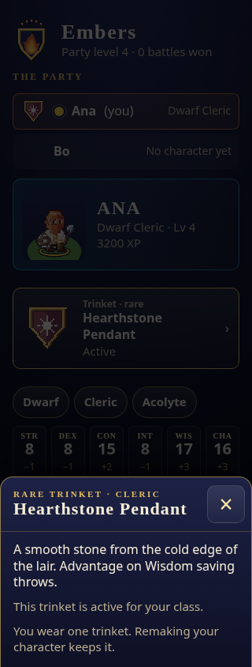
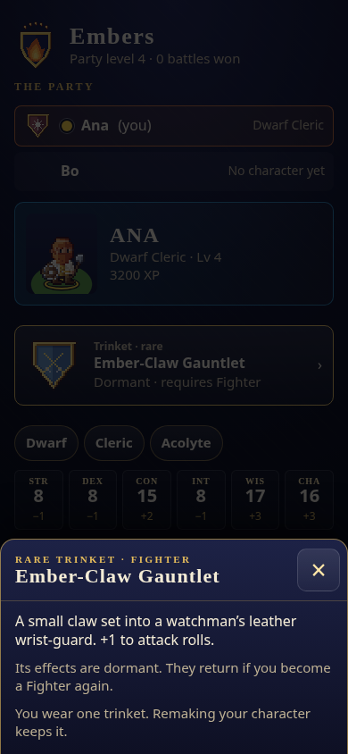
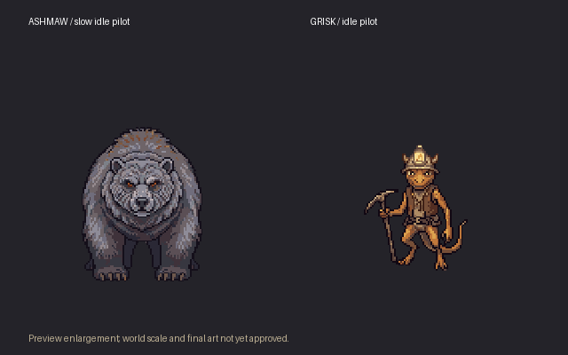

# Ashmaw bounty: foundations checkpoint

This is a checkpoint for issue #74, **not completion of the bounty**. Work remains on `ashmaw-bounty`; no PR is requested.

## Implemented and verified

- Twelve class-bound rare trinkets, using existing static modifiers and hooks. Optional worn slot preserves legacy JSON, survives a remake and becomes dormant after a class mismatch. The phone uses the existing details sheet and explains dormancy before remaking.
- Named spawn authoring/export, backwards-compatible region JSON, voted cave entrances, strict-majority travel and a reachable return. Travel saves region, position and arrival flags together; paused regional stories have their own saved cursors. A restart after a confirmed vote finishes the transfer once.
- `ch1_ford_settled` is set on victory in either canonical ford battle, never by choosing a branch, losing, fleeing or winning from the battle list. Completed older saves recover the flag from their won beat.

The travel coverage uses two small test regions. The actual Cinder Hollow and Ford entrances are not yet painted.

## Evidence

- Full .NET suite: **6,129 passed**, zero failures; [log](entrances-full-suite-final.log).
- Web suite: **507 passed**; [log](entrances-web-suite.log). The web production build also passed during the trinket step.
- Godot host and world editor builds: **0 warnings / 0 errors**; [host](entrances-host-build.log), [editor](named-spawns-editor-build.log).
- Twelve browser cases across widths 320, 390 and 768, active/dormant slots and open details: no browser errors or horizontal overflow. [Audit](trinket-phone-audit.log).
- Lore check passes. The audio importer has seven passing Python tests, including preservation of external world-animal calls.

## Art and audio

[Scenario concepts](../../../../tools/tactics-assets/concepts/ashmaw/README.md) cost **39 CU**. The owner approved Ashmaw and Grisk's concepts and subsequently approved their single-facing pixel direction. Final integration still requires owner review of actual TV world and battle motion alongside the party.

[PixelLab receipts and sources](../../../../tools/tactics-assets/pixellab/ashmaw/) retain all candidates, rejected motion pilots and corrected views. Ashmaw's two loose-sprite walks were rejected for excessive bounce; a bear skeleton gait is being tested. Grisk's front pose was corrected before rotation; his right-hand pick remains attached in the inspected south walk. Tight bear side views were regenerated on a padded canvas. The current PixelLab ledger records completed charges and pending ceilings separately.

The first seven SFX clips cost **136 CU** and were imported with no loudness shortfall. Raw duration, silence and peak checks flag no generated clip; the eight missing clips are explicitly pending. Scenario rate-limited the remaining six generation jobs; their estimate is **38 CU**, for **174 CU** across all fifteen sounds. [Plan and job receipts](../../../../tools/tactics-audio/ashmaw/).

Importing the new sounds exposed a pre-existing importer gap: it dropped five externally authored WAV animal calls from the manifest. The importer now preserves them through an explicit external catalog, with a regression test. Existing audio files remain unchanged.

## Remaining work

The authored cave, four encounters, monsters, bounty board and quest, atomic class-trinket turn-in with replacement confirmation, TV reward presentation, full animation sets and portraits, audio wiring, voiced conversations and Grisk barks, simulation/balance report, complete quest end-to-end run, actual cave restart/reconnect and Chapter I branch regressions are still required. New props and icons remain prompts and procedural stand-ins.
