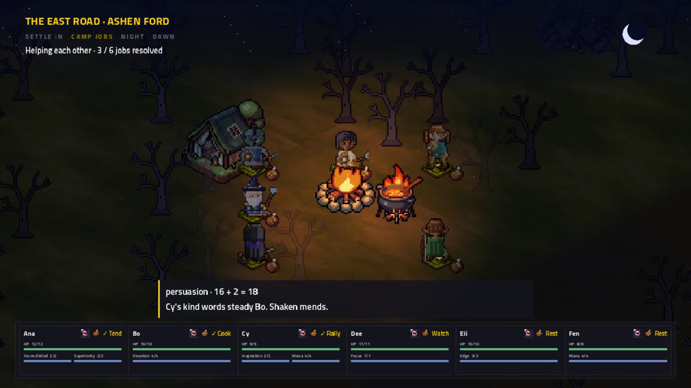
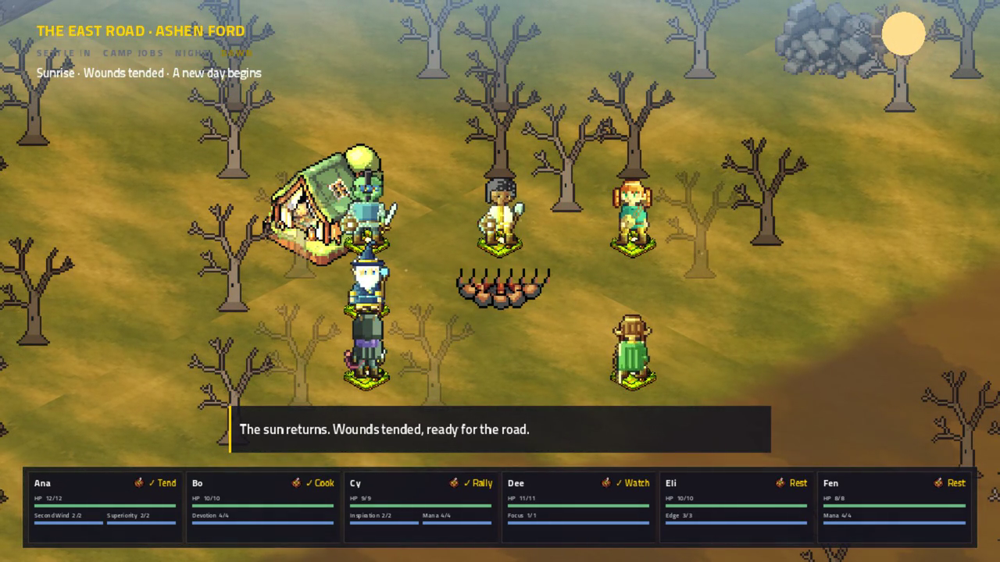
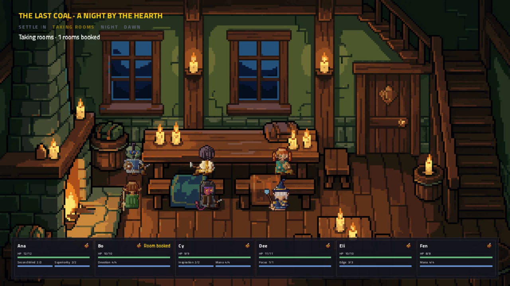
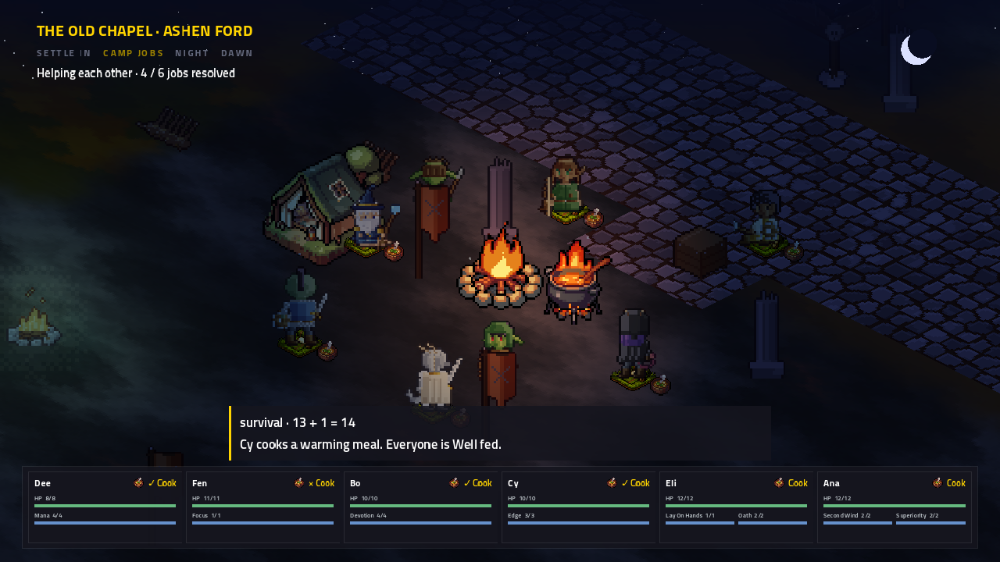
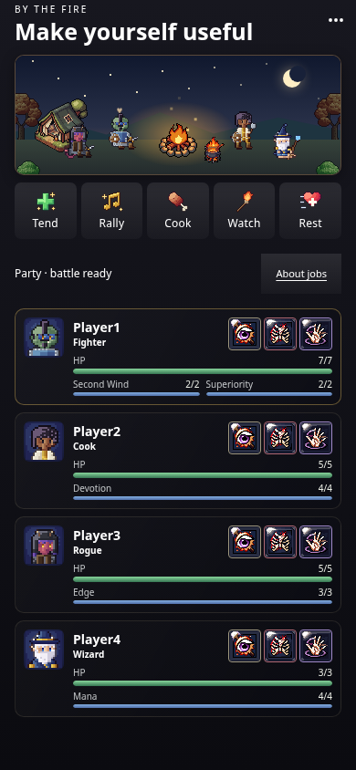

# Cozy camp presentation

The owner requested a camp that visibly progresses, local atmosphere, night becoming morning, and a hopeful adventure-game
sunrise cue, then authorized implementation and new art. This follow-up stays on `rest-and-recovery` for issue #71.

The camp now zooms into the actual authored location. Class sprites tend, cook, talk, watch, rest and doze around a warm animated
fire. PixelLab supplied native shelter, bedrolls, bowls, fire/pot loops and a cozy inn interior. The TV shows actual saved job counts,
roll captions and per-player completion/failure marks above compact HP/resource/injury cards. Phones retain the choices and purchases.

A saved 3-second sleep phase leads into an 8-second sunrise, both skippable by the leader. Recovery still applies once at dawn.
The scene passes from deep blue night through warm sunrise into morning; the camera then returns to walking. Morning remains after
camp and reconnect, derived from the existing `RestSeq`. This is a rest-driven change, not a continuous day/night simulation.
The original `camp_dawn` flute/harp/chime sting plays once, then regional music resumes without restarting when walking returns.

The [accepted design](../../specs/2026-11-03-tactics-camp-presentation-proposal.md) includes research references and the implemented
scope. [PixelLab provenance](../../specs/2026-11-03-tactics-camp-art.json) records requests, seeds, source jobs and exact cold-fire edits.
The morning score and synthesized instruments are reproducible in `tools/tactics-audio/compose_dawn.py`; no external samples or
quoted melodies are used. The dawn Ogg regenerates byte-identically, measures −19 LUFS / −9.2 dBFS sample peak, and lasts 5.826771 s.

## Verification

- Full solution build: zero warnings or errors.
- Full .NET suite after the main implementation: 5,815 passed, zero failed/skipped. Final gameplay suite: 589 passed; final presentation suite: 2,357 passed, including saved TV outcomes after reconnect.
- Phone suite: 489 passed across 22 files; TypeScript/production build passed. Existing bundle-size notices remain.
- Audio pipeline Python tests: six passed. The 44 original controller fixtures are byte-identical to main `f4a28fc5`.
- The blocking fire now has distinct reachable gathering seats; the old generic placement flood could begin on the blocked fire and return no seats.
- Godot/Xvfb/OpenGL rendering was inspected at 1280×720: warm readable night, all six party cards, job/meal results, sleep,
  sunrise, persistent morning and the inn. The cached world and its lighting bakes remain intact; one local fire light supplies warmth.
- Rendering is verified on software OpenGL. V-Sync/AA notices and the existing four-instance ObjectDB exit warning remain.
  A preview attempted during the full test run hit the existing 10-second world-open timeout; the isolated final preview opened normally.

## Preview

The new MP4 captures the actual Godot mixed audio, rather than adding music to a silent recording. The preview's host views are
scripted on the actual east-road campsite and inn so every phase can be reviewed in under a minute. Live bot evidence verifies
the server/phone path separately. `--world-demo=camp-ford` uses the other authored campsite by the old chapel.

```sh
source /workspace/.arcbox/activate.sh
godot --path src/ArcBox.Host --rendering-driver opengl3 --rendering-method gl_compatibility --audio-driver Dummy -- \
  --world-demo=camp --preset=low --res=1280x720 --audio-log --shots=/tmp/camp-vignette-shots3 --quit-after=62
```

Morning light continues after rest. Leaving the preview returns to walking beside the cold fire, as the live game does.


The 55-second session artifact is `/workspace/artifacts/arcbox-camping-cozy.mp4` (H.264 1280×720, AAC stereo 48 kHz, 7.8 MB).
Sunrise begins at 0:25. Native capture was 1,800 frames at 30 fps; the first three loading seconds were trimmed. The final mix
measures −22.5 dBFS RMS / −4.5 dBFS sample peak and contains the original dawn cue aligned at raw 28.0 seconds.

| Night and resolved jobs | Morning |
|---|---|
|  |  |




The live six-phone run also exercised the old-chapel site, including a failed cook beside successful jobs. Those badges use the
saved result rather than elapsed time. Other nearby world characters remain part of the authored location.




## Live validation

The six-phone force-branch run passed both `CAMP OK` and `INN OK`: all players voted and chose their own jobs, saved results
resolved, the optional camp talk completed, the party reached sleep/dawn and resumed walking, and the inn room spent the buyer's
own purse. Both outdoor and inn dawn routed `camp_dawn` before regional music.

```sh
source /workspace/.arcbox/activate.sh
ARCBOX_CHAPTER=1 ARCBOX_CAMP=1 ARCBOX_BRANCH=force ARCBOX_PHONES=6 \
ARCBOX_E2E_OUT=/tmp/arcbox-camp-vignette-e2e TV_RENDERING_DRIVER=opengl3 \
TV_ENGINE_ARGS='--rendering-method gl_compatibility --audio-driver Dummy' tools/tv-e2e.sh --skip-build
```


The full run exited 0: 98 story lines checked (94 voiced plus four caption-only camp lines), the ford won, both recovery visits
passed, the Chapter I card appeared and the party walked afterward. There were no gameplay or rendering errors. The verifier
recorded 29 chapter screenshots. Main was rechecked before finishing and remains `f4a28fc5`; the environment branch has not yet
landed there, so the issue's conditional merge is still pending upstream.


## Phone animation and visual polish follow-up

Each participating phone now has a compact animated camp, using the same PixelLab fire, shelter, pot and hearth art as the TV
and native class sprites from the content pack. The viewer's character has a small heart, the figures act according to saved jobs,
they doze at sleep and wake at sunrise, and the fire becomes embers. The inn uses its own backdrop. Existing icon-atlas art replaces
letter placeholders on job buttons. Motion respects `prefers-reduced-motion` and the scene is decorative to assistive technology.

The animation stays visible during the fireside story, vote and any story check. Only camp-story packets get the optional
`campScene` data; normal story screens and existing phone fixtures stay unchanged. The TV adds a clearer heading, extra embers,
sleep marks, a smoke puff on a failed cook, sunlight rays and subtle hearth flicker. These are presentation only.

- Solution and TV host build: zero warnings or errors. Final game suite: 589 passed, including camp-story dialogue/vote and reconnect.
- Web suite: 491 passed; after the final story-check addition, the affected camp/tactics suites passed 31 tests and the production build passed.
- Chromium at 390×844: all pack portraits, injury icons and five job icons loaded; actual sprite frames changed; no horizontal overflow or page errors.
  Reduced-motion disabled the animations. Dialogue and vote screens retained their controls and the scene.
- Godot/Xvfb software-OpenGL demo showed jobs, sleep, dawn and inn; no gameplay errors. The existing four-instance ObjectDB shutdown warning remains.
- Local session previews: `/workspace/artifacts/arcbox-camp-tv-polished.mp4` (34 s, game audio; sunrise around 0:25) and
  `/workspace/artifacts/arcbox-camp-phone-animation.mp4` (silent, about 10 s).


