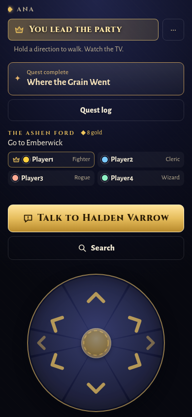
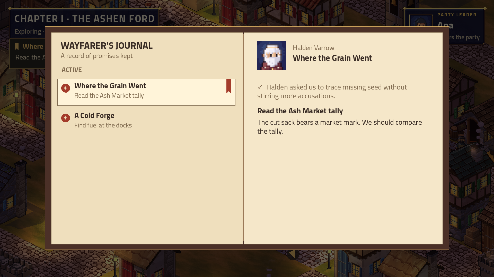

# NPCs, side quests and phone controls — issue #73

Current playback policy (issue #76 owner decision): Tactics uses authored recordings and captions only. A missing or unreadable recording is logged and never invokes live TTS; registered voice themes remain for possible future use. Earlier live-fallback verification below is historical.

Initial delivery was on `npcs-and-quests`, with rest/recovery and character/palette prerequisites integrated. Main was unchanged at that stage. The owner subsequently authorized merging; [PR #75](https://github.com/higharc91/ArcBox/pull/75) carries this delivery into main.

## Owner defaults and remaining decisions

All twelve authorized defaults are implemented: 100 XP per quest; grain pays 30 gold (within 20–40); items to the starter with a present-member fallback; away-member XP; explicit-choice failure only; eligible markers only; private journal for everyone/shared TV journal for the leader; persisted bark rotation; one town cast per preset; one pin; auto-pin only if empty; visible-target waypoint without a route line. See the [design](../../specs/2026-11-03-tactics-npcs-and-quests-design.md). No further decision blocks this slice. Earlier open art, balance and hardware questions remain in the [handoff §8](../../plans/2026-10-31-tactics-overworld-cloud-handoff.md#8-the-users-list).

## What changed

- Flag-gated people with stable IDs, fade/arrival rules and won-ending handling. Warriors leave after either ford victory; Mother Skarrow stays after parley and leaves after force. Losses preserve people. The Godot export was repeated byte-for-byte (SHA-256 `03c605cdabceb62443693bd2e857005ec037aebf9eb4e4b790e369469dbf5a2c`).
- Eight named conversations, instant voiced/attributed rotating barks with a talking emote for everyone else, restart-safe votes/checks, and reuse of the inn/temple services.
- Three lore-safe quests with atomic once-only gold/item/XP/story rewards, all-member XP and preserved main-story progress. Every quest works after either ford ending or a loss.
- A shared TV journal controlled by the leader, private phone browsing, saved pin, seven visible walking seconds for result notices, eligible quest markers and a secrecy-safe waypoint/edge arrow.
- Phone layout fixes from owner review: action rows are separate from scrolling content; party entries cannot shrink under buttons; session actions use a compact menu; battle/encounter lists scroll above their controls. The movement wheel reserves **28 px above its face**, with restrained arrival/held glow. Completed notices omit their redundant third line.
- Procedural journal/marker art and a [17-key prompt manifest](../../specs/2026-11-03-tactics-npcs-quests-art.json). No art or sound effects were generated. Existing sound fallbacks serve talk, notices, book and pin actions.

## Validation

| Check | Result |
|---|---|
| Full Release .NET solution | **6,081 passed, 0 failed, 0 skipped**; [log](solution-tests.txt) |
| Godot .NET host build | **0 warnings, 0 errors**; [log](host-build.txt) |
| Speaking-emote polish | **24 WorldPeople tests passed** after the final visual addition; [log](bark-emote-tests.txt) |
| Phone Vitest suite | **504 passed** across 24 files |
| Python lore tests + complete pack | **15 passed; lore OK**; [log](python-tests.txt) |
| Rendered voice coverage | **1,415/1,415 cast clips**, 1,313 logical line IDs; no missing renders |
| Voice drift | **0 flagged clips/groups**; [measurements](voice-check.json) |
| Browser phone audit | **264/264 passed, zero failures**; mobile/touch enabled, including wheel visual clearance; [results](phone-layout.json) |
| Real force + grain quest | **Passed** with four phones; shared log, explicit unpin/pin, two clues, completion and auto-unpin; Chapter 1 card and walking afterwards. Four battle losses then a win exercised recovery/retries. 102 story lines said once; 33 captured chapter shots. |
| Real parley | **Passed** with six phones; 131 story lines said once, River Crossing won, chapter card and walking afterwards; 34 captured chapter shots. |
| Final Godot NPC demo / latest-build quest smoke | **Passed**: 20 final demo captures, no TV errors/exceptions, existing talk/book/pin/completion sound fallbacks logged; latest six-phone grain quest completed and unpinned after its visible result interval, then the seeded skip-assault chapter reached its card and walking afterwards (90 lines said once, no fight, 20 chapter captures). [TV demo log](tv-demo.txt) · [quest/chapter run](quest-chapter-e2e.txt). |

The phone audit uses Chromium with mobile/touch enabled at **320×568, 360×640, 390×844, 430×932, 568×320 and 844×390**, covering all 44 non-portal Tactics fixtures. It checks visible control collisions, scrolling boundaries, off-screen controls, horizontal overflow, popup/menu bounds, stable pad placement and visual clearance around the wheel. It also clicks journal open/close and the leader's unpin control. Modal and closed-details visibility are respected. This is browser emulation; physical-device Safari and actual TV speaker/sofa review remain hardware checks.

The full suite initially found an old test assuming no interaction was available just outside a story marker. Townspeople now legitimately offer barks there; the test now checks that the **story** interaction remains out of reach. Earlier scene-count and fixture assumptions were updated to distinguish main beats from optional conversations, retaining legacy no-quest fixtures byte-for-byte.

The web production build succeeds. Vite retains its existing warning for the unrelated 537.65 kB Three.js flyover chunk; the .NET build has no warnings. Software OpenGL reports unsupported VSync/screen-space AA. Four music-related native objects are reported at Godot shutdown in both the existing shop demo and the NPC demo; this was reproduced in the baseline and does not produce an in-game error. An extra integration attempt run concurrently with heavy tests hit the existing 10-second world-open timeout; it was stopped, and the final integration was scheduled after unit/browser checks to avoid CPU contention. No balance change was made to help the bots win.

## Screenshots and listening review





[Tracker and edge arrow](screenshots/tv-tracker-arrow.png) · [Target waypoint](screenshots/tv-waypoint.png) · [Voiced bark](screenshots/tv-bark.png) · [Completion banner](screenshots/tv-complete.png) · [Landscape phone](screenshots/phone-walk-568x320.png)

[Force chapter card](screenshots/chapter-force-card.png) · [Parley chapter card](screenshots/chapter-parley-card.png)

The [voice sample gallery](voice-samples.html) contains **71 existing/new samples across 23 speakers**, including all ten townsfolk casts. Serve the repository root with `python3 -m http.server 8000`, then open `/docs/superpowers/reports/2026-11-03-npcs-quests/voice-samples.html` to listen. Audio sources are the actual shipped Oggs. Mechanical checks passed; these samples are offered for human delivery review, not as a claim of subjective listening approval.

**Voice cost:** 104 initial renders/196 CU, eight Tobin refinements/21 CU, two Vorga repairs/3 CU = **114 renders, 220 CU**. Each batch estimate was reported before generation. All paid job/asset IDs and superseded takes remain in [voice-assets.json](../../../../tools/tactics-lore/voice-assets.json). Nine town lines reuse existing matching captions/casts at zero generation cost, with provenance. Named casting is unchanged; [VOICE-PLAN](../../../../tools/tactics-lore/VOICE-PLAN.md) documents delivery hashes, checks and the live Chirp3-HD post-processing limitation. No failed-render caption-only lines remain.

## Main integration

The owner authorized merging through [PR #75](https://github.com/higharc91/ArcBox/pull/75). The branch was synchronized with main, retaining its watchdog and world-rendering fixes. The refreshed full suite passed **6,081 .NET tests and 504 phone tests**, with a warning-free host build. The two merge conflicts were property placement and constructor formatting only. Validation also found a stale watchdog persistence test: it now advances the configured timeout, and the two classes sharing a static hung-game gate run in the same test collection. Both focused watchdog cases pass.

## Reproduce

```sh
dotnet build src/ArcBox.Host
dotnet test --solution ArcBox.slnx -c Release --no-progress --max-parallel-test-modules 1
(cd web/play && npm test && npm run build)
python3 -m unittest discover -s tools/tactics-lore -p 'test*.py'
python3 tools/tactics-lore/check.py
python3 tools/tactics-lore/voices.py check
# With Vite running and Playwright + Chromium installed:
node tools/tactics-playtest/phone-layout.cjs http://127.0.0.1:5173 /tmp/phone-layout
# Godot 4.7.2 .NET, imported fonts, a display (or Xvfb), and .NET 10 on PATH:
godot --path src/ArcBox.Host -- --world-demo=npcs --shots=/tmp/npcs --audio-log --story-log
ARCBOX_GAME=tactics ARCBOX_CHAPTER=1 ARCBOX_QUESTS=1 ARCBOX_BRANCH=force tools/tv-e2e.sh
ARCBOX_GAME=tactics ARCBOX_CHAPTER=1 ARCBOX_BRANCH=parley ARCBOX_PHONES=6 tools/tv-e2e.sh
```
