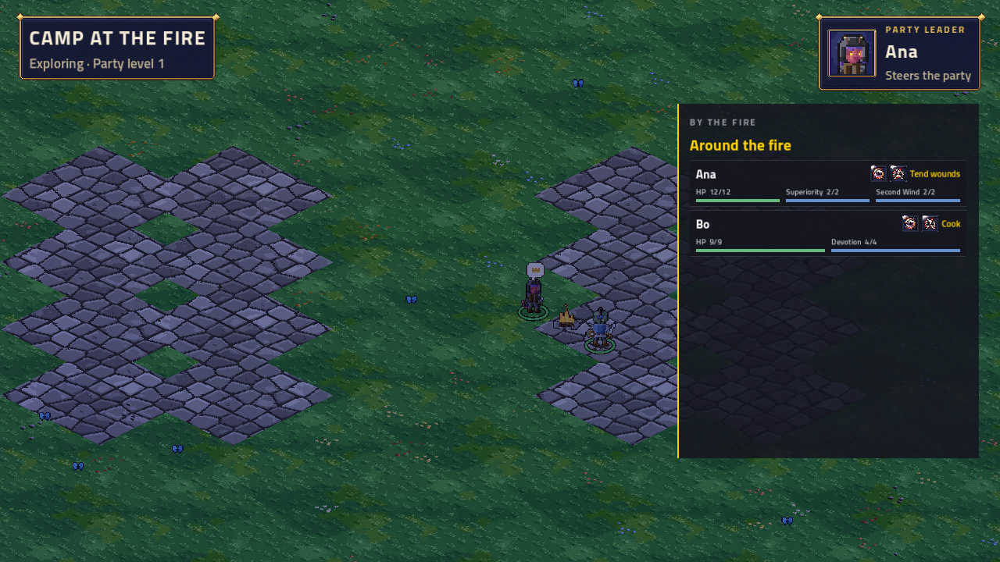
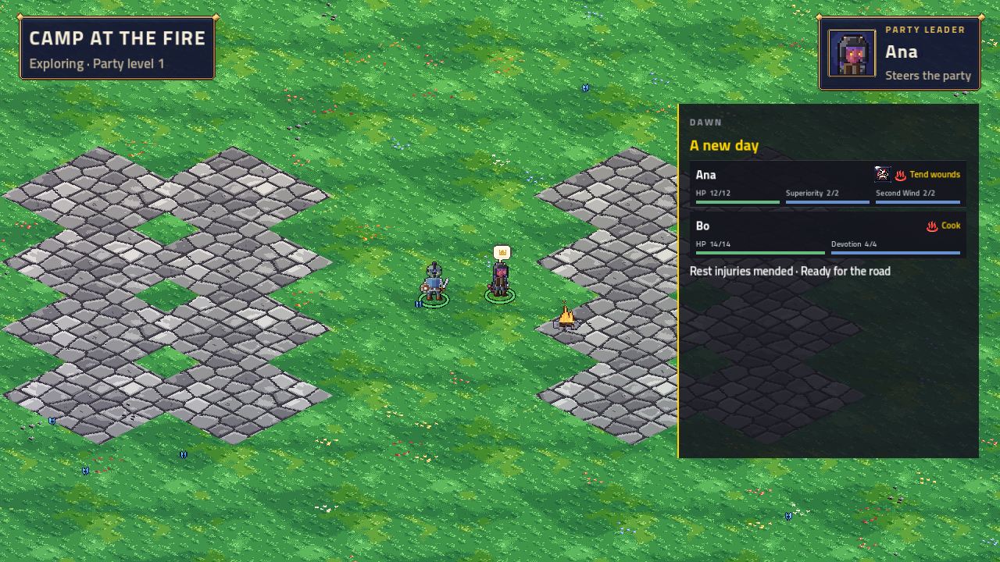

# Rest and recovery — issue #71

Implemented on `rest-and-recovery`, based on main `f4a28fc5`. No PR requested.

The party earns one non-stacking rest from a won/lost battle or completed story beat. Camp offers a party vote, individual jobs,
injury targets, saved rolls, an optional Chapter 1 conversation and dawn. The inn sells sponsored rooms after the same vote;
the temple sells an immediate cure of one chosen injury. Each purchase spends the authenticated buyer's own purse.
HP and slots still start fresh every fight. Away characters receive dawn healing and can be helped or sponsored.

All R1–R10 defaults from the issue are implemented and recorded as USER DECISIONs in the
[design](../../specs/2026-11-03-tactics-rest-and-recovery-design.md). A tied rest vote continues walking because it has no majority.
The owner's additional request for cozy music uses the existing acoustic `camp` loop, with `amb_campfire` underneath outdoors.
It continues through the camp conversation and crossfades to regional music at dawn. The owner subsequently requested a compact rest interface and actual injury icons. Eight native 32×32 icons were generated with PixelLab Pixen; no image edits or audio generation.
Prompts and job provenance are in the [injury icon brief](../../specs/2026-11-03-tactics-injury-icons.json). The [prompt brief](../../specs/2026-11-03-tactics-rest-art.json) describes future assets and all existing stand-ins.

## Verification

- Solution and Godot host builds: zero C# warnings or errors.
- Full .NET suite: 5,803 passed, zero failed or skipped.
- Final recovery/game suite: 585 passed, including vote/jobs/results/dawn session resumes, departing leaders, and injury-adjusted party bars. Final presentation suite: 2,353 passed, including all eight injury assets and music transitions.
- Phone suite: 489 tests passed across 22 files; TypeScript and production bundle passed. Existing Rollup/chunk-size notices remain.
- Lore checker passed; Python checker tests: 13 passed, including camp-tag graph rules.
- Seven new phone fixtures generated by `PhoneFixtureTests.Recovery_screens_match_their_fixtures`. All 44 preexisting fixture files were compared with main at f4a28fc5 and are byte-identical.
- Ashen Ford exported headlessly, then exported again: byte-identical. Only its painted fire was removed from the exported world;
  two interactable fires are placed in the region. Other exported regions are unchanged.
- Godot camp demo rendered and inspected under Xvfb/OpenGL at 1280×720. Night, mend, Well fed, dawn and a compact six-member inn panel were inspected. Screenshots are below.
  Audio routing verified with `--audio-log`: Music camp → Music explore at dawn, plus amb_campfire and all recovery sound fallbacks.
  Audio used the Dummy driver, so this verifies routing rather than an audible listening review. Software rendering reports its
  V-Sync/AA limitations and an ObjectDB warning at shutdown; there were no gameplay exceptions in the final demo.
- The live six-phone force Chapter 1 run validates the core flow; the compact UI is checked separately through Chromium and the Godot demo. Both recovery visits passed: `CAMP OK`, `INN OK`, then the chapter card and walking afterwards.
  The chapter scanner verified 98 lines (94 voiced main-story lines, four caption-only camp lines), the branch graph and the ford win.

Live command (after build):

```sh
ARCBOX_CHAPTER=1 ARCBOX_CAMP=1 ARCBOX_BRANCH=force ARCBOX_PHONES=6 \
ARCBOX_LINE=0.1 TV_HOLD=1 ARCBOX_E2E_OUT=/tmp/arcbox-rest-e2e \
TV_RENDERING_DRIVER=opengl3 \
TV_ENGINE_ARGS='--rendering-method gl_compatibility --audio-driver Dummy' \
ARCBOX_SERVER_ENV='Speech__Enabled=false' tools/tv-e2e.sh --skip-build
```

Camp demo:

```sh
godot --path src/ArcBox.Host --rendering-driver opengl3 --rendering-method gl_compatibility \
  --audio-driver Dummy -- --world-demo=camp --preset=low --res=1280x720 \
  --audio-log --shots=/tmp/rest-camp-demo-shots-final
```

`main` was rechecked before delivery and remains at `f4a28fc5`. The environmental branch `ccr-18ad4510-q68nad` (`ea90c2e2`)
has not landed on main, so it was not merged into this branch. Merge it when it lands, as the issue directs.

## TV review

| Night at camp | Dawn |
|---|---|
|  |  |

[Mending](camp-mend.png) · [Well fed](camp-well-fed.png) · [Compact six-member inn](inn-compact.png) · [Live flow sponsorship](inn-live.png) · [Chapter card](chapter-card.png)

## Phone review

[Own camp job](phone-jobs.png) · [Exact injury target](phone-target.png) · [Saved check result](phone-roll.png) ·
[Sponsored inn rooms](phone-inn.png) · [Temple healing](phone-temple.png) · [Injury detail and cure](phone-injury.png)

Phone captures render the real components from the new contract fixtures in a 390×844 Chromium viewport, with a full-page capture.
Temporary preview files were removed. Live recovery was exercised through the real hub by six bot phones, without a browser.


## Compact interface checks

Each card puts identity, HP/resources and injury badges together. Room booking is a compact action beside the character.
The temple opens a single injury's details and cure action on tap. Explanations and session controls are tucked into disclosure;
rolled checks can expand the party cards. Battle-ready values use the current injury-adjusted sheet and full per-battle resources.
No HP/slot wear-down was added.

Chromium verified all five four-member recovery menus at 390×844 without page overflow, plus no horizontal overflow at 320px.
All 8–12 injury images loaded in each relevant fixture. Tapping Cracked ribs opened its sheet and emitted the exact injury service
request. Native PNG size and coverage are also checked against every rules injury. Generation used eight Pixen calls (one per icon).

Detailed checks are saved in [validation.txt](validation.txt).

The full-solution check was run before the presentation follow-up; the affected game and presentation suites were rerun afterwards.


The later owner-authorized [cozy camp follow-up](../2026-11-03-camp-presentation/README.md) supersedes the initial presentation:
close campsite views, job progress/poses, additional PixelLab art, visible sleep/sunrise and an original morning cue.
