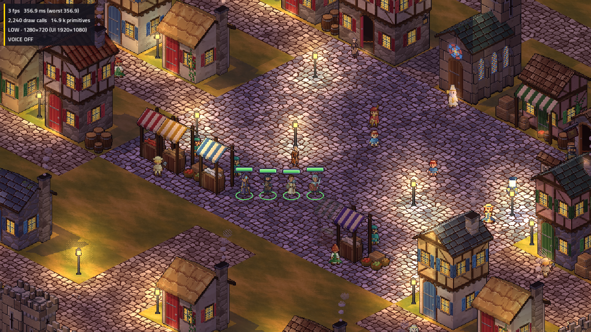

# Issue #80 — approved Bree integration and Halden review

Continuation on 2026-11-04, branch `townsfolk-art`, after loading checkpoint
`6da0040c`. The owner's “I approve or bree.” approves Bree's complete committed
eight-direction/motion set and TV appearance. The approval record binds the prior
GIFs, atlas plan/output and Windows TV images to exact SHA256s. No completed Bree
concept, direction or animation was regenerated.

## Approved production change

Installed the existing **1536×768, 4.5 MiB RGBA** Bree atlas byte-for-byte:
`9c316179a4790fe59c8d7f42caff95c6155da5d247d8cf997f2a6da0d53f884d`.
Frames remain 96×96, anchor `[48,84]`, scale 0.5, with eight real directions and
idle/walk/talk source pixels unchanged. Legacy sheets/presets remain available.
The innkeeper key is Bree's placed/story body compatibility key; the named
`characters.bree_tallow` alias also resolves it. No review hero override was installed.

Ordinary world barks now select an authored `talk` clip. Missing clips explicitly
select idle, avoiding `UnitSprite.Anim`'s attack fallback. Tests hold Bree's feet
through a bark and verify walking resumes without a jump, real facing without
mirroring, and idle fallback on a creature with attack but no talk. Existing
route pausing and interaction rules remain intact. Named portraits remain in the
later portrait phase; no generated portrait or rule/phone change is included.

The optional cosmetic `RegionPerson.Variant` round-trips through PersonMarker,
scene build/read, packed scene save/reload and painted-region JSON export. Preset
`farmer` + variant `b` resolves `characters.farmer_b` if available, otherwise the
preset. World drawing and region preloading share `WorldPeople.SpriteKey`.
Distinct variants are not collapsed by export and sort deterministically. Blank
variants are omitted, preserving existing files. No placed production people,
identity, voice, flag gate, interaction, gameplay rule, balance or phone contract
was changed. Native check: `godot --headless --path tools/tactics-world --
--check-person-variants` after building the editor; it uses a temporary scene.

## Halden — review only



[Eight-direction idle](../../../../../tools/tactics-assets/pixellab/townsfolk/halden/halden-eight-direction-idle.gif),
[walk](../../../../../tools/tactics-assets/pixellab/townsfolk/halden/halden-eight-direction-walk.gif),
[talk](../../../../../tools/tactics-assets/pixellab/townsfolk/halden/halden-eight-direction-talk.gif).
[Review instructions and provenance](../../../../../tools/tactics-assets/pixellab/townsfolk/halden/README.md).

Reused the existing approved Halden concept. Generated one character with all eight
real directions, four-frame idle, six-frame walk, five talk sources per direction.
Talk playback returns over those sources; no reroll, direction mirroring, body
resizing or per-frame recentering. Fixed clip translations preserve visible source
pixels. The 1440×768 review atlas is **4.21875 MiB**, 96×96 frames, anchor `[48,84]`,
scale 0.5. All **128 native PNGs**, provider ZIPs, requests, exact receipts, hashes,
canvases, offsets, per-frame bounds and motion review files are retained.

Idle/walk low-point drift is zero. Talk's southwest low point varies by 0.5 world
pixels, others by zero. The north static source touches its provider canvas's top
edge; inspect the head silhouette during owner review. Output clipping assertions
pass, and the TV square shot shows Halden at the party's scale. These checks do
not replace owner pixel/TV approval. **Halden is not installed in production.**

The live starting balance was **30.75 generations**. Live quote and receipts:
6 character + 8 idle + 8 walk + 8 talk = **30**; final live balance **0.75**.
No credit purchase, upgrade, regenerated concept or character reroll. Queued within
eight available slots; appended missing talk directions to the same group/name.
All jobs settled. Scenario spend stays separate at 221 CU. Other **24 sprites**,
portraits and remaining art approvals need an available allowance before paid work.

The MCP connection worked through the official authenticated HTTP endpoint.
Public Backblaze frame URLs returned 403; the documented authenticated character
ZIP downloaded after jobs completed (423 while active). Credentials were restricted
to the API host and stripped on cross-host redirects. No credential is committed;
the task's temporary authentication file was removed after final receipts.

## Four-party memory and cold content

Godot 4.7.2 .NET, Linux software Vulkan/Mobile (llvmpipe), low, 1280×720, dummy audio.
These are actual texture-memory/asset checks, not GPU frame-time benchmarks.
The strict verifier requires all four stages, four heroes, actual roster uploads
and releases, and fails above **536,870,912 bytes (512 MiB)** or incomplete/error logs.

| Pack/region | Open MiB | Roster peak MiB | Result |
|---|---:|---:|---|
| Production Bree / Ashen Ford | 267.56 | 305.24 | pass |
| Production / Cinder Hollow | 154.87 | 192.37 | pass |
| Separate Halden+Bree review / Ashen Ford | 269.94 | 307.44 | pass |

[Production Ashen log](ashen-run.txt), [gate receipt](ashen-memory.json),
[Cinder log](hollow-run.txt), [gate receipt](hollow-memory.json),
[Halden TV log](halden-tv-run.txt), [gate receipt](halden-review-memory.json).
[Current Bree at the inn](bree-inn.png). The review overlay only replaces the mayor;
Bree in those screenshots is the approved production body. Screenshots stall
rendering and regression processes shared the cloud machine; no timing comparison
is inferred. The owner's previously approved Windows Bree shots remain unchanged.

[Cold-pack receipt](cold-pack.json): **201,146,592 raw bytes (191.83 MiB), 4,813
files**, up **313,976 bytes** from 200,832,616. This sums file bodies using the
server's ordered path/file-SHA256 inventory algorithm, excluding HTTP/index overhead.
The production pack hash is `c2d06696c35c8aa9d3cf2b3dac796cd49e697357254a78506af734b1bed752c9`.
Only `creatures/bree_tallow.png` and `creatures/manifest.json` changed in content.
Review art, concepts and receipts remain outside the downloaded production pack.
Recheck the gate after each later approved production integration.

## Validation

Validation receipts are retained alongside this report. Text log copies only
normalize trailing whitespace; original logs remain in the workspace artifacts. Debug/Release solution
builds complete with zero warnings/errors. The native variant check and exact
Bree installer pass. Bree's original source/crop/import/height/contact/frame
verifiers pass unchanged. Halden's atlas rebuild is deterministic and clips no
visible pixels; pending-review hashes reproduce. The new artifacts passed a
credential-shaped text scan, and `git diff --check` passes.

Current results: **2,460 presentation**, **676 game**, **508 phone** and **16 Node**
cases pass. All 397 pre-existing WorldTools cases passed; the final 44 writer
cases, including the added stable-variant export case, also pass. Native variant
save/load/export and all three memory gates pass. No test is skipped. The web
production build passes with the existing REDLINE 537.65 kB chunk-size warning;
Happy DOM's existing localhost fetch diagnostics remain. [Validation receipt](validation.json).

The initial presentation run found the old creature-only assumption of four idle
frames. The corrected test retains all atlas bounds and combat expectations while
checking Bree's authored 5 idle / 6 walk / 8 talk playback frames and absent attack.
Web runs under concurrent compiler/native/test load hit existing five-second
limits. The final isolated run passes all 508 with the same assertions/timeouts.

Fresh four-phone production walk: **PASS**, including saved-position server restart,
cold TV reconnect, all 20 presses landing and leader drop. The first software-Vulkan
run missed the unchanged 100 ms input budget: median **136 ms**, p90 429, worst 1193.
On this four-CPU-quota machine, the rerun with `LP_NUM_THREADS=2` passes at **95 ms**
median, p90 221, worst 234. Both run receipts are retained; no budget, route or game
code was changed between runs. These are environment-specific input observations,
not evidence of GPU frame rates or a portable latency guarantee. Walking frame
medians remain slow with CPU rendering. Actual room texture memory was 311.2 MiB
at first open, 307.3 MiB after the cold TV reopening in the passing run.

[Initial live run](live-walk-initial.txt), [passing run](live-walk-lp2.txt),
[passing TV log](live-tv-lp2.txt), [passing phone log](live-phones-lp2.txt).
Reproduce after builds with:

```sh
LP_NUM_THREADS=2 VK_ICD_FILENAMES=/path/to/lvp.json \
  ARCBOX_GAME=tactics ARCBOX_WALK=1 ARCBOX_SHOTS=0 TV_RES=640x360 \
  TV_RENDERING_DRIVER=vulkan \
  TV_ENGINE_ARGS='--rendering-method mobile --audio-driver Dummy --position 160,100' \
  ARCBOX_E2E_OUT=/absolute/new/output tools/tv-e2e.sh --skip-build
```

Use the environment's activated Godot/.NET and actual Mesa ICD path; `--skip-build`
requires the server, host and phone build to be current. The unchanged median
budget is 100 ms. Full commands, result counts and limits are in [validation.json](validation.json).

The earlier complete-solution/isolated-logic, four-phone walk/reconnect and cave
battle tour receipts remain in `../loading/`; those historical results are not
represented as fresh runs here. Final whole-cast integration still needs all art
approvals, portraits, Windows TV review of new art and the complete final regression
gate. Issue #80 remains open. No PR or merge.
