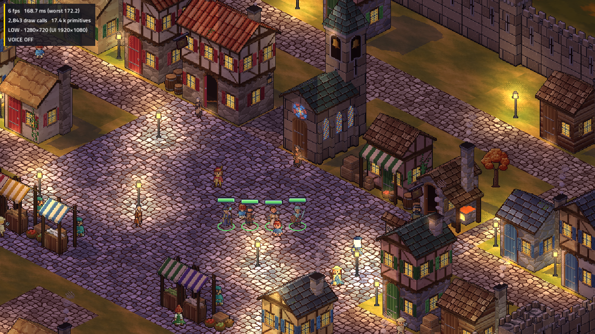

# Issue #80 — finished Aubrine image-tool review

The owner approved the trial appearance and requested finishing Aubrine:
**“Looks good, continue so we can she her finished”**. The complete eight-facing
idle/walk/talk set and six portrait moods are now ready for final owner TV review.
The prior approved concept supplied identity; shipped Bree/Halden supplied pixel
density/style. **No PixelLab API call or credits**, no purchase/upgrade, and no
completed Bree/Halden art was regenerated. Production, rules, balance and phone
contracts remain unchanged; nothing has been installed without full-set approval.

[Finished 16.6-second review reel](../../../../../tools/tactics-assets/imagegen/townsfolk/mother-aubrine/aubrine-finished-review.mp4),
[idle](../../../../../tools/tactics-assets/imagegen/townsfolk/mother-aubrine/aubrine-eight-direction-idle.gif),
[walk](../../../../../tools/tactics-assets/imagegen/townsfolk/mother-aubrine/aubrine-eight-direction-walk.gif),
[talk](../../../../../tools/tactics-assets/imagegen/townsfolk/mother-aubrine/aubrine-eight-direction-talk.gif),
[six portraits](../../../../../tools/tactics-assets/imagegen/townsfolk/mother-aubrine/aubrine-portraits-review.png).
The reel is silent and ends with a clearly labelled native TV **still**.

[2× nearest-neighbour detail crop](chapel-detail.png) preserves the actual renderer's
pixels. No generated painting is presented as a game screenshot. The figure uses
the game's actual unit lighting, source-rect animation and depth ordering.

## Completed assets

144 native frames: six per idle/walk/talk action in eight independently generated
real facings. Profile cells were curated into correct compass order; no mirroring.
The left-profile pouch/keys inconsistency was corrected; the other **126 frames
are retained pixel-identical**. One scale/offset per direction and one locked
96-colour palette prevent frame recentering or palette drift. Runtime alpha is
binary, fixing the trial's translucent background. Complete source sheets, exact
requests, input/output SHA256s and all normalized frames remain in the art folder.

The 1728×768 atlas uses **5.0625 MiB RGBA**, 96×96 frames, anchor `[48,84]`, scale
0.5. Bodies match the human 36-world-pixel target. Idle/talk use ten playback indices
out and back through six source images; walking uses six poses. Each action has
multiple distinct frames in every facing. The six 40×40 portrait moods follow the
existing format: idle, hurt, happy, angry, sad, surprised. Their shared framing and
palette are fixed; corrected source gutters prevent neighbouring shoulders leaking.
These human height settings are not a template for children/goblins.

## Validation and limits

- All **144 frames** pass actual PNG alpha, palette, non-empty/clipping, source-rect,
  height, distinct-motion and ground-contact checks. Maximum foot-height deviation
  is **one world pixel**. Six portrait files have binary alpha and correct dimensions.
- The actual C# `UnitArt`, `HudArt` and `WorldPeople` read the separate review pack:
  eight real rows, 18 slots, correct alias, 10/6/10 playback, all six mood paths.
  A synthetic presentation walk confirms bark stops without a slide, uses authored
  talk without mirroring, and resumes without a jump. [Runtime receipt](runtime-check.txt).
- Offline rebuilding the body/GIFs and portraits reproduces their hashes exactly.
  [Determinism receipt](determinism.json). Native source/frame checks are also in
  `review-validation.json` and `atlas-validation.json` under the art folder.
- The prepared installer correctly refuses the **pending full-set** gate. Its
  refusal leaves the full **4,814-file** production inventory unchanged.
  [Approval-guard receipt](approval-guard.json). It will not equate appearance
  approval with approval of the later completed frames/portraits/TV set.
- Strict four-member native checks pass all four stages, actual race replacement,
  restoration, texture uploads and releases, with the unchanged **512 MiB** cap:

| Review pack region | Open MiB | Peak MiB |
|---|---:|---:|
| Ashen Ford, three new NPC bodies | 273.15 | 310.65 |
| Cinder Hollow | 154.87 | 192.37 |

[Ashen log](ashen-run.txt), [gate](ashen-memory.json), [Cinder log](hollow-run.txt),
[gate](hollow-memory.json), [summary](validation.json). Godot 4.7.2 .NET, Linux
software Vulkan/Mobile, low, 1280×720, dummy audio, `LP_NUM_THREADS=2`. Screenshots
stall rendering and CPU rasterization is slow; these are texture/asset checks,
not hardware performance claims. No game/web code or production content changed,
so broad game/web suites were not rerun or claimed fresh for this review-only work.
Text log copies normalize trailing whitespace only.

The production cold pack remains **201,517,448 bytes**, inventory hash
`4768b6dd60fccb5d03b23637dc35c861105edea899f7ec125498007e25e2d674`.
Review sources/media stay outside production. Measure the new cold pack and repeat
production gates after owner approval and installation. Last observed PixelLab
balance remains historical; it was not queried or spent for this alternative.

[Rebuild instructions and art index](../../../../../tools/tactics-assets/imagegen/townsfolk/mother-aubrine/README.md).
Next: owner review of the completed GIFs/portraits/native TV set, then gated
integration. Other **23** sprites remain ungenerated; Bree/Halden and their prior
approvals stay intact. No PR, merge, purchase or issue closure.
