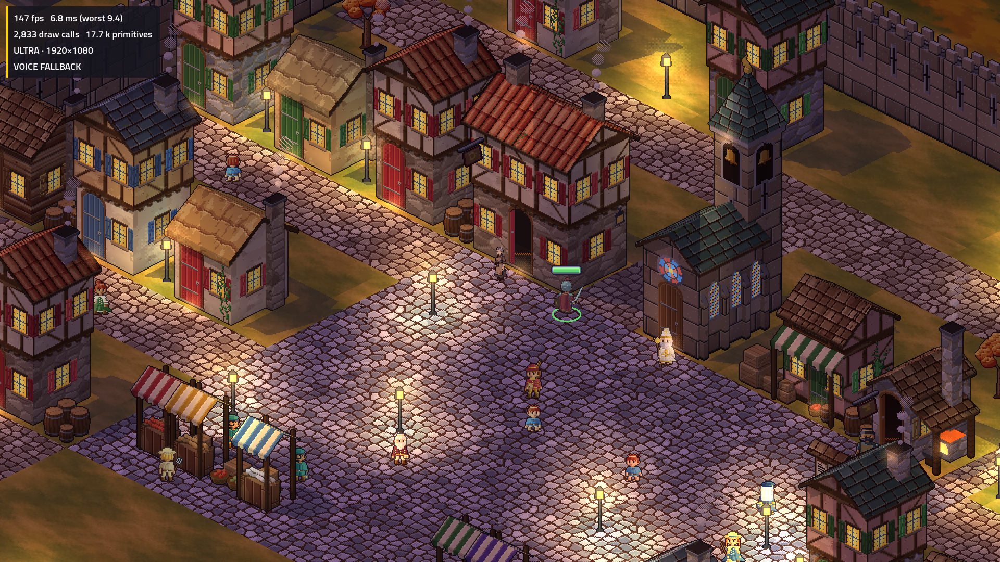

> Latest: Halden’s chat approval has arrived and his exact reviewed atlas is now
> installed. See [Halden’s production checks](halden-installed/report.md).

> Continuation on 2026-11-04: Bree’s complete set and TV appearance are now owner-approved
> and installed unchanged. Halden’s complete directional review is ready; 0.75
> PixelLab generations remain. Current integration, memory gates and checks are in
> [the integration report](approved-integration/report.md). The checkpoint below
> preserves the earlier approval and validation history.

# Bree Tallow sprite review checkpoint

Issue #80, branch `townsfolk-art`, 2026-11-03. **Review art is complete for Bree;
production integration and the rest of the town are pending.**

The owner selected candidate 1, briefly tried candidate 2, then returned to 1 and
approved its displayed idle: “nice, I'm good with that. Proceed”. Exact approval
and source hashes are in `tools/tactics-assets/pixellab/townsfolk/sprite-approval.json`.
The new full directional set and TV shots have not received a separate owner
approval. No live NPC sheet, portrait, rules value or phone contract was changed.

## What was made and fixed

- Eight real facings. The approved southeast sprite was imported pixel-for-pixel;
  seven other facings come from the matching Pro Flash study, including a true
  front and genuine rear apron ties. No directions were manufactured by mirroring.
- Idle in all directions: original five-frame southeast clip, four-frame template
  clips elsewhere with the opening frame repeated for the common five-slot layout.
- Six-frame walk in all eight directions.
- Five source talking frames in each direction. The generated clip ended with
  the hand raised, so playback uses `0,1,2,3,4,3,2,1` to return to rest smoothly.
  This reuses genuine frames without a paid reroll or per-frame recentering.
- Rejected the one-generation Pixen front edit: it kept the diagonal pose and
  introduced an unwanted white patch. Its image and receipts remain for audit.
- Reduced transparent padding from the hero-sized 160×160 staging canvas to
  96×96, anchor `[48,84]`, still at 0.5 pixel scale. The approved visible pixels
  remain exact. A compact 1536×768 atlas costs **4.5 MiB RGBA**, versus 12.5 MiB
  for the first padded eight-direction pack. This is a canvas crop, not a body resize.
- Added dev-only `ARCBOX_TACTICS_ART_ROOT` for world-review packs. Live-room packs
  are unaffected, and the old Cinder Hollow review variable remains supported.

## Actual Windows TV check

Godot 4.7.2 .NET, Debug, Vulkan Forward+, RTX 5080, ultra, 1920×1080.
Windows were launched with the established left-monitor position and temporary
`window/size/no_focus=true`; that override was removed afterwards. No server is
running. Both demo processes exited normally.

[Square](bree/world-square.png), [market](bree/world-market.png),
[baseline inn](before/world-inn.png), [before log](before-run.txt),
[Bree log](bree-run.txt). All screenshots from both runs are retained.

I inspected the inn, square and market images: Bree stands on the paving without
clipping into the doorway; the new figure reads beside the current hero. The
remaining townsfolk still use old art. The first review placed the hero's HP bar
over Bree; final shots put the stand-in to her side so her full sprite is visible.

| Short demo measurement | Baseline | Compact Bree review |
|---|---:|---:|
| Texture memory after initial route | 190.5 MiB | 195.0 MiB |
| World build total | 801 ms | 490 ms |
| Texture loading | 561 ms | 404 ms |
| Sampled route frames over 16 ms | 0 / 20 | 0 / 23 |

The route is only two tiles and about 0.2 s, with one stand-in. Warm caches and
JIT make these timings unsuitable as a performance comparison. These numbers
**do not verify the four-party 512 MiB gate**, Cinder Hollow, cold download size
or used-only loading. Screenshots also stall rendering; they are not a frame-time
benchmark. The engine labels its binary-megabyte values “MB”; the table uses MiB.

## Validation and remaining work

- Host Debug build: **0 warnings, 0 errors**.
- All **2,450 presentation tests passed**; the earlier focused UnitArt run passed 54.
- Offline pilot verifier: approval hashes, exact crop/import and 0.973 hero-height ratio pass.
- Review atlas verifier: dimensions, all action/facing frames and visible bounds pass;
  idle contact varies by at most one world pixel, talking contact stays fixed.
  Walk contact varies by up to two world pixels during the gait.
- All frame contact sheets inspected; contact sheets and animated GIFs are in
  `tools/tactics-assets/pixellab/townsfolk/`. The compact approved southeast idle
  is verified pixel-for-pixel after its transparent-padding crop.
- Full solution tests, Release build, web checks and reconnect/bot e2e were not
  repeated for this preview-only checkpoint; they remain required before issue completion.

PixelLab: earlier pilot/alternative **19 generations**, this extension **30.25**,
**49.25 total**, **30.75 remaining** at the final account check. The extension is
1 rejected edit + 6 character study + 0.25 import + 8 walk + 7 idle + 8 talk.
Slot-rejected submissions created no jobs. All Bree jobs have settled. Scenario's
separate concept total remains **221 CU**; no concept was regenerated.

Priority next: full-set/TV owner review; remaining 25 people and portraits;
production swap plus talk/bark wiring; optional variants and export round-trip;
OW-05 used-only loading and four-party/cold-download measurements; final solution,
phone and real-walk regression checks. The cloud handoff has exact commands and paths.

## Cloud continuation: loading and memory

The approved Bree source pixels, directional frames, receipts and Windows TV shots were reused unchanged. Offline rebuilding and verification pass; no concept or animation was generated, and no credits were spent. Full-set/TV approval is still requested separately. PixelLab is not exposed by this cloud session's connected tools, so current balance and cost quotes cannot be checked; **30.75 is historical, not a live balance**. No subscription purchase or upgrade was attempted.

OW-05 implementation and four-party measurements are in [the loading report](loading/report.md), with before/after native logs, gate output and an unchanged cold-pack hash. This independent performance work does not approve or install art, complete the remaining 25 sprites/portraits, or close issue #80.

## Latest continuation: Aubrine integration and Tobin appearance review

Aubrine's complete set and TV review are now owner-approved and installed.
Fresh production four-party peaks:310.83MiB Ashen /192.37MiB Cinder, below512.
111 focused tests pass; Debug/Release test-project builds zero warnings/errors.
Tobin's first image-tool appearance sheet awaits owner review before animation.
No PixelLab spend or rule/balance/phone changes. See
[the installation report](aubrine-installed/report.md) for receipts and current next steps.
