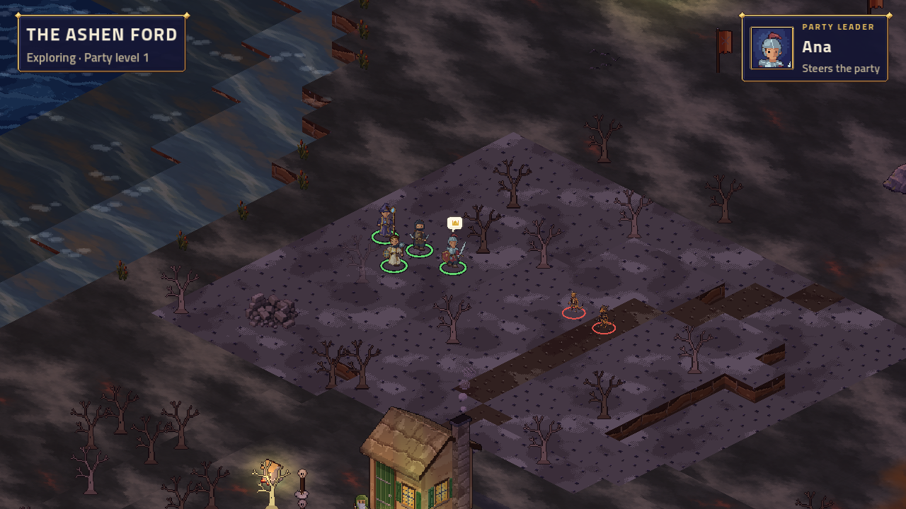
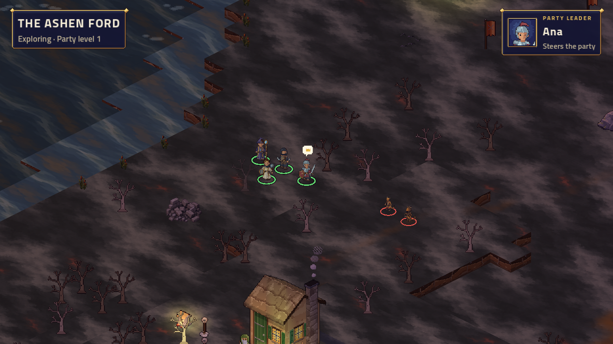

# Visible overworld mobs — issue #79

Branch: `overworld-mobs`. Seven optional groups inhabit matching, explicitly authored 14×12 arena stamps. All art and sounds are existing approved assets; no generated art, audio or paid generations were needed.

| Region | Group | Arena origin | Representatives | Gate |
|---|---|---|---:|---|
| Ashen Ford | Wolves in the Pines | 8,32 | 1 grey wolf | Always |
| Ashen Ford | Rooting Boars | 35,27 | 1 boar | Always |
| Ashen Ford | Ash Market Scouts | 119,74 | Kobold and slinger | Always |
| Ashen Ford | River Slimes | 96,76 | 1 slime | Always |
| Ashen Ford | Road Bandits | 141,63 | 1 bandit | `ch1_ford_settled` |
| Cinder Hollow | Hollow Bats | 20,2 | 1 bat | Always |
| Cinder Hollow | Candle Scroungers | 20,14 | 1 kobold | Always |

One representative can stand for several combatants, as specified in the brief. Existing eight-facing sprites retain their world scales. Grey wolves use the ordinary animal coat, rather than the green wildshape coat. Five lighter stat variants reuse their species' approved art and AI; the original story monsters retain their stats.

## Behavior and placement

The server moves groups within connected patches at 2.5-second intervals, without chasing. Region/group/epoch seeds and saved cursors reproduce movement after a restart. Only leader contact starts the fight. Contact halts walking, saves the pending ambush and presents the TV notice and phone ambush screen before the existing in-place walk-in. The leader sees a small optional danger chip within four tiles. Mobs are sent only within a 20-tile area and use movement legs and host patches.

Scenes, shops, rests and the journal pause movement. The journal sends a quiet keepalive while read, preventing the leader's silence lease from closing it. With no connected phones, roaming clocks stop. Existing creature sounds announce first appearance. Ordinary battle music and location-appropriate ambience accompany the seven fights; standalone arenas also retain their region's lighting.

Wins give 75 XP to each member under the existing battle-XP convention, 10 gold split among present members, and no loot. Defeated groups persist through reconnects, restarts, rests and region travel. Losses give no rewards and use existing injury/recovery rules; the group remains. Entering a later chapter clears defeated groups. Mob encounters cannot be selected directly from the developer battle list to bypass persistence.

Both scene exports are byte-identical on repeated exports. Validation excludes roads (including cobble, planks and flagstone), people and their walking tiles, things, beats and all spawns. It blocks every possible mob tile plus cardinal contact distance and proves the remaining world still reaches every previously reachable tile outside that danger area and every interactable. The boar patch was reduced to two safe tiles after the wider candidate obstructed access to the farms. The cave's optional side chamber leaves the set fights and route to the safe fire accessible. Map props own their stamped area to avoid duplicate drawing.

## XP impact

`rules/xp.json` uses thresholds 0 / 1,000 / 2,000 / … . XP is awarded in full to each party member, matching story battles; gold is divided.

| Sweep | Extra XP per member | Extra group gold |
|---|---:|---:|
| Five Ashen Ford groups | 375 | 50 |
| Two Cinder Hollow groups | 150 | 20 |
| All seven | 525 | 70 |

The main force fight gives 300 XP; parley gives 250. Story-only completion plus all seven groups therefore totals 825 / 775 XP respectively: both remain level 1. Completing the three 100-XP town side quests and the 300-XP Ashmaw bounty adds another 600. Those full Chapter I routes total 900 / 850 without roaming groups and 1,425 / 1,375 with all seven: **the full optional sweep can move an otherwise level-1 chapter-end party to level 2**. The five Ford groups alone also cross that threshold with all side quests (1,275 / 1,225). No XP thresholds or story rewards were changed. Groups do not respawn in the same chapter.

## Placement captures

[Open all seven placements](gallery.html). These are normal-renderer gallery views of the actual authored locations. The live wolf flow is recorded separately below.

| Group | TV capture |
|---|---|
| Wolves in the Pines | [View](wolves.png) |
| Rooting Boars | [View](boars.png) |
| Ash Market Scouts | [View](scouts.png) |
| River Slimes | [View](slimes.png) |
| Road Bandits | [View](bandits.png) |
| Hollow Bats | [View](cave-bats.png) |
| Candle Scroungers | [View](cave-kobolds.png) |

The final pass removed the mismatched arena terrain:

| Before | After |
|---|---|
|  |  |

## Review and reproducibility

- [Live wolves clip](wolves-live.mp4): actual TV driven by bot phones; wandering, ambush, stamped fight and victory. [Battle](wolves-battle.png), [victory](wolves-victory.png).
- [Phone danger](phone-danger.png) and [ambush](phone-ambush.png). Both screens were rendered at 320×568, 390×844, 412×915, 844×390, 768×1024 and 1024×768; [bounds audit](phone-audit.json).
- `--world-demo=mobs` renders all seven placements through normal host views without writing a campaign.
- `ARCBOX_MOBS=1 ARCBOX_RESTART=1 tools/tv-e2e.sh --skip-build` uses Story difficulty and seed 76 for a reproducible UI flow, as the existing chapter harness does. `ARCBOX_DIFFICULTY` can override it; gameplay defaults and the Normal simulation are unchanged. It checks wandering, phone reconnect, server restart with living mobs, ambush, winning rewards and removal.
- `ARCBOX_CHAPTER=1 ARCBOX_BRANCH=force|parley tools/tv-e2e.sh --skip-build` verifies the existing chapter routes still reach the card while avoiding mob danger.

The [full Normal-difficulty simulation](balance.md) covers **9,660 battles** (levels 1–3, sizes 1–4, six sampled parties per size except the five available solo classes, twenty seeds). It won 98.2% and averaged 4.4 rounds. Only **7 of 84 level/size/encounter cells** meet both requested bands. Most deviations are easier or shorter; level-1 boars are harder for one member (83.0%) and two (75.8%). Fifteen battles reached the 30-round cap and count as losses, chiefly kobold scouts. These are explicit balance observations for the owner, rather than a claim that every group meets the target. Enemy levels stay fixed so gaining XP helps. No target or XP threshold was changed.

Candle stubs in the kobold side chamber preserve walkability and cover. [Export hashes](exports.json) record the repeated scene exports. The simulation's applicable assessment is the 85–95% / 4–8-round mob table; the standard simulator's story bands remain afterward for diagnostics. Those targets have not been silently changed.

The cloud TV uses Mesa software rendering and a dummy audio device. Captures prove appearance and flow, not physical-TV frame rate or speaker output. The existing phone build's REDLINE flyover chunk advisory is unrelated to these changes.

Roaming stamps retain the region's natural terrain art, tint, decals and edge blending in both exploration and the in-place battle stage. They still use the same explicit map tiles, props, collision and stage bounds. This removes the rectangular arena-colour patches without repainting the world or changing the story ford's authored battle art. Renderer regression checks compare staged terrain faces with the surrounding world's faces.

## Final verification

- Solution builds with **0 warnings and 0 errors**; the final clean renderer build also has zero warnings.
- The solution run exercised 6,357 tests. All modules passed except one server-fixture route assumption; after correcting that fixture, the **entire 425-test server suite passed**. The final **65 stage-renderer tests passed**, including the three new natural-terrain comparisons. These reruns close the failures from the earlier runs; [verification record](verification.json).
- **517 phone tests pass**; the production phone build succeeds. Both new screens were visually checked at six viewport sizes with no horizontal overflow or out-of-bounds controls.
- Both authored scenes export twice identically with zero warnings.
- Both complete Chapter I branches reach their card and return to walking: [force](chapter-force.png), [parley](chapter-parley.png).
- The final live wolf run verifies wandering, phone reconnect, server restart with living wolves on screen, saved ambush, victory, 75 XP/member, 10 total gold, and the defeated sprites staying absent. The clip uses that final run and its corrected terrain/rings.
- The Normal balance sweep covers all seven encounters. Target deviations and chapter-end XP impact are explicitly reported above; they are not presented as resolved balance targets.
