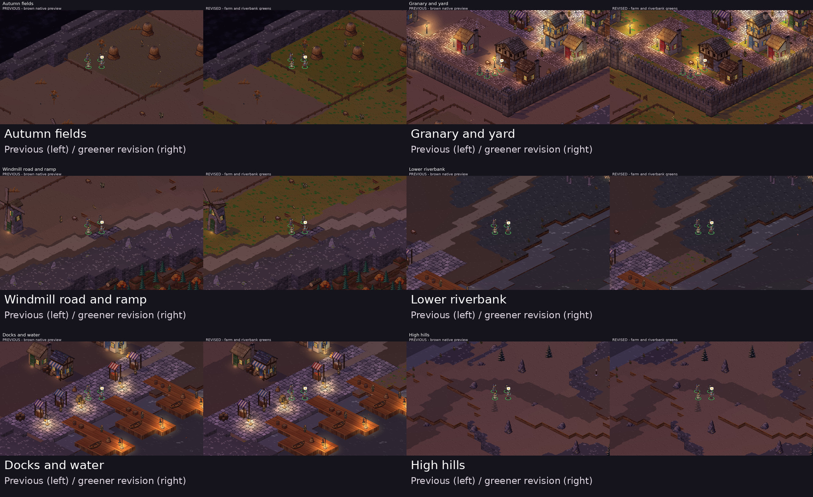

# Farm and riverbank greens

**Approved and installed:** owner response: “much better, let's go with that”.
See the [installation report](../../ground-installed/README.md). These images retain the approved preview checkpoint.

The owner requested greens near farms and water after the wider map review. **Previous brown native preview is on the left; revised greenery is on the right.** Both sides remain isolated previews, not installed content.



Olive turf with smaller green clusters now distinguishes autumn fields and pasture near Emberwick. Low banks gain small patches of grass and reeds over earth, within three tiles of water at a compatible height. Roads, ash, water and steep banks are excluded; bank patches have deliberate gaps. The charcoal burned ground and dry hills remain distinct.

| Location | Full-size pair | Previous native preview | Greener revision |
|---|---|---|---|
| Emberwick square | [Compare](town-square.jpg) | [Previous](before/world-town-square.png) | [Revised](after/world-town-square.png) |
| Granary and yard | [Compare](granary-yard.jpg) | [Previous](before/world-granary-yard.png) | [Revised](after/world-granary-yard.png) |
| Autumn fields | [Compare](autumn-fields.jpg) | [Previous](before/world-autumn-fields.png) | [Revised](after/world-autumn-fields.png) |
| Windmill road and ramp | [Compare](windmill-road.jpg) | [Previous](before/world-windmill-road.png) | [Revised](after/world-windmill-road.png) |
| Burned ground and ruins | [Compare](burned-ruins.jpg) | [Previous](before/world-burned-ruins.png) | [Revised](after/world-burned-ruins.png) |
| Lower riverbank | [Compare](riverbank.jpg) | [Previous](before/world-riverbank.png) | [Revised](after/world-riverbank.png) |
| Maud's hut | [Compare](mauds-hut.jpg) | [Previous](before/world-mauds-hut.png) | [Revised](after/world-mauds-hut.png) |
| Docks and water | [Compare](docks.jpg) | [Previous](before/world-docks.png) | [Revised](after/world-docks.png) |
| High hills | [Compare](high-hills.jpg) | [Previous](before/world-high-hills.png) | [Revised](after/world-high-hills.png) |
| Skarrow camp | [Compare](skarrow-camp.jpg) | [Previous](before/world-skarrow-camp.png) | [Revised](after/world-skarrow-camp.png) |

## Validation and reproduction

The real content loader validates both encounters, all six world stamps and all 18 maps. All map cells retain their heights, flags and fuel classification; all 19,200 world cells retain walkability, height, flags and fuel in fortified, force and parley states. Both encounter plans, 80 world blocks and three bridge states load. New fuel aliases distinguish existing combustible turf from noncombustible damp earth. Vegetation textures add no collision props.

Ten matched location captures complete with no runtime errors. Camera, standing coordinates, party, flags, resolution and renderer match the preceding gallery. The original capture warnings are retained in both sets. The dry hills and burned ruins serve as controls. This revision reruns the content/terrain verifier and native TV captures; it does not claim a new full .NET, phone or balance run.

Native source: `tools/tactics-assets/parts/ford_terrain.py`; isolated pack authoring: `tools/tactics-assets/concepts/ford-rework/ground/render-preview.py`. The [native art and hashes](../../../../../../tools/tactics-assets/concepts/ford-rework/ground/green-revision/native-art/) are retained separately from the earlier brown checkpoint.

```bash
python tools/tactics-assets/concepts/ford-rework/ground/render-preview.py --out /workspace/work/ford82-green-preview
dotnet run tools/tactics-assets/concepts/ford-rework/ground/verify-preview.cs -- content/tactics/base /workspace/work/ford82-green-preview/content/tactics/base
```

No additional generation spend: native 0, PixelLab 0, Scenario total 65 CU. Live content remains unchanged. Awaiting owner visual review.
