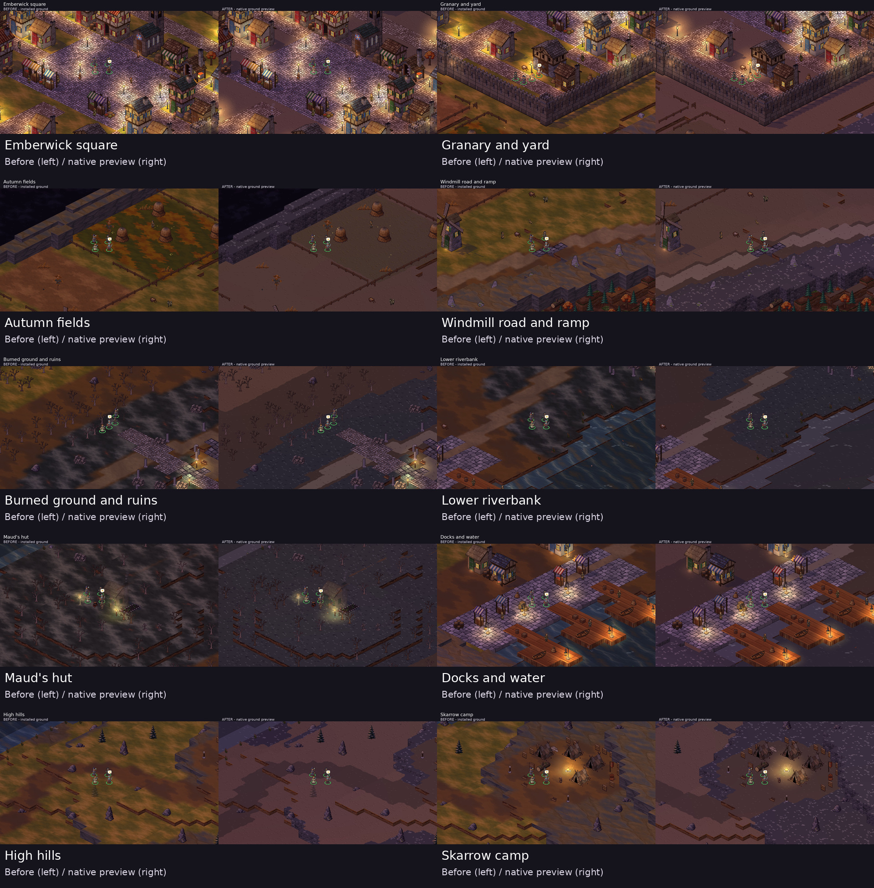

# Ground comparisons across Ashen Ford

Ten matched locations from the real world renderer. **Before is on the left; the native candidate is on the right.** Click a location for its full-size pair, or open either original 1280×720 capture.

The owner requested wider map coverage after reviewing the Ford comparison. This remains an isolated preview; the ground has not been installed.

| Location | Full-size comparison | Original before | Original after |
|---|---|---|---|
| Emberwick square | [Side by side](town-square.jpg) | [Before](before/world-town-square.png) | [After](after/world-town-square.png) |
| Granary and yard | [Side by side](granary-yard.jpg) | [Before](before/world-granary-yard.png) | [After](after/world-granary-yard.png) |
| Autumn fields | [Side by side](autumn-fields.jpg) | [Before](before/world-autumn-fields.png) | [After](after/world-autumn-fields.png) |
| Windmill road and ramp | [Side by side](windmill-road.jpg) | [Before](before/world-windmill-road.png) | [After](after/world-windmill-road.png) |
| Burned ground and ruins | [Side by side](burned-ruins.jpg) | [Before](before/world-burned-ruins.png) | [After](after/world-burned-ruins.png) |
| Lower riverbank | [Side by side](riverbank.jpg) | [Before](before/world-riverbank.png) | [After](after/world-riverbank.png) |
| Maud's hut | [Side by side](mauds-hut.jpg) | [Before](before/world-mauds-hut.png) | [After](after/world-mauds-hut.png) |
| Docks and water | [Side by side](docks.jpg) | [Before](before/world-docks.png) | [After](after/world-docks.png) |
| High hills | [Side by side](high-hills.jpg) | [Before](before/world-high-hills.png) | [After](after/world-high-hills.png) |
| Skarrow camp | [Side by side](skarrow-camp.jpg) | [Before](before/world-skarrow-camp.png) | [After](after/world-skarrow-camp.png) |

Both sides use the same camera and party positions, parley story flags, 1280×720 resolution, low render preset and software OpenGL renderer. Camera and standing coordinates are recorded in [spots.json](spots.json). Buildings, props and geometry are unchanged. Cobblestone in the square provides a useful reference beside the revised earth and grass.

All twenty location captures completed with no runtime errors. Four capture logs and image hashes are retained here. Existing compatibility-driver warnings also occur in the baseline. This screenshot-only update does not rerun or supersede the earlier presentation, mechanics or balance checks.

No additional generation spend. Pixel/TV approval remains pending after this wider review.
