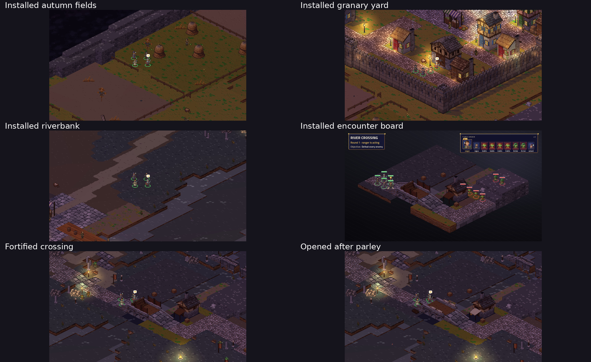

# Approved native ground installed

The owner approved the [greener native revision](../ground-art/green-revision/README.md): **“much better, let's go with that”**.
The selected ground is now installed on `ford-rework` for [#82](https://github.com/higharc91/ArcBox/issues/82).

## What changed

Twelve 128×128 top asset files and one 128×32 cliff face replace the Ford material references. Source art uses
the established palette, discrete pixel clusters and opaque edges. Both old and new tops have 32 source pixels per tile.
All 100 legacy terrain images remain intact; no character, portrait, creature or voice asset is changed.

Autumn grass and the pastures around Emberwick have olive turf with smaller green accents. Scattered low-bank
grass and reeds sit near water at compatible heights; ash, roads, water and steep banks are excluded. Burned land
stays charcoal and the high hills stay dry. The west battle bank's 56 former grass cells use charred-root ground.

The native editor painted **1,629 explicit cells** into the existing scene. Its 274 nodes and markers are preserved,
including all props, buildings, people and stamps. Four new material swatches are appended without changing any
of the 105 existing source IDs. Matching surfaces are installed in River Crossing and the three affected roaming
encounter stamps. Cinder Hollow's scene and exported world are unchanged.

## Installed views

| Place or state | Capture |
|---|---|
| Farms | [Autumn fields](world-autumn-fields.png), [granary yard](world-granary-yard.png) |
| Roads and town | [Windmill ramp](world-windmill-road.png), [Emberwick square](world-town-square.png) |
| Water | [Riverbank](world-riverbank.png), [docks](world-docks.png) |
| Other ground | [Burned ruins](world-burned-ruins.png), [Maud's hut](world-mauds-hut.png), [hills](world-high-hills.png), [camp](world-skarrow-camp.png) |
| Fortified crossing | [West](fortified-west.png), [east](fortified-east.png) |
| After force | [West](force-west.png), [east](force-east.png) |
| After parley | [West](parley-west.png), [east](parley-east.png) |
| Real encounter setup | [River Crossing](battle.png) |

The refreshed OW-22 named place set is also complete: [overview](place-overview.png),
[square](place-square-with-people.png), [Emberwick](place-emberwick.png), [road](place-road.png),
[Maud](place-maud.png), [hills](place-hills.png), [ford](place-ford.png), [fields](place-fields.png),
[docks](place-docks.png), [camp](place-camp.png) and [burned ground](place-burned.png).
`place-shots.json` records the sources and hashes. The overview is a fresh installed-content capture;
the other images retain the full-resolution installed views above under their canonical place names.

These are actual installed-content Godot captures at 1280×720. The battle image comes from the game's post-render
screenshot queue; the capture helper now uses that image to avoid grabbing the boot splash during a slow first frame.
Default review standing positions also avoid the gatehouse footprint. All final captures have no runtime errors.
Compatibility-driver warnings are retained; software rendering does not establish a hardware frame-time result.

## Verification

Both saved regions export twice byte-identically. The installed world surfaces and all maps match the approved
preview exactly. All 13 installed assets match its recorded hashes and reproduce identically from native source.
The content validator loads all 18 maps, both Ford encounter plans, 80 world blocks and three bridge states.
Every map cell preserves height, flags and fuel classification. All 19,200 world positions preserve walkability,
height, flags and fuel in fortified, force and parley states. Separate material aliases retain the original
combustibility of grass versus damp earth. No collision props, enemy stats, counts, rewards or objectives are changed.

Final merge verification: all **6,787 .NET tests and 517 phone tests pass**, with no failures or skips.
The solution build has zero warnings/errors. The complete .NET suite was repeated after correcting the two stale
art fixtures, and the phone suite was repeated too. `merge-dotnet-tests.txt`, `merge-phone-tests.txt` and
`validation.json` retain the final receipts. The earlier failed checkpoint and targeted corrections remain archived.

Asset expectations follow the approved native filenames, four-tile spans and clustered edges. The stamped-tile
rejection fixture follows the new charred-root material while retaining its exact error and refusal assertions.
No picture thresholds or gameplay expectations are relaxed.

The preceding [bridge integration](../integration/README.md) retains the movement recording, strict force/parley
chapter checks and paired balance results. This art installation does not rerun those chapter campaigns or claim
four-hero force balance acceptance. That existing balance decision remains open; the art adds no retuning.

## Reproduction and receipts

Native source: `tools/tactics-assets/parts/ford_terrain.py`. The isolated authoring tool is
`tools/tactics-assets/concepts/ford-rework/ground/render-preview.py`; installation is `ground/install.py`.
Installation checks the approved hashes, copies selected assets and map materials, and produces explicit native
scene paint. It never reconstructs the saved scene from exported JSON. Apply that paint with the world editor's
`--paint-region`, then export the scene as documented in `tools/tactics-world/README.md`.

`installed-assets.json`, `content-validation.json`, `runtime-validation.json`, repeated-export logs,
`capture-validation.json` and native renderer logs retain the checks. Earlier review images remain historical
checkpoints. No additional generation spend: **native 0, PixelLab 0, Scenario total 65 CU**.
