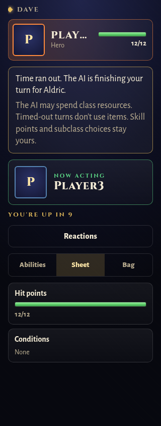
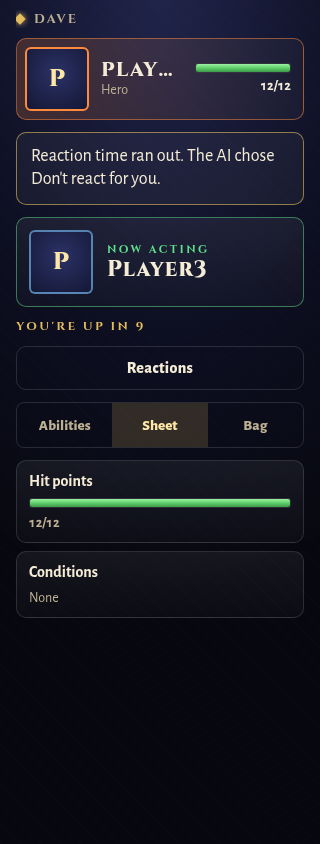
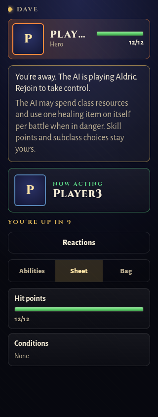
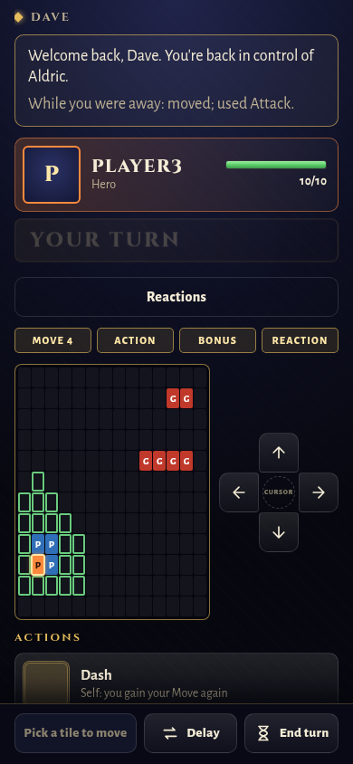
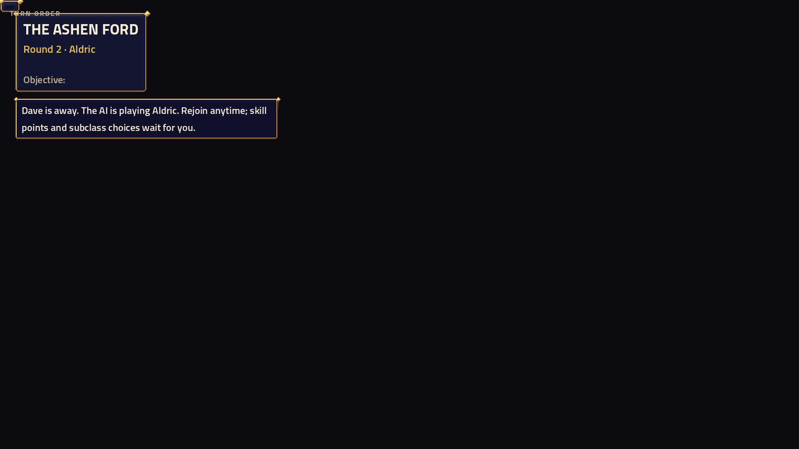

# AI control notices — issues #162 and #173

Turn timeouts, reaction timeouts, disconnects, successful returns and failed handovers now produce distinct optional `controlNotice` payloads. The affected phone renders the notice on Turn, React, Status and Results. The TV uses its existing notice panel. Connected players whose turn the AI is finishing also report `aiPlaying: true`.

A timeout or return notice survives the event's round and the following round; a disconnect notice remains while its player is absent. A new battle clears the notices and recaps. These are transient session messages, not additions to the campaign save schema. A reaction timeout names the answer that actually applied, including a fallback to Don't react after a rejected choice or engine fault. Normal manual or preference-driven reactions do not produce timeout notices.

The resource wording follows the existing rules: timed-out turns use the companion profile with items disabled. An absent member's companion may spend class resources and use at most one healing item from its own bag, on itself, when the threat map predicts it would fall. Skill points and subclass choices remain the player's. This change does not alter those rules.

Returning players see a bounded recap of their hero's and summons' last three distinct consecutive successful AI moves, abilities, items or ability reactions during the absence. Summon actions name the summon. If none completed, the recap says so. Failed commands and planned-but-unexecuted actions are excluded. A failed handover retains the existing error and does not claim the player regained control.

## Validation

- Twelve game regression cases cover connected turn timeout / `aiPlaying`, private phone payloads, TV messages, next-status persistence and expiry, disconnect/return, duplicate connection events, successful-action recap, failed handover, results after a terminal AI command, return after the battle ends, actual reaction ability/pass/rejected choice/fault fallback, and manual reaction silence.
- Seven phone cases cover the three takeover reasons, return notices/recaps on Turn, React and Results, and preservation of an aimed ability when a notice arrives or expires.
- Chromium: all four notices at 320 and 390 pixels; panel and text fit without horizontal scrolling. Screenshots below use production components with existing battle fixtures plus representative notice payloads.
- Godot 4.7.2 / compatibility renderer: production `HudLayer`, actual pack art, 1920×1080. The drop message wraps into two lines at 24 px inside a 600 px label; all lines fit. This is an isolated HUD preview, not a full battle capture. The temporary harness was removed and the normal Debug host rebuilt afterward.
- Repository gate: `bash tools/check-all.sh --full` passed all groups: Release build (zero warnings), 7,256 .NET tests, 572 phone tests and production build, 24 Node tests, 28 asset tests, 9 audio tests, 23 lore tests, and the lore/documentation validators. No tests skipped.

