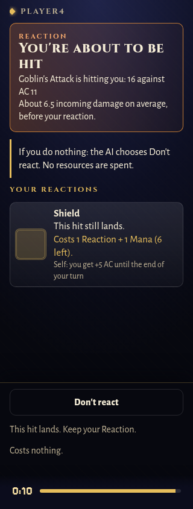
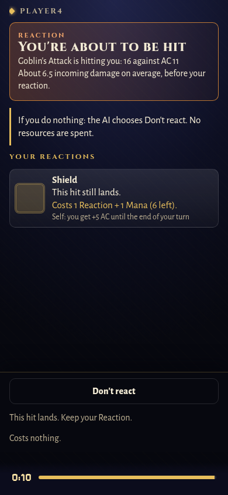

# Reaction decisions — #171

The phone's ten-second reaction prompt now states each option's immediate outcome and cost, including remaining resources or uses. It names the AI's planned timeout choice and explains the fallback when that choice becomes unavailable. For an incoming hit it shows expected immediate damage, explicitly labelled as an average. It does not reveal future dice rolls.

Defensive previews distinguish a hit turned into a miss, a hit that still lands, a critical hit, temporary-HP protection and halving. Shield's strict AC boundary is respected: a total equal to the raised AC still hits. Recasting the same AC condition does not promise that it stacks. Counterspell distinguishes automatic cancellation through tier three from a percentage check at higher tiers. Offensive reactions describe expected return damage without promising a hit or cancellation of the incoming attack.

The preview uses the existing AI effect maths on immutable state. The AI policy and battle rules stay unchanged. The incoming-hit calculation was extracted without changing it; only the explanatory preview accounts for reapplying an existing AC modifier. “Don't react” is shared by the phone options, timeout explanations, TV prompt note and public/development logs. The wire choice remains `pass`.

Validation: ten server cases cover Shield boundaries and criticals, existing Shield, resource costs, pure state/RNG reads, opportunity cost, halving and both Counterspell tiers. A phone case checks all decision data and verifies both reaction inputs. The real reaction fixture and development-log expectations were refreshed. Chromium at 320×844 and 390×844 confirms no horizontal scrolling, both reaction buttons visible without scrolling, and the original choice command when Shield is tapped. Screenshots use the real server fixture with a fresh ten-second deadline.

Full repository results are recorded in the PR after completion.

