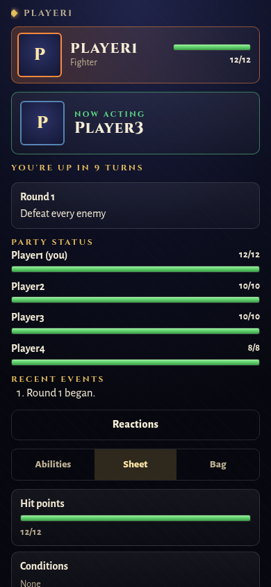
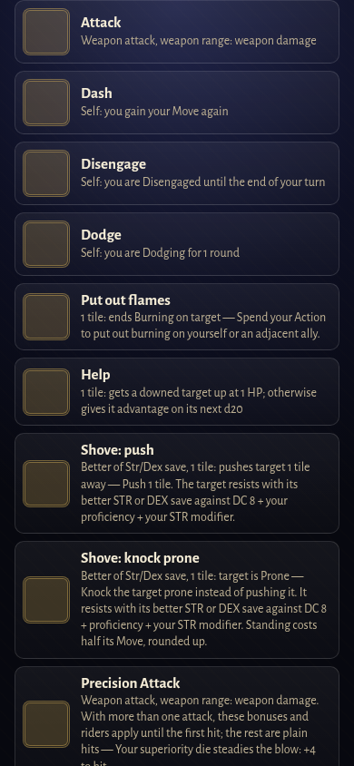

# Battle waiting screen — #166

Waiting phones now receive the current round, objective, party HP/conditions, acting unit, class and read-only ability/item descriptions before their first turn. They show the last three completed public battle events in chronological order. Turn distance explicitly says “turns”; no wall-clock estimate is invented.

The objective sentence is shared with the TV through `BattleObjectiveWords`, with the existing presentation API delegating to it. The waiting catalog does not enumerate targets, alter turn economy or execute commands. It includes known abilities even when they are currently unaffordable or out of range, so it supports planning. Current bag contents replace cached item descriptions. Recent events come only from the battle log, never future queued steps.

Validation: two adapter cases check first-screen data, descriptions without legal targets, the 64 KiB bound, live party HP and completed damage events. A phone case checks all panels and first-turn ability access without sending any command. Four existing server fixtures were refreshed; objective wording tests remain applicable. Chromium at 320×844 and 390×844 confirms no horizontal scrolling, party status visible on the first screen and abilities accessible without a previous turn.

Full repository gate results are recorded in the PR after completion.

