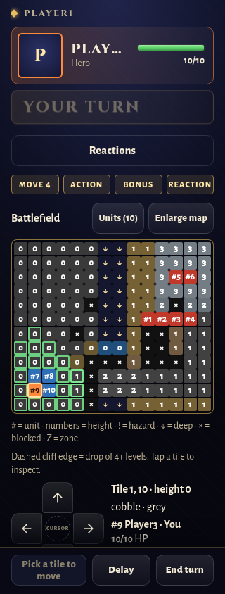
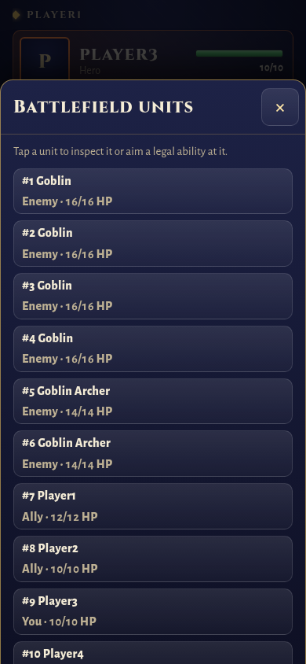
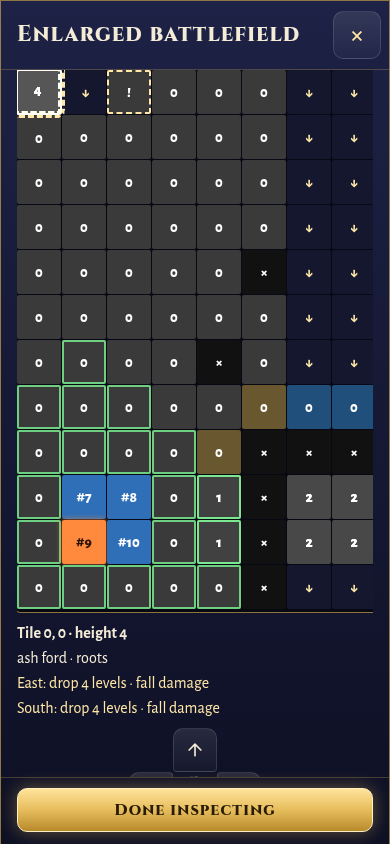
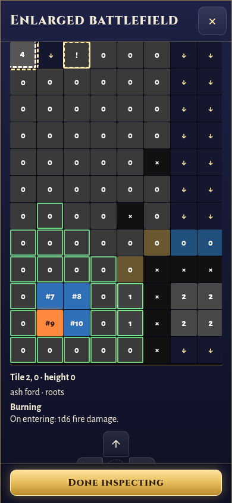

# Phone battlefield inspection — #170

Turn views now include a compact row-major snapshot of the engine's live terrain: heights, material indices, flags and active zones. Height changes, sunk ground, blocking props and difficult zones appear immediately, without waiting for a content-pack fetch. Zone details use existing effect descriptions, including side filters; healing zones are distinguished from damaging or obstructive zones. The static map loader remains a fallback for older packets.

The phone map uses numbered units and a matching roster with names, sides and HP. Two units sharing a tile are listed separately in inspection and the roster. A local target identity keeps the chosen unit distinct even when both names and positions match. Duplicate target names also carry their map number in aiming and the commit button. Numbers refer to the current roster, rather than claiming to be permanent character IDs.

Terrain numbers show height. Deep and blocked cells use distinct symbols, active hazards have an exclamation mark, other zones use Z, and dashed edges show differences over three levels. Selecting a tile shows its occupants, HP, material, height, drops, ground restrictions, effects and any server-supplied movement warning. This is inspection, not a prediction of a new move's damage. The normal map uses the full phone width; the enlarged map pans with 44×44 px cells. The d-pad remains available and stays inside the live map bounds.

From aiming, opening Units and choosing any legal unit takes two taps; including the ability selection takes three. For area effects, the shortcut chooses one of the server's legal aim tiles that affects the unit. Inspecting an illegal target clears the selection instead of silently retaining a different sole legal target. Browsing never sends a command; Use and Move still send the server-provided target or path.

Validation:

- Three adapter cases compare the snapshot against live engine terrain, check nested damage versus healing zones, verify read-only state, and check that a turn carries the snapshot directly.
- Existing level-10 tests retain their original 32 KiB choices bound and additionally check the terrain/units/choices packet below 60 KiB, reserving 4 KiB for settings and headers. All five size cases pass.
- Eight phone cases cover identical names, hazards/heights/deep ground/water, three-tap distant selection, overlapping units, illegal target inspection, legal area targeting, enlarged-map browsing and d-pad bounds. Existing multi-attack, hazard movement, turn-confirmation and phone cases pass (56 targeted cases).
- Five real server fixtures refresh only the added terrain snapshot.
- Chromium at 320×844 and 390×844 checks unclipped unit labels, no page-level horizontal overflow, roster selection without commands, 44 px enlarged cells, cliff/deep/hazard inspection and sheet closure. The cliff and hazard captures use controlled changes to the real fixture's terrain; server tests independently cover matching live changes.

The full repository gate passed all groups: Release build with zero warnings, 7,500 .NET tests, 582 phone tests and production build, 24 Node tests, 29 asset tests, 9 audio tests, 23 lore tests and lore/documentation validators. No tests were skipped. The final focused map suite also passes after strengthening the d-pad test to cover both minimum and maximum bounds. The existing retained-source asset inventory gap was repaired separately in PR #276 before the final full run.

