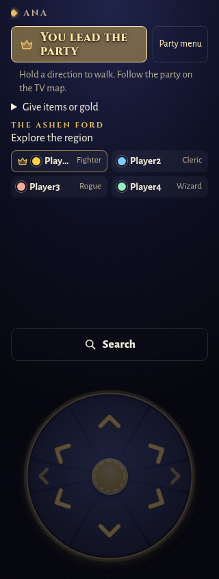
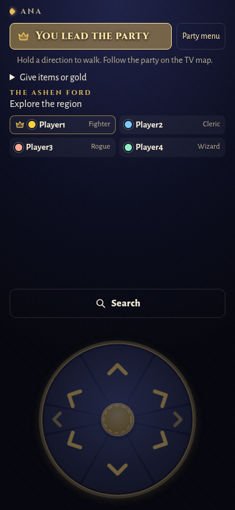
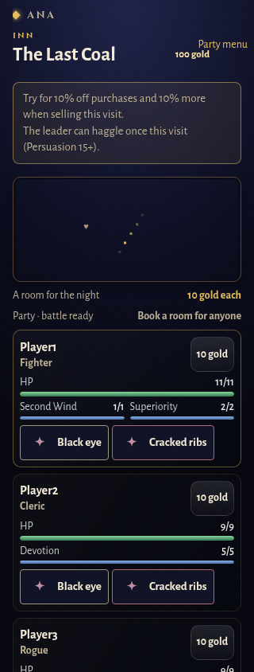
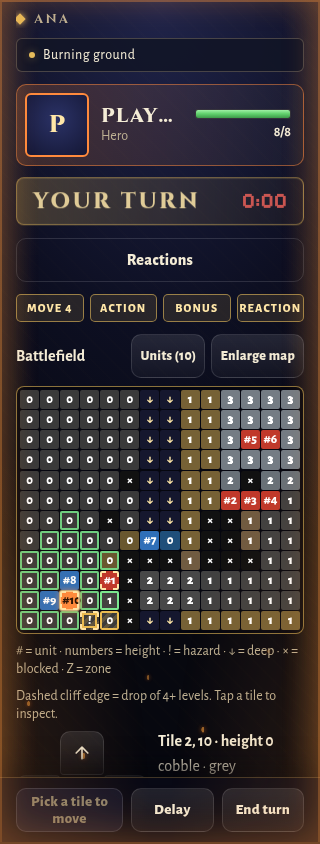

# Copy and glossary review — #176

The [glossary](glossary.md) records TV, VIP and leader roles, Party menu, Don’t react, End turn, Carry on, Concentration and shop stock wording. User-facing phone and server sources contain no bare “Watch the TV.” fallback, conc. tag, dots menu, ambiguous host fallback, “lets it go” or “Next battle” label. Internal action identifiers are unchanged.

Chromium checks at **320×844 and 390×844** cover walking, recovery, battle abilities, results and passive choices (14 fixture/width combinations). The visible Party menu and all ability tags stay inside the viewport; tags render at least 14 px and no checked fixture has page-level horizontal overflow. The existing pre-turn class data and shared Don’t react label are retained. Updated dialogue and walking regressions check the contextual prompts.

This is browser and source review, not a human usability or physical-TV test. The full repository gate is required before merge; its final totals are recorded in the PR.
