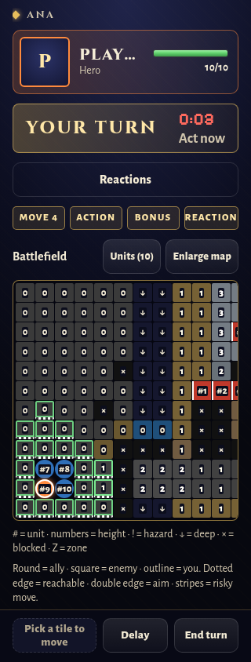

# Final phone accessibility audit — #177

**64 Tactics fixtures × 2 phone viewports = 128 passing audits** at 320×844 and 390×844, including all four between-session fixtures. No fixtures were omitted. [Machine-readable results](audit.json) retain per-fixture totals. The run sampled **9,673 visible text lines across 218 scroll states**. There are zero text-size, target-size, axe contrast, screenshot-background contrast, mobile viewport expansion or page overflow failures.

The sweep raises metadata to at least 13 px (ability tags remain 14 px), keeps disabled/spent text readable, enlarges text links and summary targets, and gives normal map cells at least 24 px with horizontal panning plus the existing 44 px enlarged map and d-pad. Roll/advantage results wrap at narrow widths. Both authored character-look previews are preserved; their caption moves below them instead of expanding a mobile viewport. Between-session headers wrap. Terrain reflections are confined to the screen rim, and the sticky footer no longer casts a shadow over nearby text. Completed quest text now has stronger contrast.

The turn clock keeps its numeric time and adds **Act now** then **Time up**, including with reduced motion enabled. A unit regression advances from three seconds to expiry. An actual Chromium check at 320×844 verified both text cues and computed `animation-name: none`. Existing reduced-motion behavior remains supported.




Reproduce with Vite running, Playwright/Chromium, axe-core and pngjs available to Node:

```sh
AXE_PATH=/path/to/axe-core/axe.min.js node tools/tactics-playtest/phone-accessibility.cjs http://localhost:5174 /tmp/audit.json
```

The tool serves the shipped content pack to the browser, waits for fonts/art to settle, audits every fixture with axe, checks computed text and target sizes, and scrolls both axes. For gradients and textured panels it captures backgrounds with glyph paint temporarily hidden, then computes WCAG relative-luminance contrast against the text colour/opacity at visible text-line samples. Clipped/occluded portions are checked when scrolled into view; they are not sampled against unrelated borders or covering panels. CSS mobile viewport width must match the requested device width, so horizontal overflow cannot silently scale text down. The optional `FIXTURE` environment variable is for focused diagnosis; it was unset for the retained 128-case run. This is an automated fixture audit, not certification of every possible content combination or a human usability test.

The production phone build also splits the renderer’s existing shared Three.js core boundary: flyover is about 382 kB and the core about 162 kB, both below the existing 500 kB warning threshold. No warning threshold was raised. Chromium loaded the production phone entry and rendered the title flyover without JavaScript errors. Full repository gate totals are recorded in the PR before merge.
