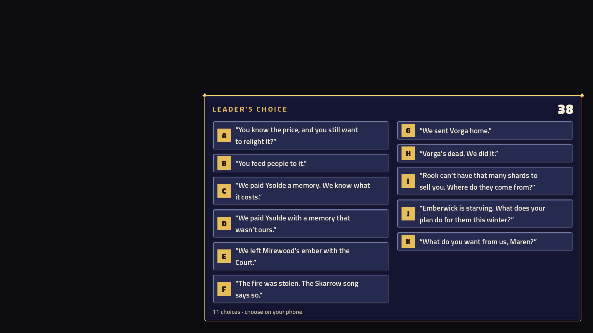
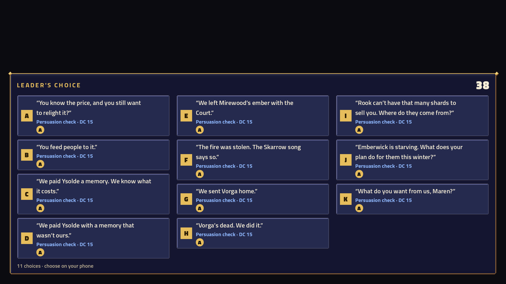
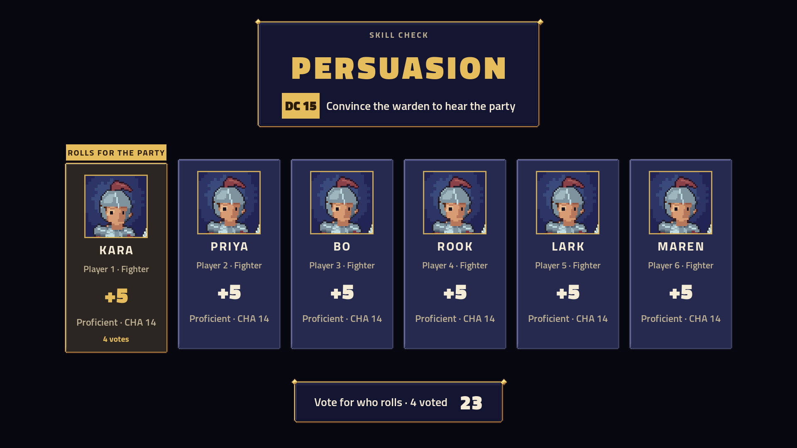

# TV typography — #168

The 1920×1080 Tactics interface now enforces **20 px minimum metadata**, with **24 px vote options and check explanations**. A Tactics-only typography helper covers existing host labels and story text, including shop, recovery, camp, reaction prompts and settings. Custom-drawn turn-strip headers/names and world labels also use at least 20 px. Recovery meters were already 24 px and stay there. Artwork, effects, voices and rules are unchanged.

Votes retain scale 1. They add a second or third column when needed; voter pips sit below the words, so votes cannot squeeze decision text. The height budget is 840 px, leaving space below the top HUD in a 1080p viewport. Character wrapping remains intact. The existing eleven-option test now requires full size and multiple columns, with an added dense detail/voter stress case; the complete 57-case story-screen suite passes, including every question in the shipped lore.

Native Godot captures use production VoteBoard and CheckBoard. The eleven-option scene uses Maren’s actual question. The dense variant deliberately adds a skill detail and voter to every option to stress layout; it is not a claim about that story’s rules. The six-hero check uses controlled characters and explanation strings. The capture asserts every visible Label is at least 20 px and entirely within 1920×1080. Native Debug build has zero warnings/errors. Successful capture logs contain only the renderer’s existing VSync/AA capability notices. No human sofa-distance or physical-TV test occurred.

Capture sources are retained as text to keep review scenes out of production. Copy them to `src/ArcBox.Host/TextReview.cs` and `.tscn`, update absolute pack/report paths, build the host, then run Godot under Xvfb at 1920×1080 with `--rendering-method gl_compatibility --audio-driver Dummy`. Remove the temporary files and rebuild afterward. Full repository gate totals are recorded in the PR before merge.
