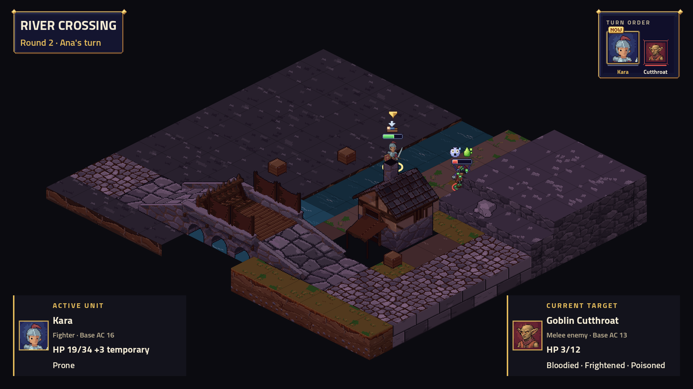

# TV active and target cards — #165

Both standalone and world-staged battles now draw active and current-target cards from the battle **as displayed**, rather than the newer server state. Each card includes its existing portrait, name, class or combat role, numeric HP/max HP, temporary HP, and named conditions. Bloodied is named at half HP. Armour is explicitly labelled **Base AC**, so situational bonuses and cover are not misrepresented as part of the base stat. Card metadata is 20 px; HP is 26 px and conditions are 24 px.

Target cues follow the action as it starts and follow retargets, resolved attacks, damage, healing and condition changes. They carry no engine command and add zero playback time. A regression queues a second target before the first impact and verifies that neither future health nor the future target leaks into the displayed cards. All 59 playback tests pass.

The production HudLayer/UnitCard and BoardCanvas rendered this 1920×1080 capture in native Godot with the actual content pack. The controlled scene has temporary HP, multiple conditions and a bloodied enemy. An additional native assertion moves the unit bounds under the card and verifies the existing BattleHud.Covers fade (alpha 0.45). Card text wraps rather than extending beyond the panel. Native Debug build: zero warnings/errors. Software rendering emits the existing VSync/AA capability notices; no application errors occurred in the successful capture. This is not a physical-TV or human usability test.

The capture sources are retained as `.txt` files to keep the temporary review scene out of the shipped assembly. To reproduce, copy them to `src/ArcBox.Host/CardReview.cs` and `.tscn`, update the absolute pack/report paths, build the host, and run the scene with Godot under Xvfb at 1920×1080 using `--rendering-method gl_compatibility --audio-driver Dummy`. Remove the temporary files and rebuild afterward. Full repository gate totals are recorded in the PR before merge.
