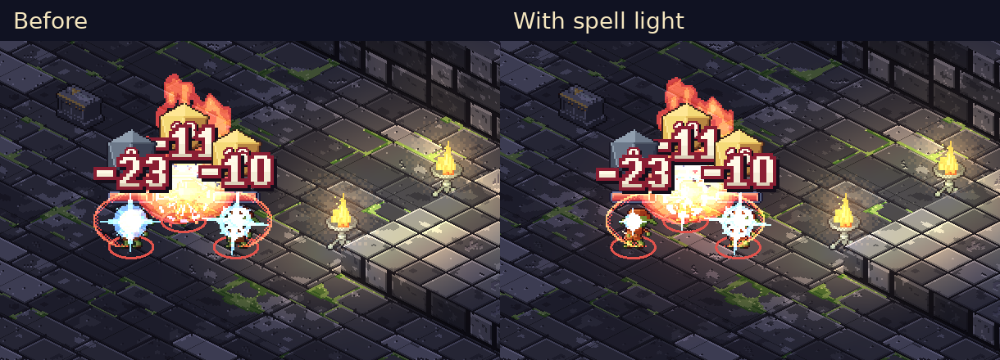
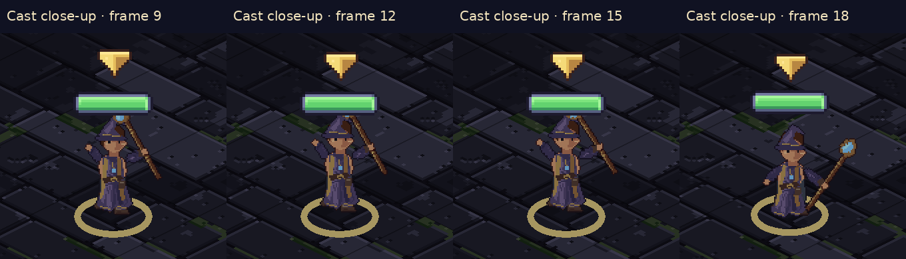

> Status: shared step 0 preview for owner review. No class art work, step 0 PR or checklist approval yet. CI remains manually disabled.

# Shared combat toolkit and spell lighting

[Open the gallery](index.html) · [Contact sheet](contact-sheet.png) · [Fire-light detail](fire-lighting-detail.png)

Fire now lights nearby floor, walls, props and figures. The light follows the projectile, spreads along luminous beams/cones, fades with the burst, and remains on persistent spell fire between turns. Force, lightning, frost and holy magic have suitable colours; ordinary arrows, dust, poison and silver weapon trails stay unlit. Small impact sparks no longer wash out fire's warmth.

The shared player adds local impact feedback, exact rules-derived area telegraphs and linked camera framing. Cast frames play during the close-up, then the camera pulls back to the target or area and settles. Full/Short/Off cinematics and Full/Reduced effects are on the TV's Battle settings button (F6). Auto selects Short for five/six heroes. Reduced removes flash, hit-stop and shake and shortens visual tails to 60% duration.

## Reproduce and inspect

Run `bash tools/tactics-fx-preview.sh step0`. The frozen before is main `9a7ffb54`, with only the neutral fixture/entry/capture harness backported; no renderer, effect, settings or camera implementation is backported. [baseline.json](baseline.json) lists those paths.

Captures use Xvfb, Dummy audio, the real rules engine, normal BeatPlayer/TV rendering, 1920×1080, fixed simulation 60 fps, screenshot capture 30 fps, the same low preset, map and seed. Each 1920×540 comparison video uses nearest-neighbour scaling; the poster retains both full-resolution captures. Videos preserve their actual pacing, and posters align the impact.

| Ability | Before / Off | Full | Short | Reduced with Full |
|---|---:|---:|---:|---:|
| Attack | 0.45 s | 0.45 s | 0.45 s | 0.45 s |
| Fire Bolt | 0.67 s | 0.67 s | 0.67 s | 0.67 s |
| Magic Missile | 0.82 s | 1.42 s | 1.42 s | 1.42 s |
| Fireball | 0.98 s | 1.90 s | 1.60 s | 1.90 s |

Times are actual shown acknowledgements at 60 fps, including frame quantisation. Reduced changes visual duration; its acknowledgement timing follows Full. Full cut-ins budget 0.9 s extra, Short 0.6 s, Off zero. Heavy-hit feedback adds no script time. A real manual Counterspell test also checks that the parent frame stays held across the reaction wait and the final acknowledgement follows settle.

## Measured budgets

Frame measurements disable all screenshot readback/encoding. Each number is the median of three per-ability frame medians, after warm-up, including the effect tail. The `--perf` overlay is enabled; its fixed-fps delta readout is supplemented by Stopwatch wall-frame measurements in [performance.json](performance.json).

| Ability | Before ms | Full ms | Change |
|---|---:|---:|---:|
| common.attack | 20.65 | 22.12 | +7.1% |
| wizard.fire_bolt | 20.65 | 20.30 | -1.7% |
| wizard.magic_missile | 20.59 | 20.79 | +1.0% |
| wizard.fireball | 20.29 | 21.09 | +3.9% |

The largest median change across all four after modes is **8.5%**, within the 10% container limit. The software renderer runs around 20–22 ms here. The real-hardware 16 ms requirement still needs the owner's TV/hardware check.

Recorded texture memory at the last sample: **125.28 → 125.59 MiB (+0.30 MiB)**, including UI/font caches; [snapshots](texture-memory.json). Added game-art texture files: **0**. Shipped content tree growth: **86 bytes**, all in the optional cut-in schema. No art/audio assets or paid generation were added; preview media stays outside the shipped content pack.

The real-engine six-hero level-1 Chapter I river crossing, default loadouts and companion AI, seeds 1–10, covers 30 completed rounds. Actual BeatPlayer playback at 60 fps adds at most **3.02 s with automatic Short, 3.32 s with explicitly Full, and 0 s with Off**. [Round measurements](round-budget.json) also contain the ideal-clock values (3.0/3.3 s). These are bounds for that fixture, not a universal cap. **Owner decision: choose the round budget; 3.6 s is proposed.** A universal per-round cap has not been selected/enforced.

## Close-up art and class fixtures

Existing `point` has four frames at 12 fps; `summon` has seven at 9 fps. The close-up exposes the shared hand gesture and sparse gathering/recovery poses. Class passes should add distinct two-handed gathering/aim frames, a readable release, and recovery holds through the existing character pipeline/anim-remap. Unit sprites have not been redesigned in step 0.

`--fx-demo=class[:abilityId]` now inventories every class/subclass choice, minimum unlock level, passive/static kind, current keys and cut-in tier. Single targets, clusters, injured/downed allies and real defensive reactions have fixtures. Class reels fail with a complete gap list when a visible proc or reaction lacks its required real trigger; they cannot silently omit it. Additional class-specific trigger fixtures must be completed in that class's pass before its capture can succeed.

The pilot fixture test covers every Wizard ability and visible proc, and the native TV renderer completed **49 beats** (47 abilities, one visible passive, plus the ordinary attack), including all three subclasses and real Shield/Counterspell responses. [Inventory](pilot-inventory.json) · [Native smoke metadata](pilot-reel-smoke.json). This verifies the reusable tool and existing content, not Wizard art completion. Static modifiers are inventoried without standalone clips. Long lingering cues extend capture tails while the real shown timing stays unchanged.

## Verification and next boundary

The final full local check suite passes: 7,224 .NET tests with zero failures/skips and zero build warnings/errors; 549 phone tests plus production build; 24 Node tool tests; Python asset/audio/lore suites and documentation checks. Supplemental fixture and native-render checks cover the class tooling. Phone fixtures remain byte-identical to `9a7ffb54`. The Xvfb/compatibility renderer emits the same baseline VSync, screen-space-AA and shutdown ObjectDB warnings on before and after; captures have no rendering errors.

Gameplay rules, AI, balance and phone code are unchanged. Current source integrates the camera with both standalone and world-stage board transforms; the supplied visual reel is the standalone crypt. A world encounter/real-TV visual pass remains part of the owner check.

[#247](https://github.com/higharc91/ArcBox/issues/247) requires the owner's explicit step 0 OK before Wizard work. The checklist stays unticked until that OK, and no PR is opened before the owner sees the preview.
