# Meridian TV: screenshots and readability review (M4, Task 10)

**Date:** 2026-11-17. **Build:** branch `ccr-de425e76-4vxzw2`, the commit that adds this page.

**How these were made.** Each shot comes from the TV app in demo mode on Xvfb with software Vulkan (Mesa lavapipe), rendering at 1920×1080 or 1280×720. The command was:

```
godot --path src/ArcBox.Host --rendering-driver vulkan -- --meridian-demo=<scenario> --shots=<dir> --res=<w>x<h> --preset=low --audio-log
```

The demo mode plays a recorded four-player bot game and waits for the scene's own `presented` signals, as a real server does. The art packs had not landed, so every tile, crew member and token is a placeholder. M5 swaps them for art at the same metrics.

## The rules checked

These are the M4 plan's Global constraints.

| Rule | Result |
|---|---|
| Body text at least 28 px at 1080p | Pass: panel text 30 px, titles 40 px, the HUD banner 34 px |
| Labels at least 22 px at 1080p | Pass with one exception (below) |
| Every seat by colour **and** mark | Pass: the strip, the board and the Debrief show each seat's mark on its colour. Marks stay unique when names share an initial (P1 to P4 here) |
| Nothing secret on screen | Pass: the TV draws only the host view, built from what everyone may see. Spoken lines are covered by the secrecy sweep in `TillerLinesTests` |
| Whole-step scaling for pixel art | Pass: cells are 32/64/128/256 px only (logical 1080p; the engine scales the window) |
| No frame over 100 ms (software Vulkan; guards against redraw storms) | Pass without screenshots; see *Frame times* |

**The exception.** A compartment name whose longest word is wider than its 128 px tile drops below 22 px, to 18 px at the smallest. "Containment" and "Reclamation" are the cases. The alternative was clipping letters (an earlier run read "Containme Lab").

## Fixed during the review

- **A symbol covered the end of a compartment's name** ("Gymnasiu"). The symbol moved to the bottom-right corner.
- **Crew discs covered two-line names** ("Engine Room"). Crew now stand in the tile's lower third, and shrink when four or more share a compartment.
- **Every seat showed "B"** when names shared an initial (Bot1 to Bot4). Seat marks now extend until they're unique: B1, Sa/Su.
- **A fight didn't say who fought** ("4 against 2: hit."). It now reads "Brood attacks Player1". A seat is named by its player, a monster by its kind; the whole table sees a fight.
- **A dropped item showed as a grey "I".** It now gets its own glyph.
- **The card panel was a fixed 230 px tall,** even for one line. It now sizes to its text.
- **Room names were about 9 px on screen at 64 px cells.** Names now go inside tiles only at 128 px cells. Smaller than that, the presented compartment and the active seat's compartment get a 22 px callout.
- **A silent voice overran the server's fallback.** This was found before this review, in Task 8: each spoken beat waited its estimate plus 2 s. The grace is now 1 s, and a test checks the silent worst case for every presented event.

## Frame times

The median, 95th-percentile and worst frame over each demo, after a 3-second warm-up. Each figure comes from one TV running alone on a 4-core container with software Vulkan:

| Run | Median | p95 | Worst |
|---|---|---|---|
| Salvage Rights, 1080p, no screenshots | 31 ms | 37 ms | 72 ms |
| Salvage Rights, 720p, no screenshots | 18 ms | 22 ms | 59 ms |
| Salvage Rights, 1080p, with screenshots | 30 ms | 37 ms | 106 ms |

The worst frames with screenshots on are the screenshot readbacks. Two TVs sharing the four cores (the other capture runs) roughly doubled the medians. The scene redraws only when something changes: a new view, a camera ease, a beat animating, or a new HUD model. That cut nothing measurable here, where the renderer's per-frame cost dominates, but it will matter on a slow TV box. The plan's real target, 60 fps on the reference TV hardware, needs that hardware.

## 1080p

| | |
|---|---|
| 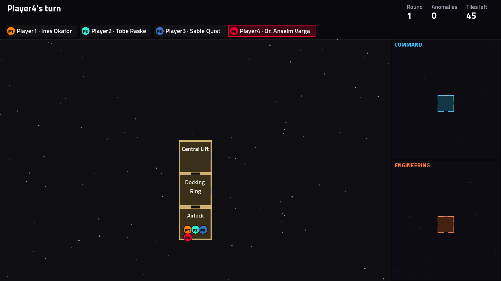 *Explore begins: the HUD, the seat strip, and the side decks framed on what's explored* | 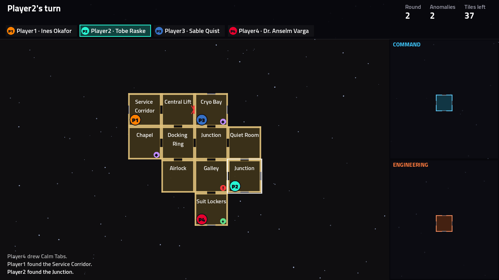 *A reveal at 64 px cells: the new compartment's name as a callout* |
| 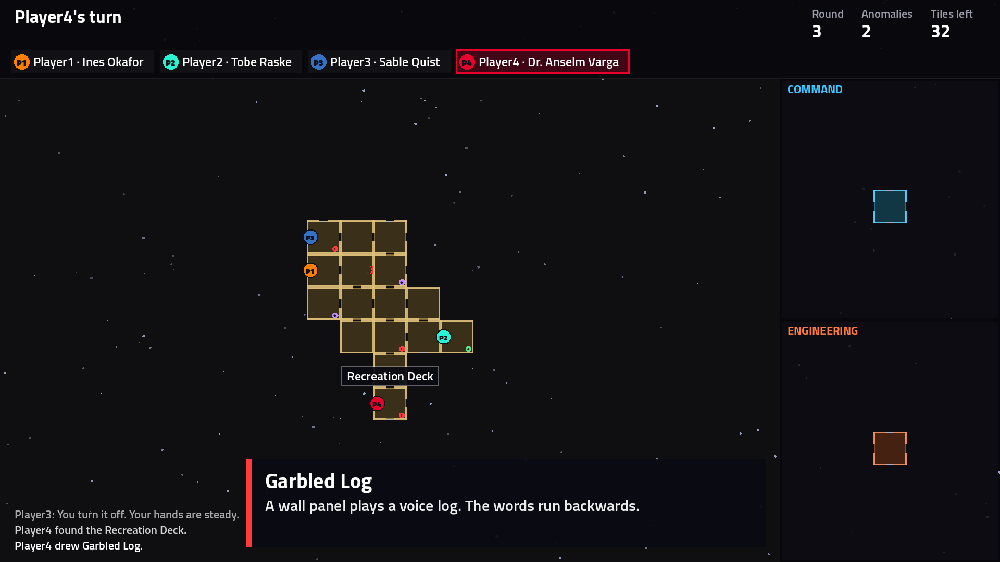 *An Incident card, read aloud by Tiller* | 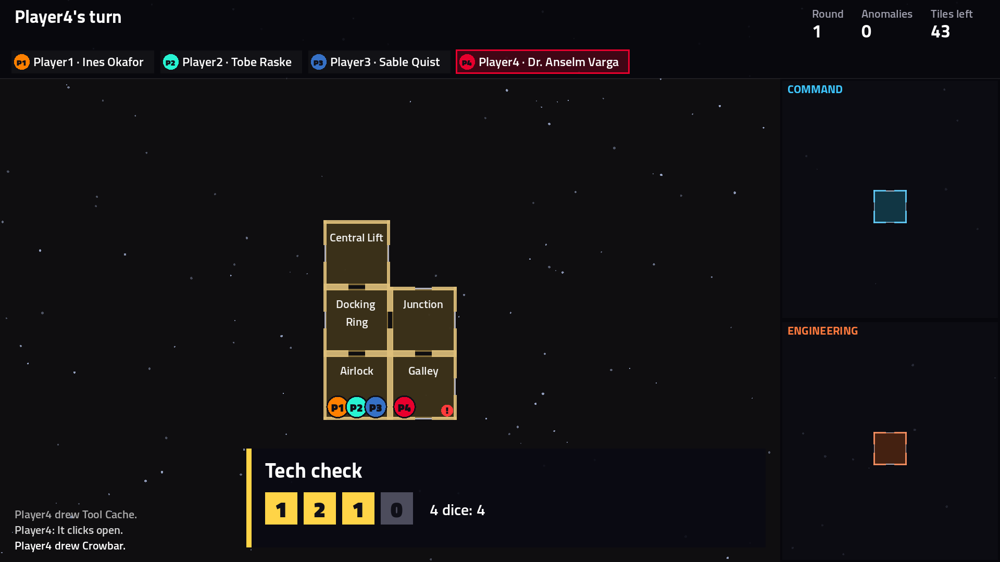 *The dice tray* |
| 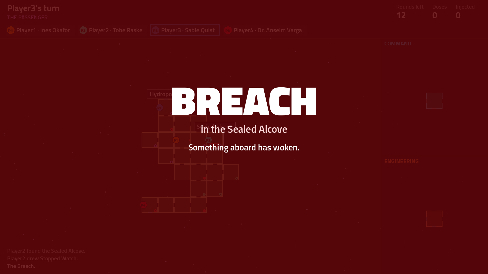 *The Breach: lights to red, and where it fired* | 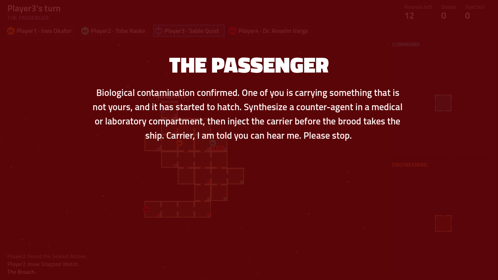 *The scenario and its public announcement* |
| 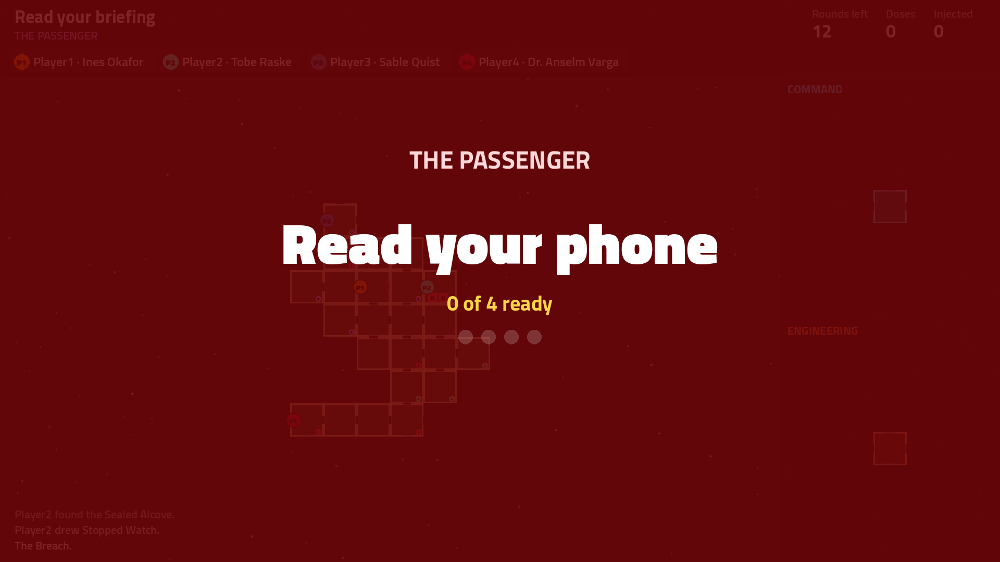 *Briefing: a ready count, never which seats* |  *A fight, naming both sides; brood tokens on the board* |
| 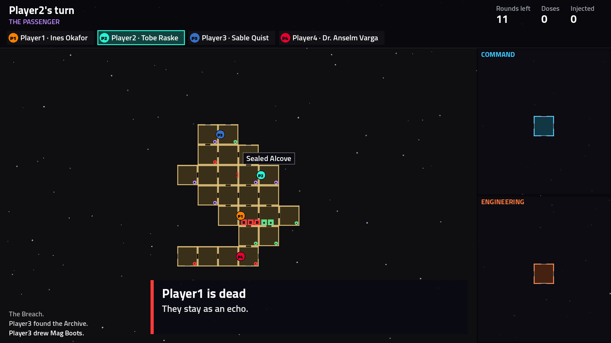 *A death: the dropped gear left behind* | 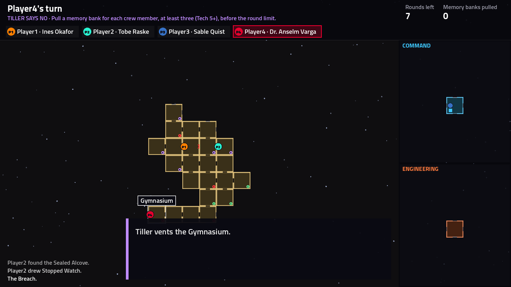 *A scenario notice (Tiller Says No)* |
| 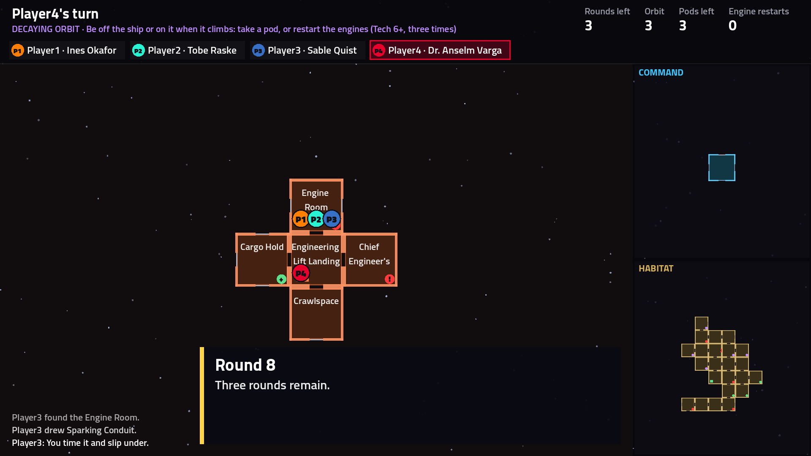 *A round warning (Decaying Orbit): pods, orbit and engine counters on the HUD* | 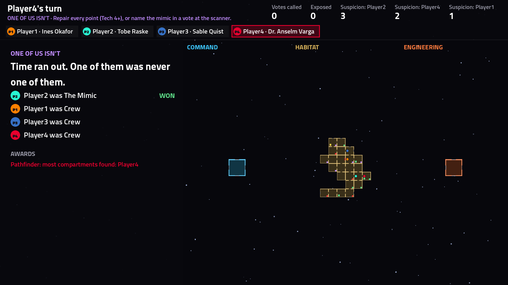 *The Debrief: the mimic revealed, the winners first, the awards and the whole ship* |

## 720p

The same layout, rendered at 1920×1080 and scaled by the engine.

| | |
|---|---|
| 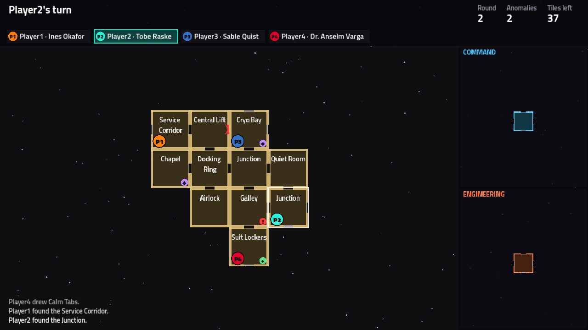 |  |
| 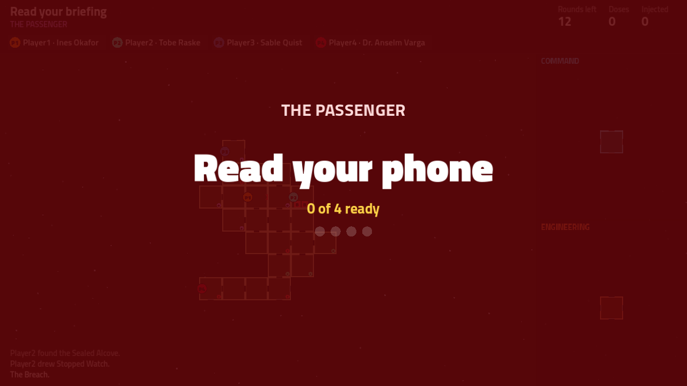 | 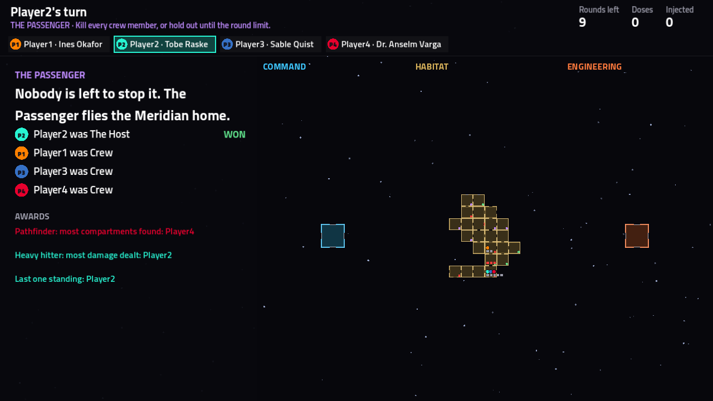 |

## For the first game night

These are things a person must judge that a screenshot can't:
- **Panel and voice timing on a real TV,** with the server's speech service.
- **The 3 m sofa test, and a Discord stream.** Check that the 64 px cell callouts and the side decks still read.
- **Whether the starfield's drift distracts.** It's slow, but it's the only motion on an idle board.
