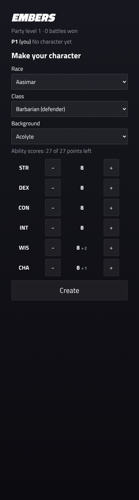
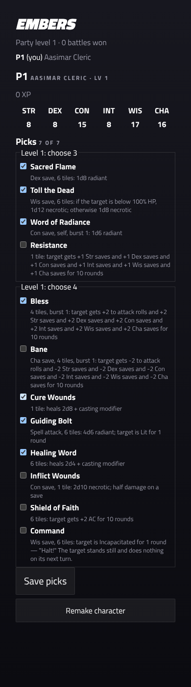

# ArcBox Tactics characters: design (sub-project 4a)

- **Sub-project:** 4 of the ArcBox Tactics breakdown: character creation and level-up in the portal. Milestone 4a covers the rules and the portal screen. The layered sprite composition in Godot is 4b, with the TV scene (3b).
- **Status:** built on `ccr-18ad4510-q68nad` on 2026-10-31 while the user was away. The decisions marked **(decided for the user)** below are open to change.

## What a player can do between sessions

The campaign portal (`/c/<code>`, Platform v2 §3.4) shows:
- the party;
- your character: its scores, picks, XP and injuries;
- what's waiting for you: a subclass to choose, or increases to spend.

The commands below go through `TacticsCampaignRules.Handle`. Each refusal comes back as the reason the player sees.

| Command | Data | Allowed |
|---|---|---|
| `createCharacter` | race, class, background, base scores | While you have no character, or yours hasn't earned XP yet **(decided for the user)**. Afterwards a character can't be remade |
| `setPicks` | the full set of picks | Any time between sessions, within the class's "choose N" features **(decided for the user**: a party game shouldn't punish a bad spell choice; the SRD only lets you swap at level-up) |
| `chooseSubclass` | a subclass of your class | From level 3, once |
| `spendIncrease` | one score (+2) or two (+1 each) | With increase points left: 2 at level 4, 2 more at 8. No score goes above 20 |

## The rules (`CharacterRules`)

- **Point-buy:** six base scores from 8 to 15. Costs are 0, 1, 2, 3, 4, 5, 7 and 9, with at most 27 points in all (rules-engine §3.1). The background's +2/+1 goes on top.
- **Picks:** checked by `SheetBuilder.ForCharacter` against the class and subclass's "choose" features (`PickRules`). A new character starts with the class's default loadout.
- **Feats:** not yet. The pack defines none. When content adds a feat list, `spendIncrease` gets a feat alternative.

## Level-up and banked choices

When the party levels up (adapter spec §6), every character keeps everything its player chose: race, background, scores, picks and subclass. Its picks gain the class's **default choices for the new slots**, so it's whole in the next battle, even for a member who wasn't there. Its owner can change those picks, choose the subclass and spend increases in the portal. That's how choices are "banked" for absent players (rules-engine §3.9).

This replaces the first adapter's level-up, which rebuilt every character as a default human of its class.

## Muster

A member who made a character in the portal plays it. Only a member without one picks a class at Muster, which gives the default character.

## Screens

| No character yet | A character |
|---|---|
|  |  |

## Testing

- **`CharacterTests`:** point-buy, increases and the cap, subclass timing, a level-up that keeps the character, every portal command including refusals, and Muster skipping members who already have a character.
- **`PhoneFixtureTests.Portal_views_match_their_fixtures`:** pins the portal JSON, which `tacticsPortal.test.tsx` renders. Those tests cover creation within the point-buy, the subclass, the increase, saving picks, and read-only during a session.
