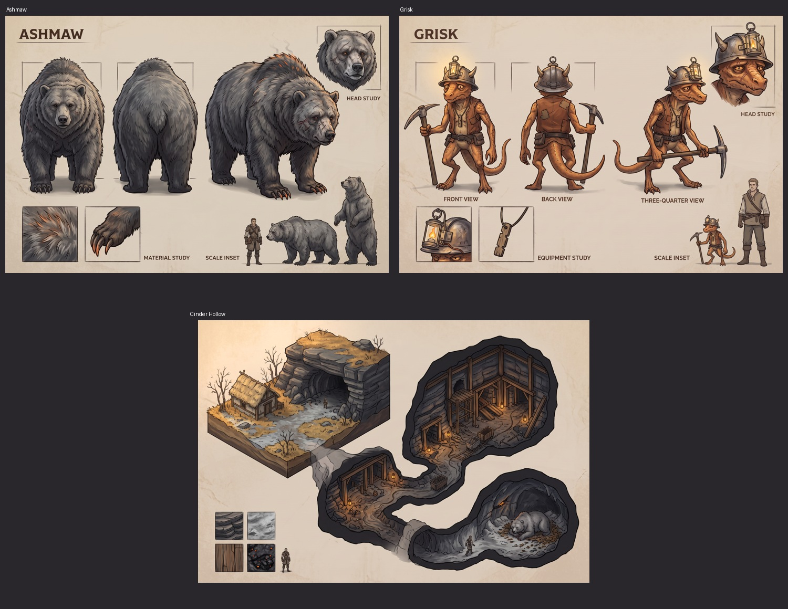

# Ashmaw bounty concepts — issue #74

Scenario generated these three production references on 2026-11-03 using the live-inspected Nano Banana 2.1 model. Ashmaw used the existing approved bear concept; Grisk reused Ashmaw's style and the existing kobold sprite; the Hollow reused Ashmaw's style. Requests, references, job IDs and asset IDs are recorded beside each image. The model exposes no seed parameter.

- [Ashmaw, full resolution](ashmaw-concept.png)
- [Grisk, full resolution](grisk-concept.png)
- [Cinder Hollow, full resolution](cinder_hollow-concept.png)

**Cost: 39 Scenario CU, 13 per image.** The owner approved both character concepts: “ok, both look good now for concept art.” See [approvals.json](approvals.json). The environment is a reference for existing Ashen Ford materials; it does not approve a new palette or generation of terrain and props.

PixelLab pilots are recorded under `../../pixellab/ashmaw/pilots/`. Final sprite integration requires a separate owner review of actual world and battle motion alongside the party. Review questions must display the relevant art.
