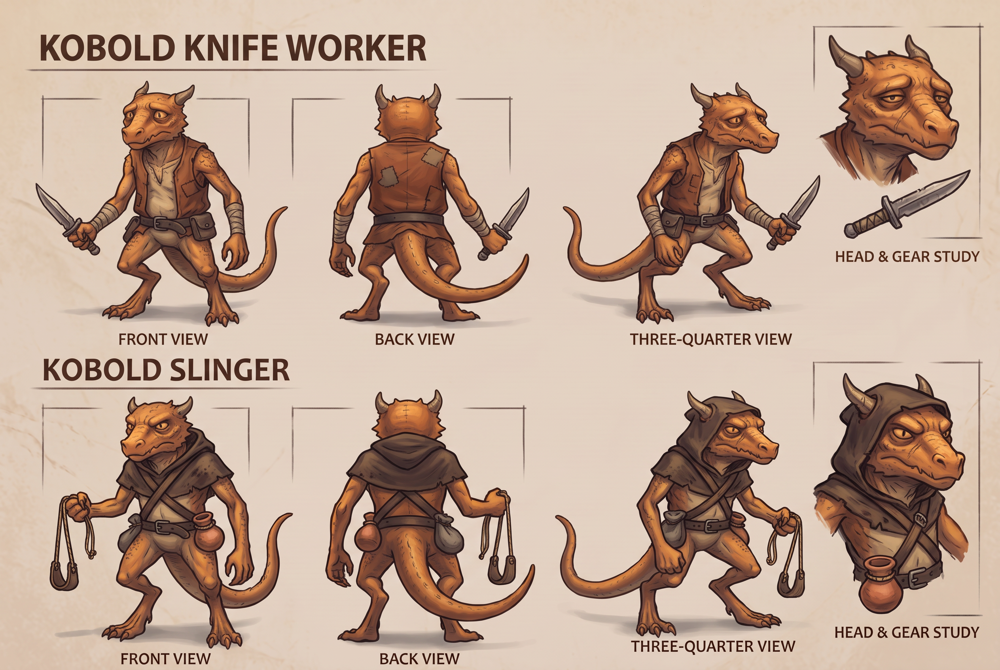

# Kobold crew refresh

Owner follow-up: overhaul the remaining kobolds so they belong beside the newly approved Grisk. The two shipped roles are `kobold` (dagger) and `kobold_slinger` (leather sling and fire pot). Combat roles and stats remain unchanged by this art follow-up.

Scenario Nano Banana 2.1 generated the shared sheet from Grisk's approved concept (`asset_TXx2ypS9LjXJ3uPfmPB353fr`). Cost: **13 CU**. Job `job_74r4jXVHiVRL9Vf99y1iD6KZ`, asset `asset_KjfNSxvbUAkbd9hz5CF7YyZE`. The model exposes no seed. Request, schema, estimate, result and source hash are retained here.

Both roles keep the same orange-brown reptilian anatomy, small horns, long tail, practical clothing and material rendering as Grisk. The knife worker has bare horns and a work vest; the slinger has a short cowl, a genuine two-cord sling and secured clay pot. Back-view belts and equipment wrap around correctly. Grisk retains his distinct foreman helmet, lamp and pick.

The concepts have been shown alongside the approval question. `approvals.json` remains pending until the owner responds. Next: matching PixelLab sprites with all eight facings, idle/walk/attack/hurt/death and the slinger's throw action, then actual world/battle motion beside Grisk before production replacement.
