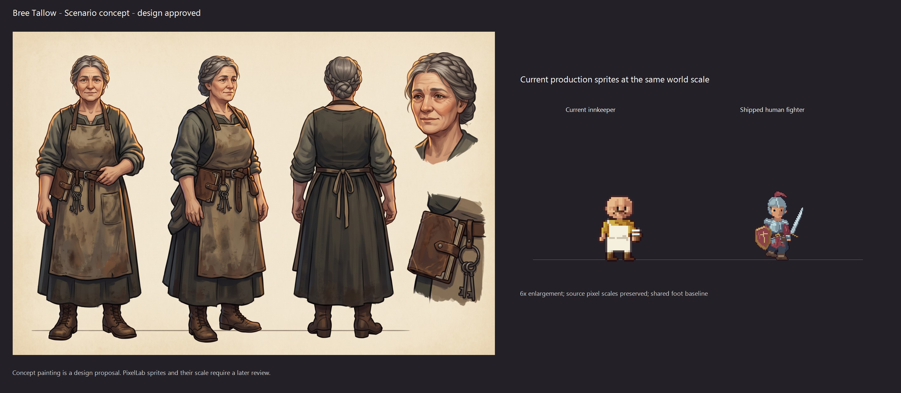
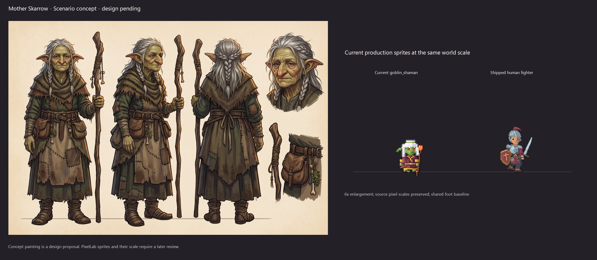

# Ashen Ford people — issue #80

Started on 2026-11-03 from main `2e64b9df`, on `townsfolk-art`.

The current region places **12 named NPCs** (including Rook) and **seven generic
townsfolk presets**: barmaid, child, farmer, farmhand, fisher, guard and merchant.
`briefs.json` reuses the existing named-character briefs and adds one brief with
two proposed variants for each generic preset. Mother Skarrow is included as a
named character; ordinary goblin presets retain their current creature art.

`node tools/tactics-assets/concepts/townsfolk/prepare.cjs` rebuilds this queue from
the placed people, refusing an unknown named brief or unauthored generic preset.
The source brief pack and the lore remain authoritative. Appearance choices are
proposals. No old NPC sheet has been replaced.

## First anchor: Bree Tallow

- Full-resolution output: [bree-concept.png](bree-concept.png).
- Exact input: [bree-request.json](bree-request.json).
- Job, asset and cost receipt: [bree-result.json](bree-result.json).
- **Scenario cost: 12 CU quoted and 12 CU charged**, authorized by the owner.
- Model: Nano Banana 2.1, 2K, one output. The live schema has no seed parameter.
- **Concept approved on 2026-11-03:** “yes, her design looks correct.” See
  [approvals.json](approvals.json). No PixelLab jobs have been submitted.

The anchor's front, three-quarter and rear views preserve her braided grey hair,
practical apron, boots and closed personal notebook. The rear has real apron
ties rather than a front buckle. The owner approved these design choices and
the sheet can now serve as the rendering-style reference for the remaining concepts.

`make-review.ps1` crops the first idle frame from the current production atlases
and builds the comparison. It reads frame sizes, foot anchors and tactical pixel
scale from the manifests. Both shipped sprites share a foot baseline and the
same 6x world enlargement. The concept is a painting; it is not evidence of a
finished pixel sprite's height or animation.

## Next steps and measurements

1. Bree's proposed design and series rendering style are approved.
2. The remaining 11 named sheets and seven paired townsfolk sheets are prepared
   in [batch-requests.json](batch-requests.json), using Bree's actual Scenario asset
   as the style reference. Every exact request was priced in a dry run:
   **18 sheets × 13 CU = 234 additional CU**, or **246 CU including Bree**.
   [batch-prices.json](batch-prices.json) records all 18 quotes. The dry runs spent
   no credits and submitted no generation jobs. The owner approved the full
   234 CU batch: “Approve the full 234 CU batch.” See `approvals.json`.
3. All concepts, including the child-B supplement, are approved on 2026-11-03:
   “yes, tthose look good. Proceed”. Prepare the Bree PixelLab pilot next.
4. Review idle, walk and named gesture motion beside the party on the real TV.
5. Integrate only approved sheets/portraits and optional placement variants.

`prepare-batch.cjs` refuses to build requests until the anchor approval is
recorded. `prepare.cjs` preserves approvals when rebuilding the queue and leaves
the submitted anchor's original request intact. The reference instructions copy
Bree's rendering language, while preserving each brief's own identity, species,
proportions and clothing. Approval of Bree does not approve the other designs or
their pixel animation.

## Completed concept outputs and reuse audit

Mother Skarrow completed successfully for **13 CU** using Bree's approved sheet
as its reference. Her front, three-quarter and rear views retain the staff, repaired
hide/wool, food pouches and grey hair. Her design is **approved by the owner**;
the eventual goblin sprite must retain its own species proportions and world scale.
The concept alone does not establish either.

The owner approved her design and asked to reuse existing concepts before resuming.
The audit found **Halden and Old Maud already in Scenario**, although their files
were absent locally. Their original images, prompt text and model/job metadata
are recovered in `generated/` with **zero additional CU**. `reuse-inventory.json`
also records older Bree/SkArrow alternatives and existing Maren/Stranger sheets
outside this batch. The selected owner-approved Bree and Mother Skarrow designs
remain authoritative. Exact-name searches alone missed these older concepts
because their prompts were stored as text-asset IDs; semantic image search and
inspection of those prompt records found them.

All **19 primary sheets** are saved: 12 named and seven paired generic presets.
The original paired child sheet supplied only the second child's face; a **9 CU
1K supplement** completes that same child's three body views from the existing
face reference, without rerolling the primary sheet. See
[the complete review index](review-index.md) for four contact pages, individual
comparisons, full-resolution originals and the child supplement.

Two complex requests (farmhand and guard) each failed twice at the provider's
output-token limit without producing assets. After a wider-layout retry also
failed, simpler **1K front/rear studies** completed for 9 CU each. The other
primary sheets are 2K. Requests and all failed-attempt receipts remain available
under `failures/`, `recovery/` and `resolution-recovery/`; no completed concept
was regenerated. Scenario's usage ledger reports four refunds, and its net
consumption agrees with successful output receipts (`billing-final.json`).

- Approved batch: **209 CU of 234 CU used**, including the child supplement.
- Including Bree: **221 CU net**, with **25 CU authorized but unused**.
- `verified-inventory.json`: dimensions, SHA-256 hashes, asset IDs, reuse status
  and costs for all 19 primary sheets and the supplemental views.
- `resume-batch.cjs`: **zero missing sheets**, with existing images, results,
  recovered assets and outstanding jobs excluded from generation.
- **All 19 primary designs and the child-B supplement are approved.** Approval
  evidence and selected asset IDs are in `approvals.json`. The first
  [Bree PixelLab pilot](../../pixellab/townsfolk/README.md) is underway: four static
  candidates and one short idle study, with no production integration.

## Visual review notes and remaining work

1. **Owner concept approval complete:** the displayed faces, ages and silhouettes
   are approved. Several adults share grey hair/braided silhouettes with the
   anchor; preserve the selected designs without making new lore claims.
2. **Paired sheet coverage:** barmaid, farmer and merchant distribute views across
   the two variants rather than giving each a complete three-view turnaround.
   Their two designs are visible, but missing angles must be checked during the
   approved PixelLab directional pilot. The second child's previously missing
   body has been completed separately. Farmhand and guard have front/rear 1K
   studies; these are design references, not shippable atlases.
3. **PixelLab and integration:** only after concept approval, build sprite pilots,
   idle/walk and named gesture loops, portraits, optional region variants and TV
   comparisons. Preserve each person's own scale, anatomy and identity.
4. **OW-05 and final checks:** used-only loading, the 512 MB gate and before/after
   download/memory measurement remain, followed by game/phone tests and live walks.

The concept inventory verifier passed; the resume generator reports zero missing
primary sheets; both review scripts ran and every contact page was inspected.
`git diff --check` passed. Game tests and runtime memory checks have not run:
this checkpoint contains concepts, comparison tooling and documentation only.

The owner set **512 MB maximum TV texture memory at region open** in issue #80's
follow-up comment. Full-party Ashen Ford must fail the work if it exceeds that
limit. Measure Ashen Ford and Cinder Hollow, cold pack download size, and used-only
loading before and after integration. The old board's 350 MB and 179 MB figures
are historical, not a fresh measurement of this main revision. A `--world-demo`
`--perf` check remains to be implemented with the loading work. No new memory,
download-size or game test results are claimed by this concept-only preparation.

## Later cloud loading checkpoint

The concept-only validation notes above describe that earlier checkpoint. The used-only loader and four-party 512 **MiB** gates are now implemented; current production and separate Bree review-pack measurements are in the [loading report](../../../../docs/superpowers/reports/2026-11-03-townsfolk-art/loading/report.md). All existing concepts and source frames were reused, and no additional concept or animation generation was submitted. Full Bree directional/TV approval and the remaining cast/portraits are still pending; re-run the gate after the final approved assets are installed.
