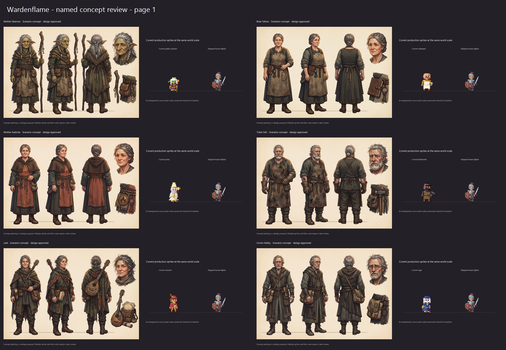
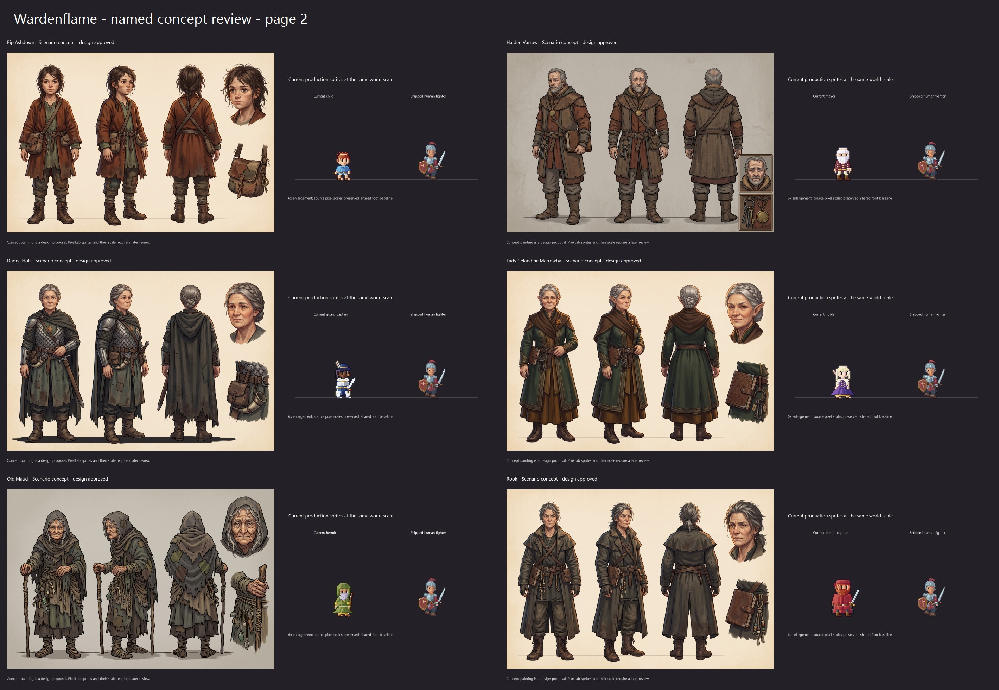
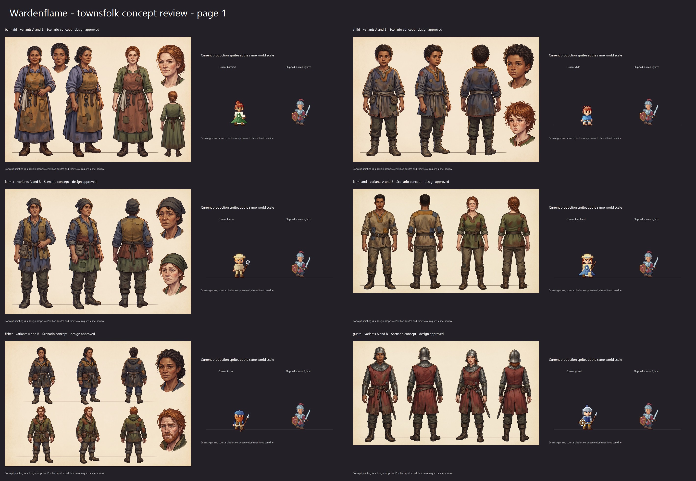
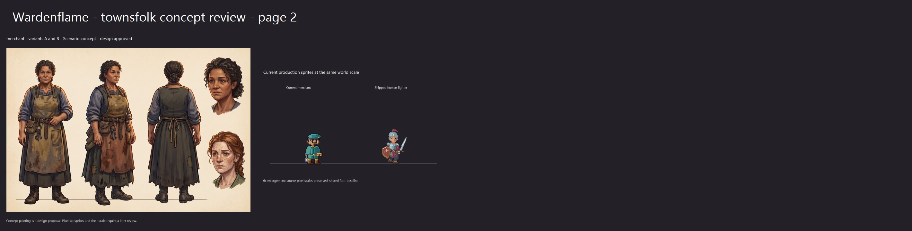
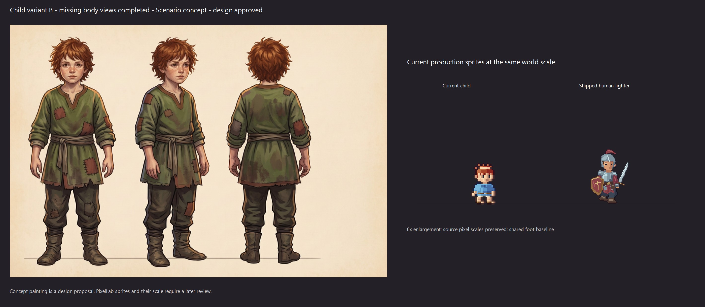

# Ashen Ford concept review

Concept designs require owner approval before PixelLab work. The comparison cards show current production people beside the shipped hero at a shared world scale.

- **Mother Skarrow** (approved): [comparison](character_mother_skarrow-review.jpg), [full concept](generated/character_mother_skarrow.png).
- **Bree Tallow** (approved): [comparison](character_bree_tallow-review.jpg), [full concept](bree-concept.png).
- **Mother Aubrine** (approved): [comparison](character_mother_aubrine-review.jpg), [full concept](generated/character_mother_aubrine.png).
- **Tobin Fell** (approved): [comparison](character_tobin_fell-review.jpg), [full concept](generated/character_tobin_fell.png).
- **Lark** (approved): [comparison](character_lark-review.jpg), [full concept](generated/character_lark.png).
- **Corvin Ashby** (approved): [comparison](character_corvin_ashby-review.jpg), [full concept](generated/character_corvin_ashby.png).
- **Pip Ashdown** (approved): [comparison](character_pip_ashdown-review.jpg), [full concept](generated/character_pip_ashdown.png).
- **Halden Varrow** (approved): [comparison](character_halden_varrow-review.jpg), [full concept](generated/character_halden_varrow.png).
- **Dagna Holt** (approved): [comparison](character_dagna_holt-review.jpg), [full concept](generated/character_dagna_holt.png).
- **Lady Celandine Marrowby** (approved): [comparison](character_celandine_marrowby-review.jpg), [full concept](generated/character_celandine_marrowby.png).
- **Old Maud** (approved): [comparison](character_old_maud-review.jpg), [full concept](generated/character_old_maud.png).
- **Rook** (approved): [comparison](character_rook-review.jpg), [full concept](generated/character_rook.png).

- **barmaid - variants A and B** (approved): [comparison](townsfolk_barmaid-review.jpg), [full concept](generated/townsfolk_barmaid.png).
- **child - variants A and B** (approved): [comparison](townsfolk_child-review.jpg), [full concept](generated/townsfolk_child.png).
- **farmer - variants A and B** (approved): [comparison](townsfolk_farmer-review.jpg), [full concept](generated/townsfolk_farmer.png).
- **farmhand - variants A and B** (approved): [comparison](townsfolk_farmhand-review.jpg), [full concept](generated/townsfolk_farmhand.png).
- **fisher - variants A and B** (approved): [comparison](townsfolk_fisher-review.jpg), [full concept](generated/townsfolk_fisher.png).
- **guard - variants A and B** (approved): [comparison](townsfolk_guard-review.jpg), [full concept](generated/townsfolk_guard.png).
- **merchant - variants A and B** (approved): [comparison](townsfolk_merchant-review.jpg), [full concept](generated/townsfolk_merchant.png).

## Child B body-view supplement

The original paired child sheet supplied only the face of variant B. This study completes the body views of that same character, using the original image as its reference. Its design is approved; pixel art still requires owner review.

