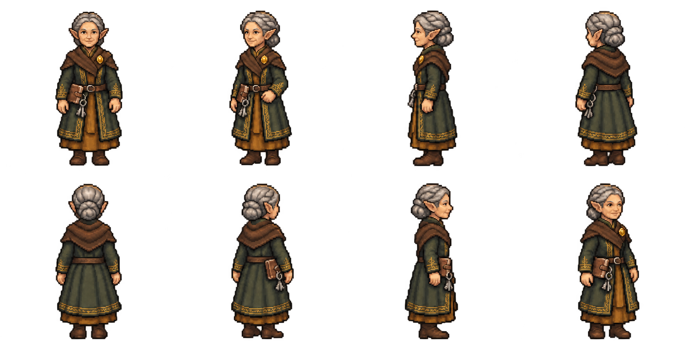

# Lady Celandine Marrowby — appearance and recorded voice draft

Approved concept reused for the first pixel appearance; no concept regeneration.
Eight planted views: south, southwest, west, northwest; north, northeast, east,
southeast. Mature cultivated elf, pointed ears, grey crown braid/lowbun, green
gold-edged wool layers over ochre, brown mantle, gold brooch, belt ledger and keys.

[Hear her existing recorded voice](voice-sample.mp3): “Of course you may.
Everything has a price. Shall we discuss yours?” Source/text/hashes are in
voice-sample.json. This is an MP3 compatibility transcode, not new speech.

The original had translucent cloudy backdrop; a retained cleanup removes it.
The northwest ledger/keyring should be occluded before preparing motion guides;
the cleanup did not resolve that equipment detail. Full native frame/palette/alpha/
body-size/anchor checks remain ahead. This is an enlarged appearance sheet,
not a production atlas. Approval applies to appearance before motion/portraits;
finished-set/TV approval remains separate. Nothing is installed in production.

Two image-tool calls, zero PixelLab calls/spend/purchases, zero new speech.
Exact requests/outputs/hashes are retained; cleanup input at its call-time path
candidate-1.png is archived as candidate-1-source.png, recorded in receipts.
