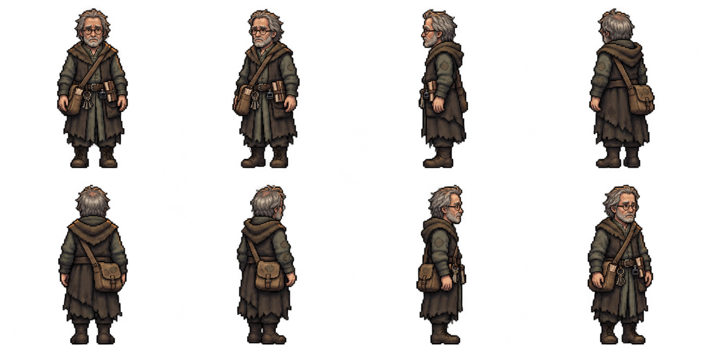

# Corvin Ashby — first pixel appearance review

The owner approved Lark's finished set and requested the next character.
Corvin is next in the approved named queue. His existing approved Scenario
concept is reused; no new concept or completed character art is regenerated.

Requested compass order: south, southwest, west, northwest; north, northeast,
east, southeast. Older lean working archivist, round wire spectacles, loose grey
hair and short beard, worried humane face, patched scholar layers and bare
ink-stained hands. Satchel and keys at anatomical right hip; notebooks and small
ink bottle at anatomical left. Simple strap crosses from left shoulder to right
satchel. No staff, hat, magic effects, armour or blacksmith tools.

`appearance-request.json` preserves the exact image-tool request.
`sprite-approval.json` records original generated path and input/output hashes.
One image-tool appearance call, zero PixelLab calls/credits. No monetary
image-tool price is inferred.

**Appearance approval is pending.** The enlarged sheet is not a native atlas.
Actual eight facings, equipment sides, logical grid, alpha, palette, body scale,
anchors and ground contact need native import QA. Idle/walk/talk and six portraits
come after appearance approval, with final full-set/TV approval before production.
Nothing from Corvin is installed in the game. Rules, balance and phone contracts
remain unchanged. Reuse all approved concepts and completed art.
