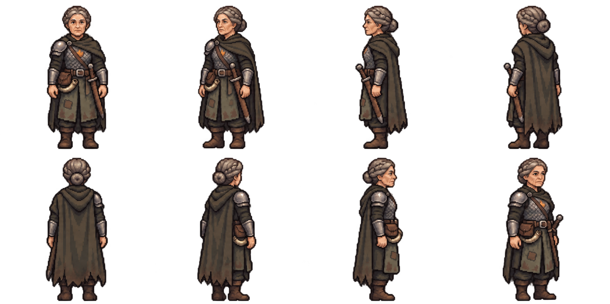

# Dagna Holt — first pixel appearance and recorded voice draft

Existing approved concept reused. The initial wrong southwest angle was corrected
before presenting the final candidate; both raw outputs and exact requests/hashes
are retained. No completed concepts or character art were regenerated.

[Hear her existing voice](voice-sample.mp3): “Don't tell me it'll be all right.
Tell me what we're doing.” This is a compatibility transcode of an existing town
bark, not new speech. Source/output hashes and text are in voice-sample.json.

Eight requested standing facings manually inspected: south, southwest, west,
northwest; north, northeast, east, southeast. Practical older woman captain,
grey crown braid/bun, worn scale mail/bracers, muted green surcoat/cloak, sheathed
sword left hip, pouch/horn right, prominent right shoulder pauldron. Native grid,
alpha, palette, body scale, anchor/equipment QA remains ahead. This is an enlarged
appearance sheet, not a validated native atlas.

Appearance approval is pending before motion/portrait generation; final full-set/TV
approval remains separate. Preset guard_captain, character dagna_holt. Nothing is
installed in production. Two image-tool calls (initial +angle correction), zero
PixelLab calls/credits/purchases; no image-tool monetary price inferred.
