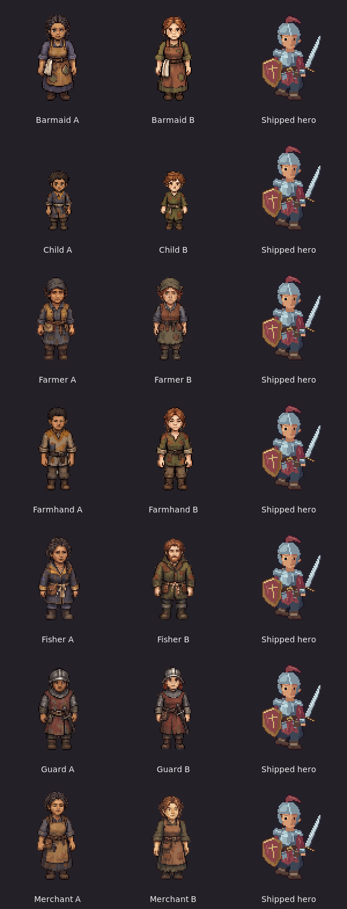

# Generic townsfolk — fourteen finished review sets

**Latest: owner-approved and installed.** Approval: “looks good, do whatever is next”.
All 14 reviewed atlases, 84 portraits and 28 placement variants are installed in
production. See [the installation report](../../../../../docs/superpowers/reports/2026-11-03-townsfolk-art/generic-installed/report.md)
and run `verify-installed.cjs` for the current production checkpoint. The
review-stage instructions and frozen isolation evidence below describe the
pre-installation checkpoint; pending-approval statements are superseded.


After integrating newer main, use `verify-integration.py` and the
[main integration report](../../../../../docs/superpowers/reports/2026-11-03-townsfolk-art/main-integration/report.md).
The older installation-only verifier targets the pre-integration baseline.

All seven approved concept pairs are translated into eight-facing pixel sprites:
barmaid, child, farmer, farmhand, fisher, guard and merchant. Each variant has two
native idle poses and four native walking poses per direction (48 source frames),
plus six 40×40 portrait moods. The children are 26 world pixels tall; adults are
36, matching the shipped human hero. No concept was regenerated.

**Historical preparation stage: finished-set/TV review, before production installation.** Issue #80
requires the owner to review the TV shots and “Stop for approval” before swapping
the production sheets. The owner's instruction to do the generic townsfolk
started this work; no approval of these new finished sets is inferred.



[Watch the complete labelled walk comparison](all-variants-walk.gif).
The hero remains standing as a scale reference; every civilian walking pose comes
from generated source art. No mirrored directions or synthetic motion frames.

| Preset | Variant A | Variant B |
| --- | --- | --- |
| Barmaid | [walk](barmaid_a/walk-review.gif) · [idle](barmaid_a/idle-review.gif) · [faces](barmaid_a/portraits-review.png) | [walk](barmaid_b/walk-review.gif) · [idle](barmaid_b/idle-review.gif) · [faces](barmaid_b/portraits-review.png) |
| Child | [walk](child_a/walk-review.gif) · [idle](child_a/idle-review.gif) · [faces](child_a/portraits-review.png) | [walk](child_b/walk-review.gif) · [idle](child_b/idle-review.gif) · [faces](child_b/portraits-review.png) |
| Farmer | [walk](farmer_a/walk-review.gif) · [idle](farmer_a/idle-review.gif) · [faces](farmer_a/portraits-review.png) | [walk](farmer_b/walk-review.gif) · [idle](farmer_b/idle-review.gif) · [faces](farmer_b/portraits-review.png) |
| Farmhand | [walk](farmhand_a/walk-review.gif) · [idle](farmhand_a/idle-review.gif) · [faces](farmhand_a/portraits-review.png) | [walk](farmhand_b/walk-review.gif) · [idle](farmhand_b/idle-review.gif) · [faces](farmhand_b/portraits-review.png) |
| Fisher | [walk](fisher_a/walk-review.gif) · [idle](fisher_a/idle-review.gif) · [faces](fisher_a/portraits-review.png) | [walk](fisher_b/walk-review.gif) · [idle](fisher_b/idle-review.gif) · [faces](fisher_b/portraits-review.png) |
| Guard | [walk](guard_a/walk-review.gif) · [idle](guard_a/idle-review.gif) · [faces](guard_a/portraits-review.png) | [walk](guard_b/walk-review.gif) · [idle](guard_b/idle-review.gif) · [faces](guard_b/portraits-review.png) |
| Merchant | [walk](merchant_a/walk-review.gif) · [idle](merchant_a/idle-review.gif) · [faces](merchant_a/portraits-review.png) | [walk](merchant_b/walk-review.gif) · [idle](merchant_b/idle-review.gif) · [faces](merchant_b/portraits-review.png) |

Directions in every action GIF: top row S, SW, W, NW; bottom row N, NE, E, SE.
Portrait moods: idle, hurt, happy / angry, sad, surprised.

## Actual TV review

The separate pack places alternating A/B variants on all 28 existing generic
people. Their positions, routes, barks, conditions and interactions are unchanged.
All twelve named people retain their installed art, including named Pip's child
variant. Existing legacy files are retained. The native software OpenGL screenshots
include the real four-member party:

- [Inn staff and square](native/town-views/shots/world-inn.png)
- [Market](native/town-views/shots/world-market.png)
- [Children](native/town-views/shots/world-children.png)
- [Fields](native/town-views/shots/world-fields.png)
- [Docks](native/town-views/shots/world-docks.png)
- [Guards](native/town-views/shots/world-guards.png)

## Import and validation

Each original `sprite-source.png` and exact `sprite-request.json` is retained.
The seven paired portrait outputs and requests are retained too. The first fisher
portrait sheet invented a long braid; it is explicitly rejected and the corrected
low-bun output is authoritative. The correction request and rejected source stay
available. Total: **22 image-tool calls**, no Scenario/PixelLab calls, no purchases
or upgrades. Image-tool pricing was unavailable; no monetary cost is inferred.
Existing approved concepts and the child-B supplement were reused.

The importer identifies 48 connected figures, fits one regular column grid per
direction, and uses one uniform scale for the whole character. It never recentres
or scales individual frames. Adult native height is 72 pixels and child height
52 at pixelScale 0.5, on 96×96 frames with anchor [48,84]. Atlases are 576×768,
1.6875 MiB RGBA each, with one shared 96-colour palette per character. All original
source pixels remain retained separately. Maximum vertical foot drift across all
sets is 2 world pixels; no output frame touches its canvas edge. Idle uses a short
blink/breath pose amongst held neutral frames. Generic barks retain idle fallback;
there is no invented combat or named gesture role.

`verify.cjs` checks production isolation, source/output hashes, frame dimensions,
binary alpha, unique eight facings and four walk poses per facing, all portraits,
and the three permitted cosmetic documents. Typed `verify-runtime.cs` checks the
real loaders, source rectangles, child/adult head lifts, all aliases, both variants
of every placed preset, and preservation of all named bodies. Both pass. The 38 existing WorldPeople presentation tests also pass; see
`presentation-tests.txt`.

The native editor build has **0 warnings/errors**; its person-variant check passes
native scene save/load, painted export and JSON round-trip. These checks use the
existing optional Variant field; no game/phone/renderer source changes are needed.
The production pack remains byte-identical to `facbaceb` (5,053 files).

## Measured memory and pack size

Same software OpenGL renderer, four actual party members, complete open/crossing/
party-change/party-restored runs. Strict `world-memory.cjs` verifies the 512 MiB
limit and eight human/elf hero texture uploads/releases. These are engine texture
memory measurements, not GPU timing benchmarks.

| Run | Open MiB | Peak MiB | Gate |
| --- | ---: | ---: | --- |
| Original Ashen Ford | 409.06 | 409.28 | PASS |
| Generic review Ashen Ford | 423.33 | 423.56 | PASS |
| Original Cinder Hollow | 208.41 | 208.41 | PASS |
| Generic review Cinder Hollow | 208.41 | 208.41 | PASS |

See each `native/*/memory.json` and its `tv.txt` for all four stages.
Uncompressed pack-file bytes: **217,274,314 before / 220,219,831 review** (+2,945,517).
This sums deployable content files, not HTTP transfer compression or the source
art/review tooling. The final production installation must repeat the runtime
and memory gates. No final integration or full game/phone-suite pass is claimed.

## Rebuild and continue

From the repository root:

```sh
npm ci --prefix tools/tactics-assets/imagegen/townsfolk
node tools/tactics-assets/imagegen/townsfolk/generic/build.cjs
node tools/tactics-assets/imagegen/townsfolk/generic/build-portraits.cjs barmaid child farmer farmhand fisher guard merchant
node tools/tactics-assets/imagegen/townsfolk/generic/build-contact.cjs
node tools/tactics-assets/imagegen/townsfolk/generic/build-pack.cjs /workspace/work/issue80-generic-review
node tools/tactics-assets/imagegen/townsfolk/generic/verify.cjs /workspace/work/issue80-generic-review
```

With `/workspace/.arcbox/activate.sh` active, run the retained `verify-runtime.cs`
against that review pack. `native-review.py` runs the existing TV renderer; invoke
`--pack /workspace/work/issue80-generic-review --name town-views` for screenshots,
or add `--mode perf` and a distinct name for strict memory gates; use
`--region cinder_hollow` for that region. Do not overwrite bound owner-reviewed
screenshots after approval.

`approval.json` binds the exact source/atlas/motion/portrait/TV review files.
The owner has now approved this batch and it is installed. For a fresh pre-installation baseline, record
the owner's quote and change its status to approved, then run
`install-approved.cjs` with the rebuilt review pack. It refuses pending approval,
changed review bytes or a changed production baseline before writing. It copies
only the 98 art files and three cosmetic documents. Revalidate production,
measure memory, and complete required game/phone checks. Work/push on
`townsfolk-art`; no PR, merge or issue closure unless requested.
