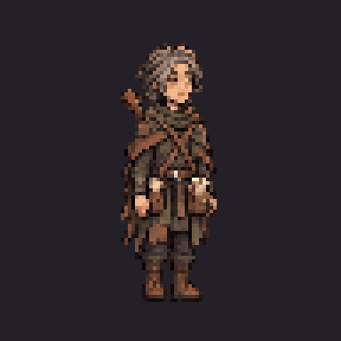

# Lark — completed image-tool review set

The owner approved the pixel appearance: **“Yes, looks great. Continue”**.
The owner then approved the finished set: **“Looks good, next”**.
The exact body and six portraits are now installed in production alongside Bree,
Halden, Aubrine and Tobin. The separate review overlay remains available. No PixelLab API call, credit debit, purchase or upgrade.

[Watch the 16.6-second finished review](lark-finished-review.mp4).
Actual sprite loops and portraits, ending with a **labelled native TV still**;
the reel is silent, and its closing shot is not live video footage.



[Eight-direction idle](lark-eight-direction-idle.gif),
[walk](lark-eight-direction-walk.gif), [talk](lark-eight-direction-talk.gif),
[standing views](lark-directions-review.png), [portrait moods](lark-portraits-review.png),
[native square TV](../../../../../docs/superpowers/reports/2026-11-03-townsfolk-art/lark-imagegen/world-songkeeper.png),
[2× square detail](../../../../../docs/superpowers/reports/2026-11-03-townsfolk-art/lark-imagegen/square-detail.png).
Directions: south, southwest, west, northwest; north, northeast, east, southeast.
Portrait order: idle, hurt, happy; angry, sad, surprised.

## Assets and curation

- Eight real facings and idle/walk/talk: **144 native frame slots** from143 selected
  source cells. The southwest talk clip holds its valid peak pose in one slot,
  replacing a raw pose with sideways foot drift. It does not invent a sixth pose
  or move individual frames to hide the problem. Raw sources remain unchanged.
- Atlas1728×768 / **5.0625 MiB RGBA**, frames96×96, anchor `[48,84]`, scale0.5.
  Adult body target72 native /36 world pixels. Do not apply this height to children
  or goblins. Idle/talk play ten indices over six slots; walk plays six once.
- `normalized/` contains each final frame; `rotations/` the final native facings.
  `directional/guides/` holds appearance inputs, not the completed runtime set.
- The approved instrument stays on the back, neck over anatomical right shoulder,
  pear body toward left lower back. Paper satchel left hip; scroll tube right hip.
  The rear concept defines the shoulder geometry where front/rear studies disagreed.
  Hands stay empty; no instrument-playing animation is implied by a talk gesture.
- The northwest source put a scroll tube on the near left hip. One image-tool edit
  corrects all18 poses to the paper satchel. A second edit repairs the south walk's
  repeated planted boot; only that six-frame row is imported. **119 unrelated
  native frames remain pixel-identical**, verified by `verify-preserved.cjs`.
- One regular source-column grid is fitted per direction from six idle-foot centres;
  one scale/offset is shared by all18 poses. No individual recentering or mirroring.
  The locked96-colour palette uses exact RGB-keyed nearest lookup, avoiding the
  reduced-colour bucket cache that changed unrelated ties in the Tobin trial.
  Runtime alpha is binary. Horizontal/vertical foot, bounds, height and motion
  checks pass; the front walk now changes both boot masks across its cycle.
- Six native40×40 portraits, common scale/offset, shared64-colour palette.
  Body keys: `characters.minstrel` / `characters.lark`; portrait aliases:
  `minstrel` / `lark`. No civilian attack animation.

`generation-receipts.json` records exact requests, input/output hashes and raw
original paths:11 completion image-tool calls plus the prior appearance call,
zero PixelLab calls/credits. No monetary image-tool price is inferred. Existing
approved concepts and other completed character art were reused, not regenerated.

## Reproduce offline

From the repository root with Node/npm and .NET10:

```sh
npm ci --prefix tools/tactics-assets/imagegen/townsfolk
npm run build-lark --prefix tools/tactics-assets/imagegen/townsfolk
npm run verify-lark --prefix tools/tactics-assets/imagegen/townsfolk
node tools/tactics-assets/imagegen/townsfolk/lark/build-receipts.cjs
node tools/tactics-assets/imagegen/townsfolk/lark/build-review-pack.cjs /absolute/external/lark-review
dotnet run tools/tactics-assets/imagegen/townsfolk/lark/verify-runtime.cs -- /absolute/external/lark-review
```

These are offline art utilities, not API/game/phone dependencies. The overlay
refuses unrelated destinations and never writes production. Unchanged content is
linked; never edit linked rules/content. Generated manifests and images are separate.
After host setup/build with Godot4.7.2 .NET:

```sh
ARCBOX_TACTICS_ART_ROOT=/absolute/external/lark-review \
  "$GODOT" --path src/ArcBox.Host -- --world-demo=ashen_ford \
  '--world-looks=songkeeper@29,58@32,61' --shots=/absolute/shots \
  --perf --res=1280x720 --preset=low --quit-after=150
```

Linux software Vulkan and Windows left-monitor/no-focus handling follow the
handoff/TV-host guide. Cloud memory results are not a hardware timing benchmark.

## Approval gate

Appearance and **finished-set/portrait/TV approvals are complete**.
Installation and fresh production checks are documented in the
[installation report](../../../../../docs/superpowers/reports/2026-11-03-townsfolk-art/lark-installed/report.md).
The earlier pending-state guard evidence below remains historical.
The approval record binds the finished review to15 exact asset/validation hashes
and its native TV screenshot. The guarded installer refuses appearance approval
alone, verified against the complete unchanged production inventory. After full
approval, install these exact assets, add strict Lark playback/portrait/stop-resume
cases and rerun production memory/cold-pack checks. Do not ask for appearance
approval again or regenerate completed art. No PR or merge.
[Report and receipts](../../../../../docs/superpowers/reports/2026-11-03-townsfolk-art/lark-imagegen/report.md).
