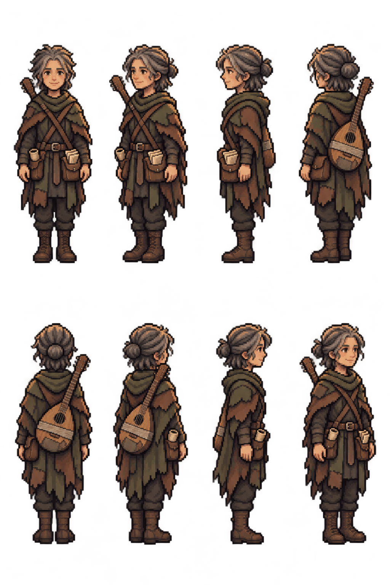

# Lark — first pixel appearance review

The owner selected Lark next and authorized starting the appearance pass.
The existing approved Scenario concept is reused; this is a pixel translation,
not a new concept. No PixelLab connection or credit spend.

Requested direction order: south, southwest, west, northwest; north, northeast,
east, southeast. Practical patched olive/brown travelling layers, hood down,
half-up hair bun, clean-shaven androgynous face, worn boots and song papers.
Hands empty, with the worn pear-shaped instrument carried on the back.

The concept's front and rear studies disagree on which shoulder the instrument
neck rises over. The prompt uses the **rear carry view** to define one consistent
geometry: neck over anatomical right shoulder, body toward left lower back.
Satchel/papers at anatomical left hip; scroll tube at right hip. This resolves
the angle mismatch without regenerating the approved concept. Equipment
handedness remains part of directional QA; do not silently mirror the sprite.

`appearance-request.json` retains the exact image-tool request. `sprite-approval.json`
records the original generated path, source/output hashes and current review state.
No monetary image-tool price is inferred. Completed Bree, Halden, Aubrine and
Tobin assets are reused, not regenerated.

**Appearance approval is pending.** This enlarged sheet is not a validated native
atlas. Check all eight facings, equipment, transparency, logical grid, palette,
adult scale, anchors and ground contact during import. Idle/walk/talk, six portrait
moods and the final full-set/TV approval gate remain ahead. Nothing is installed
in production, and rules, balance and phone contracts remain unchanged.
