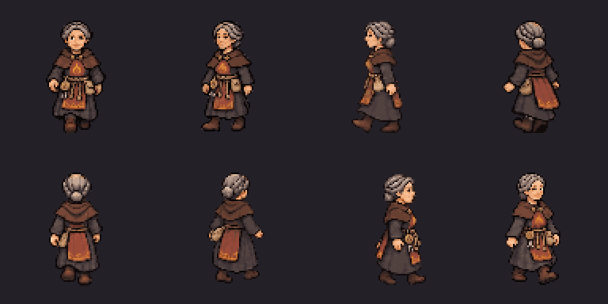
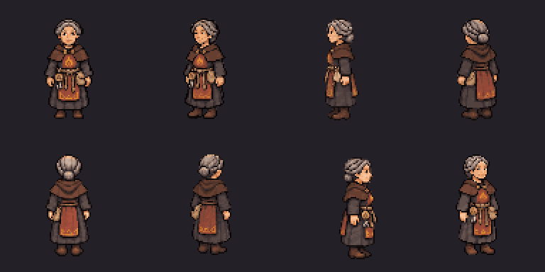

# Mother Aubrine — complete image-tool review set

The owner approved the appearance: **“Looks good, continue so we can she her finished”**.
Her complete directional/motion/portrait set is now ready for **final owner TV review**.
This is a separate review pack; production still contains approved Bree and Halden.
No PixelLab API call, generation debit, purchase or upgrade was made.

[Watch the 16.6-second review reel](aubrine-finished-review.mp4).
It shows real sprite loops and the six portraits, ending with a **native TV still**;
it is silent. The closing TV still is labelled, not presented as a live video capture.





[Idle](aubrine-eight-direction-idle.gif), [all facings](aubrine-directions-review.png),
[portrait moods](aubrine-portraits-review.png),
[native chapel](../../../../../docs/superpowers/reports/2026-11-03-townsfolk-art/aubrine-imagegen/world-chapel.png),
[2× native chapel crop](../../../../../docs/superpowers/reports/2026-11-03-townsfolk-art/aubrine-imagegen/chapel-detail.png).
Directions: south, southwest, west, northwest; north, northeast, east, southeast.
Portrait order: idle, hurt, happy; angry, sad, surprised.

## Assets and curation

- Eight genuine facings, six source frames each for idle/walk/talk: **144 frames**.
  `normalized/` retains each final native frame; `rotations/` contains the final
  idle reference in each facing. No direction is mirrored at runtime or in import.
- 96×96 frames, anchor `[48,84]`, scale 0.5, 18 slots per direction. The 1728×768
  runtime atlas uses **5.0625 MiB RGBA**. Bodies target 72 native / 36 world pixels.
  Idle/talk play the six frames out and back (10 indices); walk uses all six once.
- One uniform scale and translation per **whole direction**, shared across its
  18 poses. No per-frame recentering. Runtime alpha is binary; one shared locked
  96-colour palette keeps clothes consistent. All bounds, adult-height, unique-motion
  and ground-contact checks pass. Maximum foot-height drift is **one world pixel**.
- The left-profile token/keys error was corrected with the image tool. The visible
  left hip now has the cloth pouch; far-side right token/keys are hidden. The other
  **126 native frames remain pixel-identical**. Their completed native rows are
  retained in `directional/locked-native-rows.png` and reused rather than recoloured.
- Six native 40×40 portraits, with a common scale/offset and shared 64-colour palette.
  Portrait spacing was corrected before import, so neighbours cannot leak into a cell.
  The review pack supplies `priest` and `mother_aubrine` portrait aliases and body keys
  `characters.priest` / `characters.mother_aubrine` without changing lore or contracts.

Raw generated originals, exact requests, inputs/outputs hashes, rejected/uncorrected
sources and curation are retained. `generation-receipts.json` records 13 completion
image-tool calls plus the prior appearance trial separately. It records **zero PixelLab
spend**, not a claimed monetary price for the platform image tool. `directional/rotations/`
are the original input guides; use **`rotations/` for final native facings**, particularly
west, whose guide predates the equipment correction. The approved concept was reused;
no existing Bree/Halden concept, sprite or animation was regenerated.

## Reproduce offline

From the repository root, with Node/npm and .NET 10:

```sh
npm ci --prefix tools/tactics-assets/imagegen/townsfolk
npm run build-aubrine --prefix tools/tactics-assets/imagegen/townsfolk
npm run verify-aubrine --prefix tools/tactics-assets/imagegen/townsfolk
node tools/tactics-assets/imagegen/townsfolk/mother-aubrine/build-review-pack.cjs /absolute/external/aubrine-review
dotnet run tools/tactics-assets/imagegen/townsfolk/mother-aubrine/verify-runtime.cs -- /absolute/external/aubrine-review
```

The PNG/GIF packages are pinned **offline art utilities**, not PixelLab connections,
game dependencies or phone dependencies. No API credential is needed to rebuild.
The importer targets this **adult human**; do not blindly use its height for children
or goblins. The original concepts and species/age proportions remain authoritative.

`build-review-pack.cjs` refuses an unrelated existing directory. It links unchanged
production content read-only; never edit linked files. Its creatures/portraits
manifests and new images are separate files. Use Godot 4.7.2 .NET after building the host:

```sh
ARCBOX_TACTICS_ART_ROOT=/absolute/external/aubrine-review \
  "$GODOT" --path src/ArcBox.Host -- --world-demo=ashen_ford \
  '--world-looks=chapel@30,55@33,58' --shots=/absolute/shots \
  --perf --res=1280x720 --preset=low --quit-after=150
```

Linux software Vulkan flags and Windows left-monitor/no-focus handling follow the
existing handoff/TV-host guide. Do not call software render timings a GPU benchmark.
[Full report and receipts](../../../../../docs/superpowers/reports/2026-11-03-townsfolk-art/aubrine-imagegen/report.md).

## Approval gate

`install-approved.cjs` is prepared but **refuses appearance approval alone**. It
requires recorded complete-set/portrait/TV approval, verifies all approved hashes,
then installs only body/portrait images and manifest entries while keeping legacy
assets. Its pending-approval guard was tested against the full production inventory:
no file changed. Do not bypass this gate or ask for the already-granted appearance
approval again. After full-set approval, integrate and rerun the production asset,
portrait, talk/contact and 512 MiB gates; update exact per-character animation
expectations without weakening the existing Bree/Halden checks. No PR or merge.
