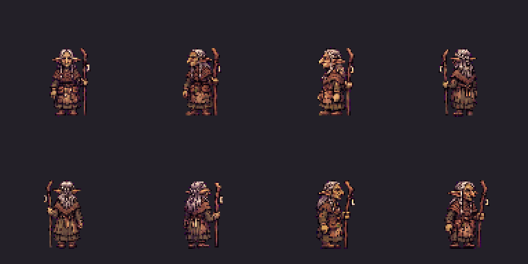

# Mother Skarrow — approved and installed

Appearance approved: “she looks good, do the animations”. All eight directions
and288 frames are complete: idle, walk, talk, staff attack, cast, hurt and down.
Six expression portraits; short50-native-pixel goblin body and LEFT-hand staff.
Full-set/TV approved: “looks good, I approvee”. Exact artwork installed in
production. Generic goblin shamans and Skarrow Stormcaller are unchanged.

[Watch the voiced review](mother_skarrow-finished-review.mp4) ·
[Close-up animation](mother_skarrow-closeup-review.gif) ·
[Portraits](mother_skarrow-portraits-review.png) ·
[Approved voice](voice-sample.mp3)

The owner approved Kore: “sounds good, use it”. All67 Mother Skarrow lines now use
Kore at pitch0 without a filter, from64 selected sources. Same canonical captions,
other speakers and recordings-only playback. Town2 sample: “Forty winters I have
held this clan. Do not ask me if I can hold it one more.” It uses the verified
number-clarified production take, with exact source/encoded/review hashes.
Rejected Laomedeia sample and all original67 Ogg files remain preserved.

Raw paid sources, exact model requests, live schema/cap checks/quotes, job/asset/
billing receipts and local caption checks are under voice-recast/.20 superseded
paid speech takes remain with reasons and hashes. Narrated instructions and word
substitutions were replaced. Two stubborn chapter3 lines use only documented
pause tags with the same Kore speaker, language and zero pitch/filter; descriptive
prose was repeatedly spoken there. No narration was cut from an audio take.
The original audition is retained as performance approval, while production uses
a fresh “40” render for the unchanged “Forty” caption.

All67 source/installed clip checks pass; source mono24kHz16bit /4.4–15.16seconds,
zero clipped source samples. Unbiased local small.en/medium.en ASR matches words
after documented spelling/number/homophone/vocalization differences and physically
near-silent out-of-duration tail artifacts. No per-clip transcription service
charge; optional checker packages/models are dev tools outside the content pack.
Full1443/1443 coverage;0 pitch/brightness outliers;23 tooling +71 logic +52
story/bark presentation tests pass. Both test-project Debug builds0warnings/errors.
ASR/acoustic checks do not establish acting maturity; the owner approved the voice.

Total224CU including prior6CU audition/ASR; this continuation218CU.220 speechCU
and4 prior paid ASRCU. No purchases/upgrades/PixelLab. Full cost/receipt accounting
is in voice-recast/batch/cost-summary.json; no image-tool price inferred.
No image generation during recast. The single appearance image-tool call and
original concept/source/request/input/output hashes remain preserved.

Offline build/validation/native commands and results:
[Art report](../../../../../docs/superpowers/reports/2026-11-03-townsfolk-art/mother-skarrow-imagegen/report.md).
`install-approved.cjs` guards exact full-set/TV approval before production writes.
All requests/raw exports,11 generation receipts, native captures, shared palettes
and normalized frames are retained. No PixelLab or new speech generation.

## Latest checkpoint — Mother Skarrow approved and installed

Owner full-set/TV approval: “looks good, I approvee” (2026-11-05).
Installed the exact approved288-frame, eight-direction body atlas and six40×40
portraits after validating all25 review asset hashes and the approved TV still.
No new art or voice generation, credits, purchases or upgrades. All67 approved
Kore voice lines retained. Eleven named townsfolk artwork sets now installed.

Mother uses a placed goblin_shaman_mother_skarrow variant, named battle sprite
characters.mother_skarrow and named lore portrait preset. Generic goblin_shaman
and separate Skarrow Stormcaller remain unchanged. Staff attack/cast/hurt/down
playback included; lying down frame35 is held. Slain presence gate unchanged.
Added two registered cosmetic aliases, seven art files and six cosmetic document
edits only. Installer preserves compact existing JSON formatting. Every other
5021 baseline content file is byte-identical to9a208878. No gameplay, balance,
phone contract, caption or voice changes; all old assets preserved.

170 focused presentation tests pass, including named body/portrait/region preload
and generic shaman separation. All-atlas coverage now covers Mother’s authored
combat clips without treating other civilians as combatants. Typed production
checks verify eight facings/source rectangles/combat/down, six portraits,
bark stop/resume, named battle alias and original slain gate. Host/test Debug
builds have0warnings/errors. Native installed-pack software Vulkan four-party
peaks340.48MiB Ashen Ford /192.37MiB Cinder Hollow, below512MiB; strict memory
checks cover open/crossing/party-change/restored and all8human/elf class texture
uploads/releases. Software renderer figures establish memory, not GPU timing.

Production pack216586388bytes /5034files, inventory SHA256
728704ed27106c3fe7818874f4d3537882c8ba9bb9c1aead254cf0435a4f8147.
`mother-skarrow/verify-installed.cjs` verifies exact approved art, all retained
assets and cosmetic-only differences against the committed pre-install baseline.
It needs local Git subprocess access. Historical private-review isolation
artifacts remain frozen as pre-install evidence, including their old inventory.
Use verify-installed for the current installed checkpoint instead.

Native production screenshots/logs/memory/test/runtime evidence are retained at
docs/superpowers/reports/2026-11-03-townsfolk-art/mother-skarrow-imagegen/production/.
Do not regenerate completed assets or ask for Mother approval again. Old Maud’s
appearance and24-line voice are already approved; her completion animations and
portraits are next queued work, with a separate finished-set/TV gate.

Rebase before pushing townsfolk-art. No PR, merge, closure or environment publish.
Earlier pending-Mother approval/installation notes are historical and superseded.
