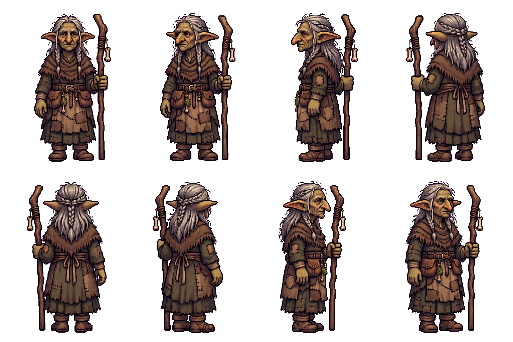

# Mother Skarrow — appearance draft and approved production voice

Mother Skarrow’s first eight-view pixel appearance translates her already approved
concept: elderly goblin clan chief, short adult goblin proportions, weathered
olive-green face/long ears, greying braids, repaired hide/wool and LEFT-hand staff.
Appearance approval remains pending before motion/portraits; finished-set/TV
approval is separate. Old Maud’s appearance is approved and completion art queued.

[Hear the approved production voice](voice-sample.mp3) · [Three-line voice reel](voice-recast/approved-voice-reel.mp3)

The owner approved Kore: “sounds good, use it”. All67 Mother Skarrow lines now use
Kore at pitch0 without a filter, from64 selected sources. Same canonical captions,
other speakers and recordings-only playback. Town2 sample: “Forty winters I have
held this clan. Do not ask me if I can hold it one more.” It uses the verified
number-clarified production take, with exact source/encoded/review hashes.
Rejected Laomedeia sample and all original67 Ogg files remain preserved.

Raw paid sources, exact model requests, live schema/cap checks/quotes, job/asset/
billing receipts and local caption checks are under voice-recast/.20 superseded
paid speech takes remain with reasons and hashes. Narrated instructions and word
substitutions were replaced. Two stubborn chapter3 lines use only documented
pause tags with the same Kore speaker, language and zero pitch/filter; descriptive
prose was repeatedly spoken there. No narration was cut from an audio take.
The original audition is retained as performance approval, while production uses
a fresh “40” render for the unchanged “Forty” caption.

All67 source/installed clip checks pass; source mono24kHz16bit /4.4–15.16seconds,
zero clipped source samples. Unbiased local small.en/medium.en ASR matches words
after documented spelling/number/homophone/vocalization differences and physically
near-silent out-of-duration tail artifacts. No per-clip transcription service
charge; optional checker packages/models are dev tools outside the content pack.
Full1443/1443 coverage;0 pitch/brightness outliers;23 tooling +71 logic +52
story/bark presentation tests pass. Both test-project Debug builds0warnings/errors.
ASR/acoustic checks do not establish acting maturity; the owner approved the voice.

Total224CU including prior6CU audition/ASR; this continuation218CU.220 speechCU
and4 prior paid ASRCU. No purchases/upgrades/PixelLab. Full cost/receipt accounting
is in voice-recast/batch/cost-summary.json; no image-tool price inferred.
No image generation during recast. The single appearance image-tool call and
original concept/source/request/input/output hashes remain preserved.

Rebuild the appearance from repo root (npm dependencies under parent townsfolk):

    node tools/tactics-assets/imagegen/townsfolk/mother-skarrow/build-appearance.cjs

For offline voice import/validation, see voice-recast/batch/README.md. Native
art-grid/palette/goblin scale/anchors and staff/boot/ear/handedness QA remain before
motion work. Proposed goblin body50 native /25 world versus humans72/36 is subject
to native/TV validation. Audit named-only art aliases and required battle playback
before art integration; generic goblin art/contracts stay unchanged.

Voice report: docs/superpowers/reports/2026-11-03-townsfolk-art/mother-skarrow-voice-recast/report.md.
