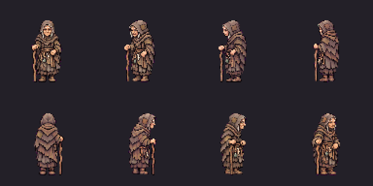

# Old Maud — finished artwork awaiting full-set/TV approval

Approved appearance and all24 approved Gacrux voice lines reused. Eight facing
idle/walk/talk animations and six portraits are finished, in a private review
pack pending separate finished-set/TV approval before artwork installation.
Human more than100years old, stooped, repaired hood/robe and RIGHT-hand stick.

[Watch the voiced TV review](old_maud-finished-review.mp4) ·
[Close-up animation](old_maud-closeup-review.gif) ·
[Six portraits](old_maud-portraits-review.png) · [Approved voice](voice-sample.mp3)



## Approved ancient voice installed

The owner approved the papery, unhurried Gacrux audition: “perfect, let's go with
that”. All24 lines now use that voice at pitch0, with no filter. The exact audition
source is reused for town1;23 selected new recordings cover the remaining lines.
Captions are unchanged. Old production recordings and six rejected new takes are
preserved. Long direction notes leaked into three takes; three other takes had
word substitutions reported by two ASR models. All were replaced.

All selected sources/encoded clips decode; mono24kHz sources,5.6–17.52seconds,
zero clipped samples. All24 have paid ASR caption checks; punctuation, neighbour
spelling and listed leading ah/oh interjections are accepted, no other word
changes. ASR does not establish acting quality. Full1443/1443 clip coverage,
23 tooling tests,71 logic and52 story/bark presentation tests pass.

Live quotes, cap checks, sources, job/asset IDs and hashes are under voice-recast/.
Total274CU:150 speech (including the previous5CU audition) and124 transcription.
This continuation spent269CU; no purchases/upgrades. Rebuild/validate offline with
batch/import-recordings.py and batch/validate-recordings.py inside voice-recast/.
Artwork appearance is approved; completed-set/TV approval remains pending.

## Latest checkpoint — Old Maud completed animation/portrait/voiced TV review

Owner completion authorization: “ok, do those”. Appearance was already approved
(“I approve Old Mauds, start Mother Skarrow”); Gacrux voice already approved and
installed across all24 lines. Reused both plus the approved concept. **Separate
finished-set/TV approval remains required before Old Maud artwork installation.**
Mother Skarrow is already approved/installed; do not ask her approval again.

Maud has eight real facings,144 native frames: six source poses each idle/walk/
talk,10-frame ping-pong idle/talk playback, slower5fps six-frame walk. Small blink/
breath, careful alternating steps, restrained emptyLEFT-hand gestures; ordinary
walking stick remains anatomicalRIGHT. Six40×40 mood portraits. Human century-old
stoop normalized to64native/32world pixels versus upright human72/36.96×96 frames,
anchor48/84, headTop20, pixelScale0.5,1728×768 atlas5.0625MiB,96 shared colours,
binary alpha. One fixed registration per direction, no per-frame recentering or
mirroring; maximum vertical foot drift1.5world pixels. Component-based cell
extraction preserves source pixels and excludes neighbouring sprites. No redraw
or synthetic posed frames. Automated geometry checks complement owner visual QA.

Review video: tools/tactics-assets/imagegen/townsfolk/old-maud/
old_maud-finished-review.mp4 (19.6s). Includes approved installed Gacrux town1:
“Sit down, dearie. I've waited a hundred years, I can wait while you sit.”
Close-up GIF, three eight-facing action GIFs, portrait/contact sheets, every
normalized frame, source exports, guides and native TV still retained.21 assets
and the TV still are hash-bound in sprite-approval.json. Complete-set status is
pending_owner_full_set_tv_approval; guarded installer refuses before writes.

Private /workspace/artifacts/issue80-old-maud-review uses a hermit_old_maud
placed variant plus named old_maud sprite/portrait and art aliases. Generic
hermit art untouched. No battle role or new gameplay behavior. Rules/balance/
phone contracts/voices/captions and production content unchanged. Isolation
checks compare all5034 files, allowing only five named review cosmetic documents.
Current production pack216586388bytes, inventory SHA256
728704ed27106c3fe7818874f4d3537882c8ba9bb9c1aead254cf0435a4f8147.

Checks:170 focused presentation tests pass. Typed review runtime validates real
facings/atlas rectangles, named body and six portraits,32world-pixel head lift,
slow walk, generic-hermit separation and bark stop/resume. Frame/palette/source/
receipt/bound-review hash and offline rebuild checks pass. Native software Vulkan
four-party peaks **343.70MiB Ashen Ford /192.37MiB Cinder Hollow**, below512MiB;
strict memory checker covers open/crossing/party-change/restored and all8human/
elf class texture uploads/releases. These are memory results, not GPU timings.
Host/game code unchanged; prior installed checkpoint builds passed. New standalone
runtime verifier compiles and passes. Existing native host reused for these runs.

Nine new image-tool calls: eight directional6×3 sheets and one portrait sheet.
11 total including two original appearance calls. Raw exports/exact requests/
input-output hashes retained; no completed art regenerated. No PixelLab or new
speech calls, credit purchases or upgrades. Image-tool pricing unavailable; no
monetary estimate inferred. Next: owner finished-set/TV approval, then install
exact reviewed art and verify production; do not infer approval from appearance
or previous voice approval. Rebase before pushing townsfolk-art. No PR, merge,
issue closure or environment publication.

Reproduce offline from the repository root (npm dependencies in parent townsfolk):

```sh
node tools/tactics-assets/imagegen/townsfolk/old-maud/prepare-guides.cjs
node tools/tactics-assets/imagegen/townsfolk/old-maud/key-sources.cjs directional/south-export.png directional/south-west-export.png directional/west-export.png directional/north-west-export.png directional/north-export.png directional/north-east-export.png directional/east-export.png directional/south-east-export.png portraits-export.png
npm run build-old-maud --prefix tools/tactics-assets/imagegen/townsfolk
npm run verify-old-maud --prefix tools/tactics-assets/imagegen/townsfolk
node tools/tactics-assets/imagegen/townsfolk/old-maud/build-review-pack.cjs /workspace/artifacts/issue80-old-maud-review
node tools/tactics-assets/imagegen/townsfolk/old-maud/prepare-native-review.cjs /workspace/artifacts/issue80-old-maud-review
node tools/tactics-assets/imagegen/townsfolk/old-maud/verify-pack-isolation.cjs /workspace/artifacts/issue80-old-maud-review
```

Activate `/workspace/.arcbox/activate.sh` and run:

```sh
dotnet run --no-restore tools/tactics-assets/imagegen/townsfolk/old-maud/verify-runtime.cs -- /workspace/artifacts/issue80-old-maud-review
python tools/tactics-assets/imagegen/townsfolk/old-maud/native-review.py ashen_ford
python tools/tactics-assets/imagegen/townsfolk/old-maud/native-review.py cinder_hollow
node tools/tactics-assets/imagegen/townsfolk/old-maud/build-video.cjs docs/superpowers/reports/2026-11-03-townsfolk-art/old-maud-imagegen/ashen_ford-shots/world-old-maud.png
```

First standalone restore needs the configured proxy for NuGet vulnerability
metadata. Native launcher needs Xvfb/software Vulkan capabilities. Do not rerun
native screenshots over the approved hash-bound TV evidence after owner approval.
