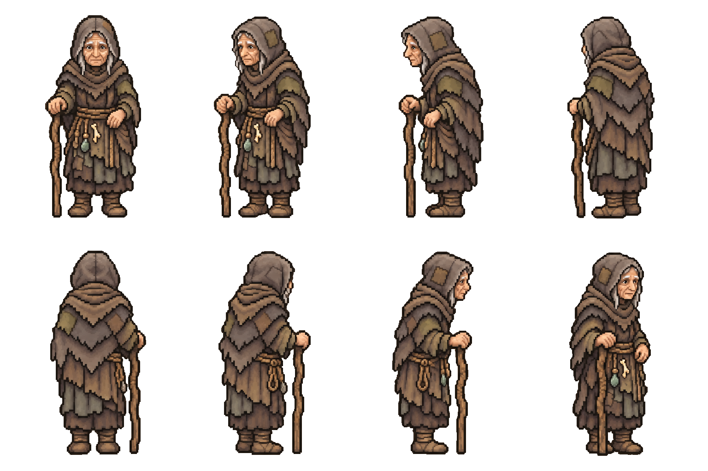

# Old Maud — first pixel appearance and recorded voice

Approved concept reused. Eight standing views: south, southwest, west, northwest;
north, northeast, east, southeast. Extremely elderly, stooped but lucid woman in
repaired grey/taupe/olive hood/shawl/robe, rope belt and ordinary charm strings,
dull green bottle, wrapped ankles/worn boots and a simple right-hand walking stick.
No ember glow or magical staff.

[Approved recorded voice](voice-sample.mp3): “Sit down, dearie. I've waited
a hundred years, I can wait while you sit.” This is the installed Gacrux town clip,
reusing the exact owner-approved audition. [Three-line listening reel](voice-recast/approved-voice-reel.mp3).
The rejected Achernar sample is archived under voice-recast/rejected-achernar-voice-sample.*.

Both raw image-tool results, requests and input/output hashes are retained. The
preview applies the native import alpha128 threshold and clears transparent RGB;
it does not redraw, move or mirror figures. Rebuild with node build-appearance.cjs
after npm ci --prefix tools/tactics-assets/imagegen/townsfolk from the repo root.
Eight-cell bounds/alpha-preview checks pass. Full native grid/palette/body-size/
anchor/staff handedness and ground-contact checks remain before motion import;
this enlarged sheet is not a validated native atlas.

Appearance is approved (“I approve Old Mauds, start Mother Skarrow”); motion and
portrait work is authorized and queued while Mother Skarrow starts. Separate
finished-set/TV approval is still required before installation. No Old Maud production art. Two image-tool calls,
zero PixelLab calls/spend/purchases; voice spending is detailed below. No image-tool monetary price
is inferred. Reuse these sources rather than regenerating the approved concept.

## Approved ancient voice installed

The owner approved the papery, unhurried Gacrux audition: “perfect, let's go with
that”. All24 lines now use that voice at pitch0, with no filter. The exact audition
source is reused for town1;23 selected new recordings cover the remaining lines.
Captions are unchanged. Old production recordings and six rejected new takes are
preserved. Long direction notes leaked into three takes; three other takes had
word substitutions reported by two ASR models. All were replaced.

All selected sources/encoded clips decode; mono24kHz sources,5.6–17.52seconds,
zero clipped samples. All24 have paid ASR caption checks; punctuation, neighbour
spelling and listed leading ah/oh interjections are accepted, no other word
changes. ASR does not establish acting quality. Full1443/1443 clip coverage,
23 tooling tests,71 logic and52 story/bark presentation tests pass.

Live quotes, cap checks, sources, job/asset IDs and hashes are under voice-recast/.
Total274CU:150 speech (including the previous5CU audition) and124 transcription.
This continuation spent269CU; no purchases/upgrades. Rebuild/validate offline with
batch/import-recordings.py and batch/validate-recordings.py inside voice-recast/.
Artwork appearance is approved; completed-set/TV approval remains pending.
