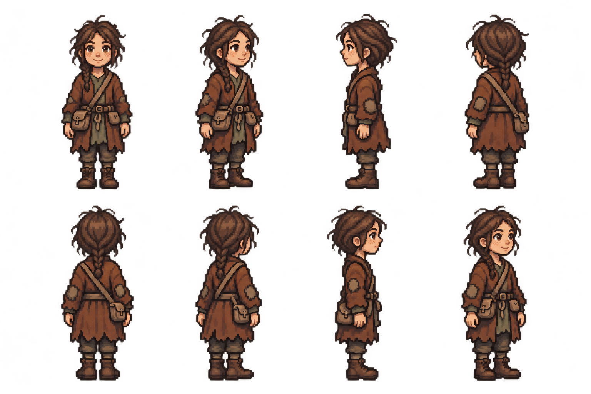

# Pip Ashdown — first pixel appearance review

The owner authorized continuing with Pip. Her existing approved concept is reused;
this is the first pixel appearance pass, with no new concept or completed-art regeneration.

[Hear Pip's existing voice](voice-sample.mp3):
“I can run that for you! Two coppers. One if you're nice. Three if you're not.”
Source is the existing `bark_pip_ashdown_town_1.397e121f.ogg` recording; the MP3
is a compatibility transcode, not a new performance. `voice-sample.json` records
source/output hashes and the bark ID/text.

Requested directions: south, southwest, west, northwest; north, northeast, east,
southeast. Pip is a nine-year-old human girl: child proportions, freckles, dark
braided hair, patched rust coat/sage tunic/trousers, boots and an errand satchel.
Child target is about52 native /26 world pixels versus72/36 for adults; native
import/height validation remains ahead. Do not run the adult72-pixel guide/import
scripts unchanged. Satchel at anatomical right hip, small pouch at left.

**Appearance approval is pending.** No animation/portrait generation or production
installation yet. Native grid, alpha, palette, direction/equipment/age proportions,
anchor and ground contact need QA. Retain the separate finished-set/TV gate.
Pip shares the child preset with generic children: future integration must use
the existing cosmetic variant mechanism for Pip rather than replace all children.

Exact request and input/output hashes are retained. One image-tool appearance
call, zero PixelLab calls/credits/purchases. No image-tool monetary price is
inferred. Rules, balance and phone contracts are unchanged.
