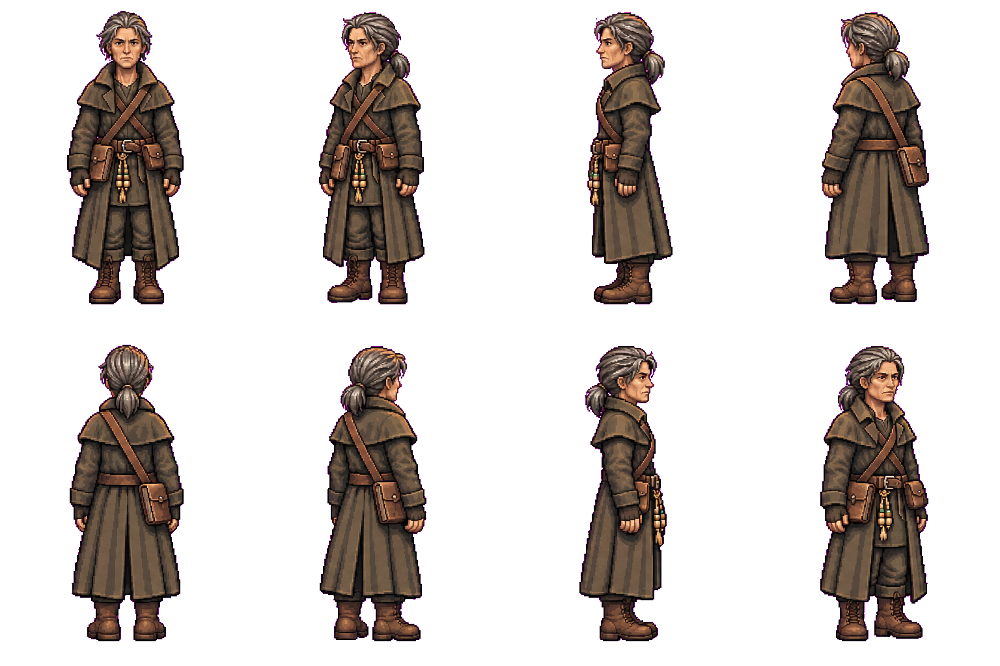

# Rook — first pixel appearance and existing voice

Rook runs the Ash Market from Emberwick’s docks: a practical river smuggler and
broker who sells to all sides. This draft translates the already approved concept;
it does not establish a gender, species or exact age as new canon.

[Hear the existing recorded voice](voice-sample.mp3): “Shards, word, a boat at
midnight. All for sale. Which do you need?” Existing Umbriel town clip; MP3
compatibility transcode only. Source/text/hashes are in voice-sample.json.

Eight planted views: front, southwest, west, northwest; north, northeast, east,
southeast. Weathered dark coat/cape, grey-streaked low ponytail, fingerless gloves,
brown boots, front tally cords, right-hip ledger satchel and left-hip pouch.
The first draft had the wrong southwest facing and swapped rear satchel side;
these were corrected. Two transparent sources had damaged alpha and are retained
as technical superseded outputs. candidate-1-export.png is the selected opaque
magenta export. build-appearance.cjs removes only the magenta key to produce
candidate-1-preview.png without resizing/recentering/mirroring or drawing pixels.

From repo root, after npm ci --prefix tools/tactics-assets/imagegen/townsfolk:

    node tools/tactics-assets/imagegen/townsfolk/rook/build-appearance.cjs

Eight-cell bounds/binary-alpha preview checks and voice decoding pass. This is
an enlarged appearance sheet, not a validated native atlas. Native grid, palette,
body size/anchors, coat/ledger occlusion and residual colour-key fringe cleanup
remain before motions. Owner appearance approval precedes animations/portraits;
finished-set/TV approval is separate before installation.

Three image-tool calls, zero PixelLab or new speech calls/purchases; no image-tool
monetary price inferred. Exact sources/requests/input/output hashes retained.
Production content, rules, balance and phone contracts unchanged. Include this
recorded voice with subsequent reviews. Reuse the existing concept and appearance.
