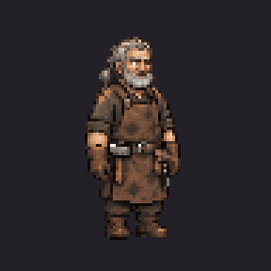

# Tobin Fell — completed image-tool review set

The owner approved his appearance: **“yeah that looks great. Proceed with finishing him”**.
The owner then approved the finished set: **“Looks good. Who is next”**.
His exact complete directional/motion/portrait set is now installed and its
production checks pass. See the [installation report](../../../../../docs/superpowers/reports/2026-11-03-townsfolk-art/tobin-installed/report.md).
The separate review overlay is retained; production contains approved Bree, Halden,
Aubrine and Tobin.
No PixelLab API call, credit debit, purchase or upgrade was made.

[Watch the finished 16.6-second review](tobin-finished-review.mp4).
The reel shows actual sprite loops and portraits, ending with a labelled native
TV still; it is silent. The closing shot is not a live video capture.



[Eight-direction idle](tobin-eight-direction-idle.gif),
[walk](tobin-eight-direction-walk.gif), [talk](tobin-eight-direction-talk.gif),
[standing views](tobin-directions-review.png), [portrait moods](tobin-portraits-review.png),
[native forge TV](../../../../../docs/superpowers/reports/2026-11-03-townsfolk-art/tobin-imagegen/world-forge.png),
[2× forge detail](../../../../../docs/superpowers/reports/2026-11-03-townsfolk-art/tobin-imagegen/forge-detail.png).
Direction order: south, southwest, west, northwest; north, northeast, east, southeast.
Portrait order: idle, hurt, happy; angry, sad, surprised.

## Retained assets and import

- Eight genuine facings, six source frames each for idle/walk/talk: **144 frames**.
  Each final frame is in `normalized/`; final standing guides are in `rotations/`.
  `directional/guides/` holds appearance inputs, not the final runtime frames.
- Atlas 1728×768, **5.0625 MiB RGBA**, 96×96 frames, anchor `[48,84]`, scale 0.5.
  Adult human bodies target 72 native / 36 world pixels; this is not a universal
  height for children or goblins. Idle/talk play ten indices over six poses;
  walk plays six once. No civilian attack animation.
- The generated sheets space columns within outer margins. One regular grid
  is fitted per direction from all six idle foot centres, then one scale/offset
  is shared across all 18 poses. No per-frame recentering or mirroring. Validation
  includes horizontal foot drift so an incorrect grid cannot quietly slide.
- One locked 96-colour palette and binary alpha. The raw northeast image carries
  colourful RGB noise in low-alpha background pixels; the binary-128 import
  removes it from runtime output. Raw originals remain unchanged for provenance.
- The first south walk repeated one lead leg. The image tool corrected that row;
  the selected contact/settle/passing order is recorded in `directional/curation.json`.
  All **138 other native frames remain pixel-identical**, including palette ties.
- Six native **40×40** portrait moods use one common scale/offset and shared
  64-colour palette. Review aliases: `blacksmith` and `tobin_fell` for portraits,
  `characters.blacksmith` / `characters.tobin_fell` for the body.
- Grey ponytail/beard, soot-worn front apron versus crossed rear straps, belted
  right-hip hammer and left-hip pouch/tongs are retained. Tools stay belted and
  hands remain empty. The approved concept/appearance was reused without redesign.

`generation-receipts.json` binds exact requests, referenced inputs and raw outputs.
Ten completion image-tool calls plus the earlier appearance call; zero PixelLab
calls or credits. No monetary price is inferred for the platform image tool.

## Reproduce offline

From the repository root with Node/npm and .NET 10:

```sh
npm ci --prefix tools/tactics-assets/imagegen/townsfolk
npm run build-tobin --prefix tools/tactics-assets/imagegen/townsfolk
npm run verify-tobin --prefix tools/tactics-assets/imagegen/townsfolk
node tools/tactics-assets/imagegen/townsfolk/tobin-fell/build-receipts.cjs
node tools/tactics-assets/imagegen/townsfolk/tobin-fell/build-review-pack.cjs /absolute/external/tobin-review
dotnet run tools/tactics-assets/imagegen/townsfolk/tobin-fell/verify-runtime.cs -- /absolute/external/tobin-review
```

The PNG/GIF utilities are offline tools, not API or game/phone dependencies.
The overlay refuses an unrelated existing destination and never writes production.
Unchanged files are linked: never edit a linked content or rules file. Generated
images and manifests are separate. Use Godot 4.7.2 .NET after host setup:

```sh
ARCBOX_TACTICS_ART_ROOT=/absolute/external/tobin-review \
  "$GODOT" --path src/ArcBox.Host -- --world-demo=ashen_ford \
  '--world-looks=forge@36,55@39,58' --shots=/absolute/shots \
  --perf --res=1280x720 --preset=low --quit-after=150
```

Linux software Vulkan and Windows left-monitor/no-focus handling follow the
existing handoff/TV-host guide. Review memory is not a hardware timing benchmark.

## Approval gate

Appearance and **full-set/portrait/TV approvals are complete**.
The earlier pending-state guard verification below is retained as history.
`sprite-approval.json` binds the finished previews to exact hashes.
`install-approved.cjs` refuses appearance approval alone; this refusal was tested
against the complete production inventory and left every byte unchanged. After
full-set approval, install these exact assets, update the per-character atlas
counts and stop/talk/resume/portrait cases, and rerun production memory gates.
Do not request appearance approval again or regenerate completed concepts/art.
No PR or merge. [Report and receipts](../../../../../docs/superpowers/reports/2026-11-03-townsfolk-art/tobin-imagegen/report.md).
