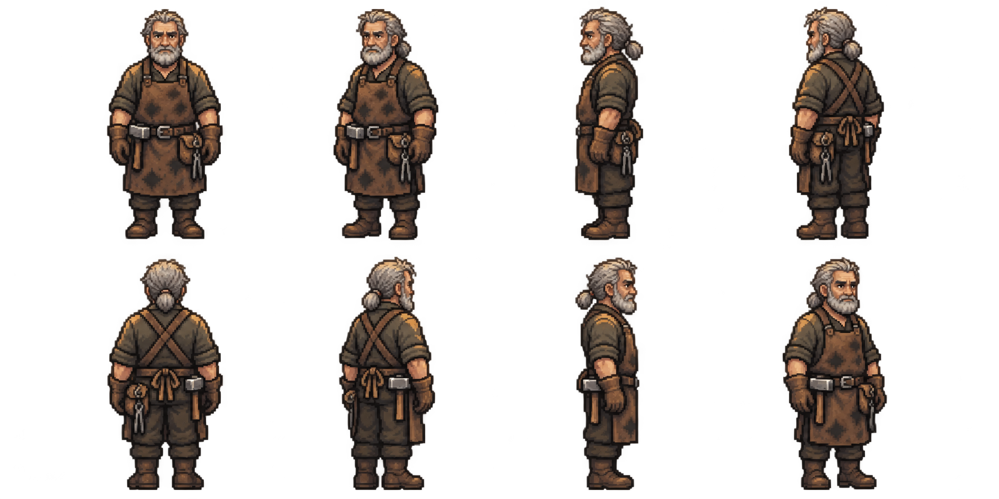

# Tobin Fell — first pixel appearance review

The owner selected Tobin next and requested making him with the image tool,
continuing the Aubrine workflow. His existing approved Scenario concept is reused;
this is a pixel appearance candidate, not another concept or a production atlas.

Views: south, southwest, west, northwest; north, northeast, east, southeast.
The sheet retains grey hair and a low ponytail, grey beard, soot-worn workshirt,
front leather apron / crossed back straps, repaired gloves and belted tools.
The hammer stays on his anatomical right; the pouch/tongs stay on his left.
Hands are empty and relaxed.

`appearance-request.json` retains the exact image-tool request.
`sprite-approval.json` records source/output SHA256 hashes and the original image
path. One image-tool call; zero PixelLab calls or credits. No completed art was
regenerated, and no monetary price is inferred for the image tool.

Appearance approval is pending. Do not generate the complete motion set before
that gate. Native pixel grid, binary alpha, shared palette, body scale, anchors,
frame bounds and ground contact still need import/validation. This large review
sheet is not a validated native eight-direction atlas. Idle/walk/talk, portraits
and the final full-set/TV approval remain ahead. Nothing is installed in production.
