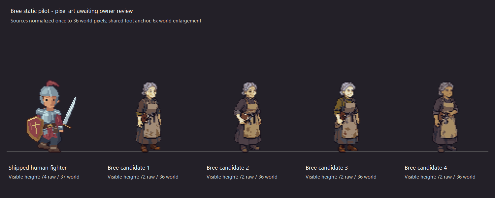
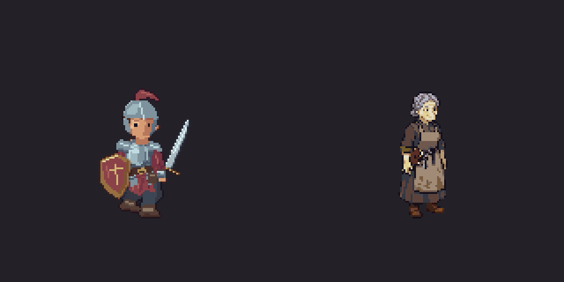
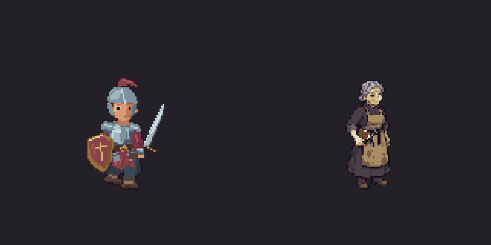
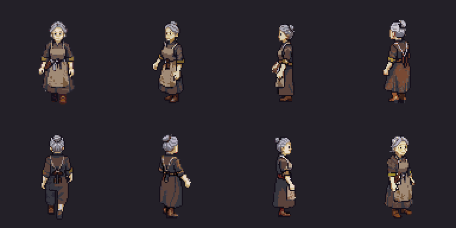
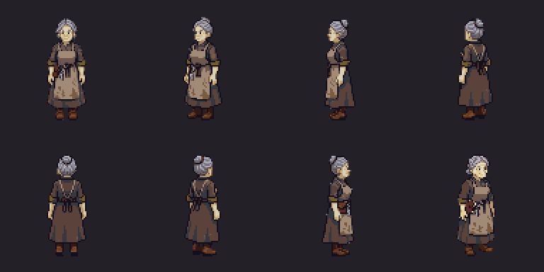

# Townsfolk sprite pilot — issue #80

All 19 primary concept designs and the child-B body-view supplement were approved
on 2026-11-03: “yes, tthose look good. Proceed”. Exact asset IDs are recorded in
`../../concepts/townsfolk/approvals.json`. Do not regenerate these concepts.

Start with **Bree Tallow**, using her approved concept for identity and
`current-hero-idle.png` for the current shipped pixel density. The latter is an
unmodified first-frame crop, not new generated art. Rebuild it and its source
hashes with `./prepare-pilot.ps1`; `pilot-inputs.json` records manifest dimensions,
anchor, pixel scale and head-to-foot height. The legacy 64×80 references do not
establish the current production scale.

## Submission and review

1. PixelLab authenticated on 2026-11-03 using owner-supplied local MCP configuration.
   The static Pro pilot returned four 160×160 candidates for **15 generations**.
   Exact input and receipt are `bree-static-request.json` and
   `bree-static-result.json`; no credentials are stored here.
2. Generate one full-body facing of Bree: braided grey hair, substantial practical
   clothing, worn apron and boots, closed personal notebook. Preserve the approved
   face, build, clothing and handedness. Use restrained pixel clusters, selective
   coloured outlines, top-left light and clean transparent background. Keep her
   anatomy distinct from the armoured hero; compare their world scale at a shared
   foot baseline. Use the Ashen Ford palette from `../wardenflame-style.json`.
3. Inspect static silhouette, face, density, ground contact and camera angle before
   spending on a short idle or walk. Do not mislabel a three-quarter sprite as a
   straight south view for automatic rotation. Consult the live direction schema.
4. Inspect every motion frame at native size and enlarged: planted feet, sensible
   weight transfer, stable clothes/notebook, no limb swaps or loop jump. Normalize
   with one fixed canvas/offset across the clip; never recenter individual frames.
5. Show the owner pixels and motion beside the current party on the real TV before
   integration or expansion to the remaining characters. Keep receipts, exact
   inputs, output hashes, direction/frame metadata and approval evidence.

Named gestures, complete directions, portraits and paired generic variants follow
the approved pilot. Barmaid/farmer/merchant reference sheets have incomplete angles
per variant; check those explicitly. The child-B supplement is authoritative for
that variant's body. Preserve species/age proportions for Skarrow and children.

No live manifest or gameplay contract has changed. OW-05's used-only loading,
512 MB texture limit, Ashen Ford/Cinder Hollow memory and cold-download measurements
remain required before final integration.

## Pilot results



The owner switched back to **candidate 1** on 2026-11-03:
“nvm back to cndiate 1”. `sprite-approval.json` records the current source hash
and the superseded candidate-2 selection. The existing candidate-1 idle is reused
with no new generation spend. The owner then approved that displayed idle:
“nice, I'm good with that. Proceed”. Full eight-direction/TV review is separate.





The Pro model ignored the requested 72-pixel body height: raw candidates are
115–117 pixels tall. `normalize-static.ps1` fits each static candidate once to
the current hero's 36-world-pixel head-to-foot height with nearest-neighbour
sampling and a shared foot anchor. No animation frames are individually moved or
rescaled. Candidate 1 was selected for a four-frame idle trial, costing
**2 generations**, giving **17 generations total** for this pilot.

The animation delivers the unchanged source plus four generated frames. All five
canvases are 160×160 and contain the complete sprite. The lowest opaque row stays
at 123; the top moves by up to two source pixels during breathing. The last frame
differs from the source by 41 pixels, so the pinned ending is close rather than
identical. Source and generated frames, hashes, bounds and changed-pixel counts
are retained. These checks do not establish walking contact or complete directions.

`build-static-review.ps1` shows raw output; add `-Normalized` for the scale review.
`build-idle-review.cjs` builds the contact sheet, GIF and measurements, using
`pngjs` and `gifenc` supplied through `NODE_PATH` without adding game dependencies.
The GIF plays at 300 ms per frame for review; no runtime timing has been chosen.
The selected static appearance and original displayed idle are approved. Full
directional/TV approval remains open. Nothing is installed in production, and
the rest of the NPC sprite batch has not been generated.

## Historical candidate 2 follow-up

The previously selected sprite was `normalized/candidate-2.png`. Its matching four-frame
idle plus unchanged source cost **2 additional generations**, bringing the complete
Bree pilot to **19 generations**. Inputs, receipts and original frames are preserved
in `candidate-2-idle/`. Rebuild its preview with `build-idle-review.cjs 2`.

All five frames have the same visible bounds, including the lowest row at 123;
the foot silhouette in rows 118–123 is unchanged. The motion is very subtle:
generated frames differ from the source at 21–31 visible pixels. Comparison ignores
RGB differences underneath fully transparent pixels. The last frame is close rather
than identical to the start (21 visible pixels differ). No frame was recentered.
Motion, full directions, walking and TV approval remain pending. Static selection
does not approve the candidate-2 animation or install either sprite in game.

## Current complete Bree review set

Candidate 1's appearance and original southeast idle are approved. All eight
facings now have idle, walk and talk source frames, retained under `directional/`.
The complete new set and real TV shots await owner review; production is unchanged.
See the [report](../../../../docs/superpowers/reports/2026-11-03-townsfolk-art/report.md)
and [cloud handoff](../../../../docs/superpowers/plans/2026-11-03-townsfolk-art-cloud-handoff.md).





`directional/atlas-plan.json` is the authoritative curation. The failed front edit
is explicitly rejected; `curated-rotations/` preserves the approved southeast
sprite alongside seven real facings. Talk plays five source frames out and back;
no pixels are mirrored or generated by the return. Its eight playback indices are
distinct from its five source images. Transparent padding is cropped to 96×96,
anchor `[48,84]`, preserving native density at scale 0.5 and every approved visible
pixel. The 1536×768 RGBA atlas is **4.5 MiB**. Do not restore the old staging padding.

Reproduce offline with Node/npm from the repository root:

```sh
npm ci --prefix tools/tactics-assets/pixellab/townsfolk
npm run build-review --prefix tools/tactics-assets/pixellab/townsfolk
npm run verify --prefix tools/tactics-assets/pixellab/townsfolk
```

This creates a separate pack at the user home's `.codex/tmp/bree-tv-review`.
`ARCBOX_TACTICS_ART_ROOT` selects it only for dev world demos. No local API helper
or credential is required to rebuild or validate already-saved art. Node packages
here are offline art tooling dependencies, not game/runtime or phone dependencies.

`credit-ledger.json` records **49.25 PixelLab generations total**, including the
rejected edit and historical candidate-2 idle; **30.75 remained** at the last check.
No paid jobs are still running. The separate Scenario concept total remains 221 CU.
The rest of the sprites, portraits, variant editor support and production talk/bark
wiring remain; do not treat this as issue completion. Four-party OW-05 checks are
now implemented and measured below, and must be repeated after final art integration.


## Cloud loading validation

The complete review set was rebuilt and verified offline from the retained source frames with no new generation. The separate review pack also passes the new **four-member** OW-05 check: 267.56 MiB at region open, 305.24 MiB peak through roster replacement. It loads the compact Bree atlas without retaining the old innkeeper sheet. See the [loading report](../../../../docs/superpowers/reports/2026-11-03-townsfolk-art/loading/report.md) for commands, receipts and limits. These are software-rendered memory checks; production integration and full-set/TV approval remain gated. No credit record or approval was changed. Current live PixelLab tools/costs/balance were unavailable; the 30.75 balance above is historical.
