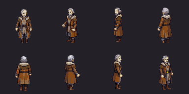
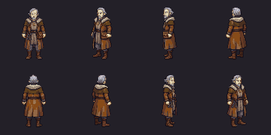

# Halden Varrow — review only

Complete real eight-direction idle, walk and talk from the existing approved Halden
concept. No concept regeneration or character reroll. **Owner pixel/TV approval is
required before production installation.** Bree is already approved and installed.





[Idle](halden-eight-direction-idle.gif), [static directions](directions-review.png),
[walk frames](walk-contact.png), [talk frames](talk-contact.png),
[native TV square](../../../../../docs/superpowers/reports/2026-11-03-townsfolk-art/approved-integration/halden-square.png).
Directions: south, southwest, west, northwest; north, northeast, east, southeast.

The compact atlas uses 96×96 frames, anchor `[48,84]`, scale 0.5, 15 slots per
facing: 4 idle, 6 walk, 5 talk source frames. Talk plays `0,1,2,3,4,3,2,1` within
its five-frame section. The 1440×768 texture costs **4.21875 MiB RGBA**.
One fixed translation per clip/direction preserves all visible source pixels;
no body rescaling, per-frame recentering or direction mirroring. Native source
canvases are retained under `native/`; original provider download ZIPs are retained.
The north static rotation touches the provider canvas's top edge: inspect the
head silhouette during approval. Compact output itself clips no opaque pixels.

`atlas-validation.json` records all source SHA256s, native canvases, fixed offsets,
visible bounds, body heights and foot drift. Idle/walk low-point drift is zero;
talk's southwest low point varies by 0.5 world pixels, the other directions by zero.
These measurements support visual review; they do not grant approval.

From the repository root, after installing the parent folder's Node dependencies:

```sh
node tools/tactics-assets/pixellab/townsfolk/halden/build-review.cjs
node tools/tactics-assets/pixellab/townsfolk/halden/build-review-pack.cjs /absolute/external/halden-review
```

Use `ARCBOX_TACTICS_ART_ROOT=/absolute/external/halden-review` only with the dev
world demo. Linked production content in that separate pack must never be edited.
Builds need no API credential or paid calls. The review pack overlays only the
mayor body; old portraits and the rest of the cast stay in their current phases.

Live quotes and exact submission receipts: character **6**, idle **8**, walk **8**,
talk **8** = **30 generations**. `balance-before.json` records **30.75**,
`balance-after.json` records **0.75**. No purchase/upgrade, no missing jobs or rerolls.
Further sprites/portraits need an available allowance; don't submit a paid call
against this remaining balance. Scenario spend stays separate at 221 CU.

The public Backblaze URLs returned 403. The documented authenticated PixelLab
character-download ZIP worked once jobs completed; it returns 423 while active.
Credentials must be restricted to the API host and stripped on cross-host redirects.
No credential or signed upload URL is retained here. Reuse these saved frames.
