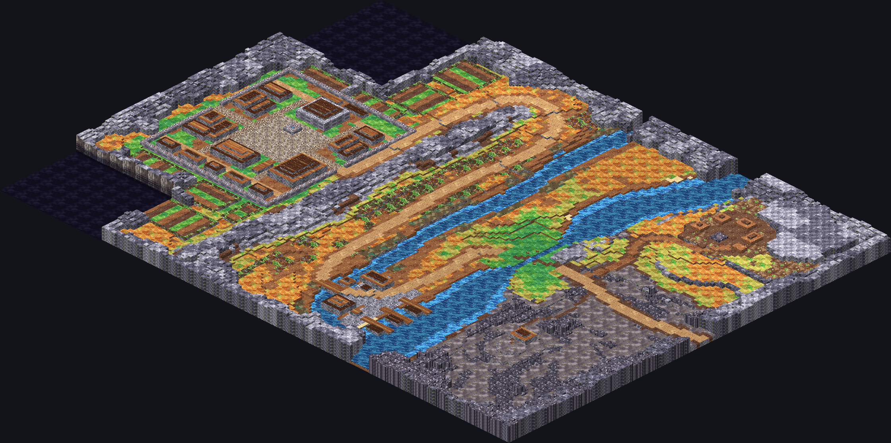

# Tactics world: the painting workspace

A small Godot 4.7.2 .NET project for painting overworld regions. You paint `regions/<id>.tscn`, press **Export region**, and that
writes `content/tactics/base/rules/world/<id>.json`, which the game loads. The logic and its tests are in
[`games/Tactics/Tactics.WorldTools`](../../games/Tactics/Tactics.WorldTools); the C# here is only the part that needs Godot.

Ashen Ford is ready to paint over. This is what's there now, drawn at a quarter of the TV's scale, not the workspace itself, which shows
a flat grid:



## What you need

The Godot .NET editor and the .NET SDK, with the SDK on PATH **before you launch**. On this machine the first `dotnet` on PATH is
`C:\Program Files\dotnet`, which has no SDKs, so a Start menu shortcut gets the wrong one. Launch from PowerShell, at the repo root:

```powershell
$env:PATH = "$env:LOCALAPPDATA\Microsoft\dotnet;$env:PATH"
dotnet build tools/tactics-world/Tactics.World.Editor.csproj
& "$env:LOCALAPPDATA\Microsoft\WinGet\Packages\GodotEngine.GodotEngine.Mono_Microsoft.Winget.Source_8wekyb3d8bbwe\Godot_v4.7.2-stable_mono_win64\Godot_v4.7.2-stable_mono_win64.exe" --path tools/tactics-world --editor
```

Build first, because the plugin is C#. Then double-click `regions/ashen_ford.tscn` in the FileSystem dock.

**If the PATH is wrong,** `dotnet build` says `No .NET SDKs were found`, and Godot's Output panel says
`.NET Sdk not found. The required version is '10.0.13'`, then `Could not load file or assembly 'Microsoft.Build'`. Close Godot and use
the commands above.

**If there's no Region dock** (it's a tab on the right, and may be behind another tab), open Project > Project Settings > Plugins and tick
Enabled beside Region Tools. If that gives an error, close Godot, run the build and open it again.

## Painting

Select a layer in the Scene dock and the TileMap panel opens at the bottom. On its Tiles tab, pick a swatch, then paint with the left
mouse. The tools along the top of the panel are Paint (D), Line (L), Rect (R), Bucket (B), Picker (P) and Eraser (E). Scroll to zoom, and
drag with the middle mouse to move around. Ctrl+Z undoes.

| Layer | What you paint | Erased means |
|---|---|---|
| `Material` | What a tile is made of. Each swatch is the corner of the real texture, so it won't line up the way it does in the game | Void. Fine for a whole 32x32 chunk. In a chunk with any paint it's a hole, which the export refuses |
| `Height` | The tile's height, 0 to 9 | Height 0 |
| `Flags` | How a tile plays. A swatch is a combination of marks, and the palette has all 32 | Plain ground |

**The Height ramp** is a contour map: clear is 0, then 1 blue, 2 cyan, 3 green, 4 lime, 5 yellow, 6 orange, 7 red, 8 pink and 9 violet.
The number is on each tile when you're zoomed in. A party can climb 2 levels in a step, and can drop any distance. So a drop of 3 or more is
one way: fine as long as there's a way round, and the export tells you if there isn't. Water in Ashen Ford is at height 1.

**Flags** show as letters, each in its own place on the tile:

| Mark | Flag | Place on the tile |
|---|---|---|
| W | Water | top left |
| R | Difficult (rough) | top right |
| X | Impassable | bottom left |
| H | Hazard | bottom right |
| D | Deep | top middle |

The small dot is the combination with no flags, the same as a blank cell.

**A swatch doesn't carry flags.** Recolouring a roof or rock tile keeps its Impassable flag, so if you paint grass over rock you get an
invisible wall. Repaint the Flags layer as well. The same goes the other way: painting rock over grass leaves it walkable.

**To hide a layer,** click the eye beside it in the Scene dock. Hidden layers still export. Hiding `Height` and `Flags` shows you the
ground on its own.

**To find a tile,** multiply its coordinates by 32: tile (100, 52) is at (3200, 1664) on the 2D view's rulers. If the export names a tile,
click the problem instead, which centres the view there and marks it in cyan.

**Sides aren't painted.** The game chooses them. Keep `Material`, `Height`, `Flags`, `Beats`, `Stamps` and `Spawns` at the origin. If one
gets dragged, Ctrl+Z, or the export tells you to set its Position back to zero.

## Markers

| Group | Marker | Set in the Inspector |
|---|---|---|
| `Beats` | `BeatMarker`, where a story beat happens | `Beat`, an id from `lore/arcs.json` for the region's chapter |
| `Stamps` | `StampMarker`, a battle map placed at its corner | `Map`, `HeightOffset` |
| `Spawns` | `SpawnMarker`, one of each | `Kind`: `Start` or `Recovery` (where a beaten party wakes) |

**To move one,** select it in the Scene dock and drag it. It snaps to tiles and outlines the tile it's on. A stamp is different: see below.

**To add one,** right-click the group, choose Add Child Node, and pick the marker type. It has to be under the right group, or the export
says so.

**A stamp is a tuned battle,** so its tiles must match the map exactly. Don't paint inside its outline.

- **To place one,** add a `StampMarker`, set `Map` and `HeightOffset`, drag it to the map's corner, keep it selected and press **Apply stamp**.
  That writes the map to all three layers, and one Ctrl+Z takes it back.
- **To move one,** drag it (its outline turns orange until it's applied) and press **Apply stamp** again. The tiles it used to cover stay
  as they were, because nothing records what was under it.
- **Then repaint the old area.** It's drawn in thin orange and listed in the dock. Click the row to go there, repaint, and press
  **Done repainting**. Moving the stamp back over the area clears it too. The export warns until then, and still writes the file.
- **Deleting a stamp marker forgets its pending areas,** with no warning, and leaves its tiles where they are. Finish repainting first.

## Exporting

Press **Export region**. It saves the scene first, then runs every check the game's pack loader runs and lists everything wrong at once.
Godot has no autosave here: Ctrl+S often, as a crash loses anything unsaved.

If there are problems, no file is written and the old one stays as it was. Warnings still write it. Each line ends with what to do, and
clicking a line that names a tile goes to it.

| Problem | What it means | What to do |
|---|---|---|
| no material in a painted chunk | A hole, which would play as an invisible wall | Paint it, with Impassable if you want a wall |
| a height or flags but no material | Paint that would vanish on export | Paint `Material` there, or erase it |
| outside the region | Paint beyond the yellow outline | Erase it, or change `Size` on the root node |
| isn't in the palette or a stamped map | A material that's gone from the manifest | Repaint those tiles |
| undefined flag bits, heights outside 0 to 9 | A cell a swatch can't make | Repaint it |
| uses too many materials | Over the limit for one region | Repaint some tiles with fewer materials |
| can't be reached from the start | A marker no one can walk to | Paint a way, climbing 2 or less a step, or move the marker |
| can't be stood on | The Start marker is on Impassable or Deep | Move it, or clear the flag |
| doesn't match its map | Paint inside a stamp | Select its marker, press Apply stamp |
| doesn't fit, overlaps, stamped twice | A stamp is misplaced | Move the marker or delete one. A map can only be stamped once |
| Unknown map | `Map` is misspelt | Set it to a file in `rules/maps` |
| isn't in lore/arcs.json | The beat id is wrong, or it's another chapter's | Check the spelling |
| no Beat id, or a beat with 2 markers | A blank or repeated marker | Set its `Beat`, or delete the extra |
| no start spawn, or 2 spawns | Each `Kind` needs exactly one | Add a marker, or delete the extra |
| has been moved | A layer or group is off the origin | Set its Position back to zero |
| is under X, so it isn't exported | A marker in the wrong group | Move it to the right group |
| the scene is named X but its Id is Y | Two scenes could overwrite each other's file | Rename the scene, or change `Id` |
| Save the scene first | It couldn't be saved | Check it isn't read-only, or use Save Scene As |
| couldn't be read, couldn't be written | Something's holding a file | Close it, and export again |

| Warning (the file is still written) | What it means | What to do |
|---|---|---|
| old stamp at (x, y) may still be in the world | A pending area | Repaint it, then Done repainting |
| a beat has no spot | The story reaches a beat with no marker | Add a `BeatMarker` |
| a battle beat has no stamp | Its encounter's map isn't stamped here | Add a `StampMarker`, press Apply stamp |
| party can't walk to a beat | The story can't get there in order, often because the way runs through a battle not yet won | Paint a way round the stamp, or move the marker |
| can't get back from the recovery spawn | A beaten party can't return to the fight | Paint a way, or move the `Recovery` marker |
| a scene has no beat spot | A choice moves the party to a place with no marker | Add a `BeatMarker` for the arc's first beat there |

## Keeping the scene the source of truth

The scene is what you edit. **The region file is generated, so never edit it by hand:** your change would be lost on the next export, and
the test `A_region_file_is_what_its_scene_exports` fails until the two agree. After painting, commit both the `.tscn` and the `.json`.

For a new region, make its scene with the command below, which refuses if the scene exists, so painted work can't be replaced. Then add
`world/<id>.json` to `rules/manifest.json` once. The status line reminds you until you have. The scene's file name must match its `Id`. `$Godot` is the console build, as set under
[Exporting from a command line](#exporting-from-a-command-line).

```powershell
& $Godot --headless --path tools/tactics-world -- --new=greyfen --chapter=2 --size=160x120 --name="The Greyfen"
```

Each export changes the pack's hash: see the note at the end of [Exporting from a command line](#exporting-from-a-command-line).

## First refinements

- **The scarp is one long even ridge,** x 54 to 59 from the south edge up to about y 17. It's the first thing to break up. Keep it closed:
  it's what sends the road north round its tip, and a gap shortens the walk.
- **Start to ford is about 40 seconds,** and the far ends a little over a minute. Nothing checks those times on a painted scene until
  the walking milestone, so a shortcut won't be reported.
- **Woods are only floor,** as the world has no props yet. So moored boats and tents are low blocks.

Keep a note of how long Ashen Ford takes to paint. It's the guide for how long later chapters will take, and it decides whether a chapter a
week is realistic (spec section 7). Write it here when it's done:

> Painting Ashen Ford took: not recorded yet.

## Checking that a change walks

You can't walk it yet: milestone 5b isn't built. Three things tell you today.

1. **The export's reach check,** a problem: every marker can be reached on foot from the start, by the rules' climbing limit.
2. **`StoryOrder`, at export,** a warning: it replays Chapter 1 branch by branch, with each battle's stamp shut until it's won, and proves
   a beaten party can get back. A reach check can't see this, as it walks through stamps.
3. **The tests,** which read the exported file and the saved scene:

   ```powershell
   dotnet test --project games/Tactics/Tactics.WorldTools.Tests
   ```

`AshenFordDraftTests` in that project test the original draft's code, not your paint, so they pass whatever you do. `BasePackRegionTests` are
the ones that look at your work. None of these tell you how it looks or feels: for that you need the game, from 5b on.

## Exporting from a command line

Set `$Godot` to the console build, `...\Godot_v4.7.2-stable_mono_win64_console.exe`, with the PATH set as above. The same code runs headless:

```powershell
& $Godot --headless --path tools/tactics-world -- --export=ashen_ford
```

It exits 0 on success and 1 if there are problems, and prints `PROBLEM:` and `WARNING:` lines. `--rules=<folder>` writes to a copy of the
pack instead. `--export` also takes a scene path. To press the plugin's real button with no one there:

```powershell
& $Godot --headless --editor --path tools/tactics-world -- --press-export=ashen_ford
```

`--press-apply=<scene>` presses Apply stamp on the first stamp the same way, moving it first with `--move=x,y`, then undoes it.
`--second-move=x,y` instead walks a second move, an export, Done repainting and its undo, and `--click-first-problem` clicks a problem
after an export. These print `Parameter "t" is null` as they save: it's Godot failing to make the scene's thumbnail with no renderer, and
it's harmless.

**A region file is in the rules pack, so any change to it changes the pack's hash.** A battle saved under the old hash starts again, with a
notice, the next time that campaign opens, and each TV downloads the whole pack again. So don't deploy every export: send them in batches.

## Rebuilding the palette

`palette/` is generated and committed. Rebuild it when the terrain manifest gains a material:

```powershell
dotnet build tools/tactics-world/Tactics.World.Editor.csproj
& $Godot --headless --path tools/tactics-world -- --swatches
& $Godot --headless --path tools/tactics-world --import
& $Godot --headless --path tools/tactics-world -- --tilesets
```

Scenes store a material's source id, so a rebuild keeps every existing source and adds new ones after them. A material dropped
from the manifest stays in the tile set, and the export names the tiles that still use it. Delete `palette/*.tres` only if no
painted scene exists.

## Trying it on a test scene

`--sample=<scene>` writes a new small region around River Crossing, or `--map=<id>`, and adding `--tamper` paints over a stamped tile, which
the export must refuse. Export to a copy of the pack, so the real one isn't touched:

```powershell
& $Godot --headless --path tools/tactics-world -- --sample=res://regions/_sample.tscn --tamper
& $Godot --headless --path tools/tactics-world -- --export=res://regions/_sample.tscn --rules=$env:TEMP\rules-copy
```

## The Ashen Ford draft

`regions/ashen_ford.tscn` began as Claude's scripted draft, `AshenFordDraft` in `Tactics.WorldTools`. It's now painted work like any other
scene. `--draft=ashen_ford` writes the scene only if it isn't there. No command replaces a scene: `--draft`, `--new` and `--sample` all
say so, change nothing and exit 2, so re-drafting means deleting the scene by hand.
